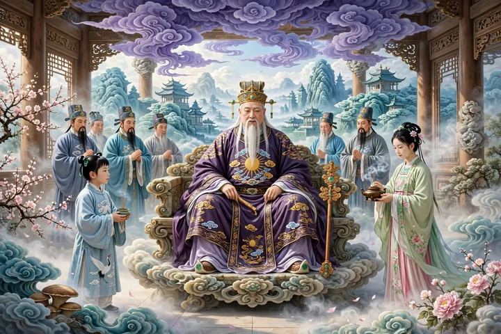

# 002 木公金母

木公又叫东王父，也叫东王公。他是青阳之气所化，是万神中最先的一位，也号称玉皇。他住在云房之中，以紫云为盖，以青云为城，仙童侍立在旁，玉女散着香气，众仙官都听他的号令。从前汉初的时候，有个小孩在路上唱歌说：“穿着青裙，走进天门。拜见金母，拜见木公。”当时的人都不明白这是什么意思，只有张子房听懂了，就前去拜见那个小孩，说：“这就是东王公身边的玉童啊（《太平广记》）。”

## 原文

木公亦云东王父，亦云东王公。盖青阳之气，万神之先也，亦号玉皇。君居于云房之间，以紫云为盖，青云为城，仙童侍立，玉女散香，真僚仙官皆禀其命焉。昔汉初小儿于道歌曰：“著青裙，入天门。揖金母，拜木公。”时人皆不识，惟张子房知之，乃往拜之曰：“此乃东王公之玉童也。（《太平广记》）。
