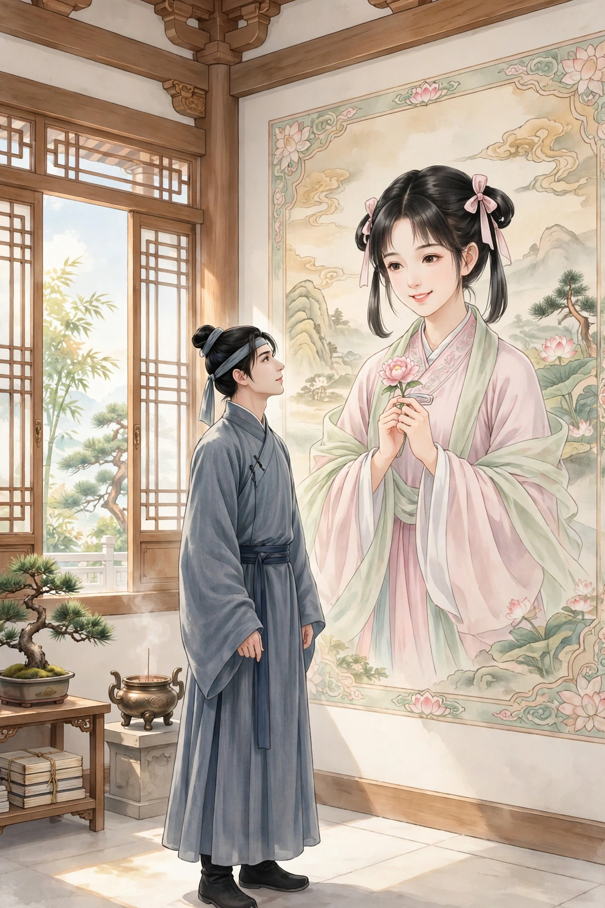

# 画壁

江西的孟龙潭和朱孝廉一起客居在京城，偶然走进一座小寺庙，殿堂和僧舍都不太宽敞，只有一位老僧挂着褡子住在里面。看见客人进来，老僧整理好衣服出来迎接，带着他们四处游览。殿里塑着志公的像，两面墙上的画画得非常精妙，人物栩栩如生，东面墙上画着散花的天女，其中一个梳着垂髫发式的小姑娘手里拈着花，微微笑着，樱桃般的嘴唇好像要动起来，眼波好像要流转起来。朱孝廉盯着她看了很久，不知不觉神魂颠倒，恍惚地凝神想着，身体忽然飘飘悠悠，像驾着云雾一样，已经到了壁画上面。看见殿阁一重又一重，已经不是人世间的景象，一位老僧在法座上讲经说法，偏袒着肩膀、围在四周听讲的人很多，朱孝廉也混在其中站着。

过了一会儿，好像有人在暗地里轻轻牵他的衣襟，回头一看，原来是那个垂髫的小姑娘嫣然一笑，转身就走，朱孝廉立刻跟着她，穿过弯曲的栏杆，走进一间小屋子，迟疑着不敢往前走。姑娘回过头，举起手中的花，远远地做出招呼的样子，朱孝廉便快步走了过去，屋子里静悄悄的没有别人。他猛地抱住姑娘，姑娘也没有很坚决地拒绝，于是两人亲近起来。过了一会儿，姑娘关上门出去了，嘱咐朱孝廉“不要咳嗽”，夜里又再来，这样过了两天。姑娘的同伴们发觉了，一起搜寻找到了朱孝廉，开玩笑地对姑娘说：“肚子里的小郎君都已经这么大了，还披散着头发学着做没出嫁的姑娘吗？”大家一起捧着簪子和耳饰，催她梳起发髻，姑娘含羞不说话。一个姑娘说：“妹妹姐姐们，我们不要久留，恐怕人家不高兴。”大家笑着走了。

朱孝廉看姑娘，云一样的发髻高高簇起，凤形的发鬟低低垂下，比垂髫的时候更加艳丽绝伦。四下里没有别人，两人渐渐亲昵起来，兰花麝香的气味熏得人心动。欢乐正没有尽头，忽然听见吉莫靴铿铿作响，声音非常急厉，锁链锵然作响，接着又有纷纷嚷嚷、争辩喧闹的声音。姑娘惊慌地起身，和朱孝廉偷偷张望，只见一位穿金甲的使者，黑脸像漆一样，手里挽着锁链、提着槌子，众姑娘环绕着他。使者问：“都到齐了吗？”大家回答：“都到齐了。”使者说：“如果有藏匿下界人的，就一起出来告发，不要连累自己。”大家又同声说：“没有。”使者转身回头怒视，好像要搜寻藏匿的人，姑娘非常害怕，脸色像死灰一样，惊慌地对朱孝廉说：“可以赶快藏到床底下！”于是打开墙上的小门，突然逃走了。朱孝廉趴着不敢稍稍喘息。一会儿听见靴子声来到房里，又出去了，不久，喧闹声渐渐远去，心里稍稍安定下来，然而门外总有来来往往说话议论的人。朱孝廉局促不安地待了很久，觉得耳边像有蝉鸣，眼前像有火光冒出来，景况几乎不能忍受，只静静听着等姑娘回来，竟然不再记得自己是从哪里来的了。

这时孟龙潭在殿里，转眼间不见了朱孝廉，疑惑地问老僧，老僧笑着说：“去听讲经说法了。”问：“在什么地方？”老僧说：“不远。”过了一会儿，老僧用手指弹着墙壁呼唤说：“朱檀越，为什么在外游玩这么久还不回来？”转眼间看见墙壁的画里有了朱孝廉的像，侧耳站立着，好像在听什么。老僧又呼唤说：“同游的伙伴等候很久了。”朱孝廉便飘忽地从墙壁上下来，心灰意冷地像木头一样站着，眼睛发直，脚都软了。孟龙潭非常惊骇，慢慢地问他。原来朱孝廉刚才正趴在床底下，听见敲击声像打雷一样，所以才出房来偷听。大家一起看那个拈花的姑娘，只见她螺形的发髻高高翘起，不再是垂髫的样子了。朱孝廉惊讶地拜见老僧，问其中的缘故，老僧笑着说：“幻象由人心生起，老僧怎么能解释呢？”朱孝廉气堵在胸口说不出来，孟龙潭心里惊骇，没有主意，于是起身，走下台阶出去了。

异史氏说：幻象由人心生起，这话像是得道的人说的话。人有淫邪的心，就会生出亵渎的境界；人有亵渎的心，就会生出恐怖的境界。菩萨点化愚昧的人，千种幻象一起出现，都是人心自己动起来的啊。老僧一片慈悲恳切的心意，可惜没有听到他的话就立刻大悟，披散着头发走进山里去。
