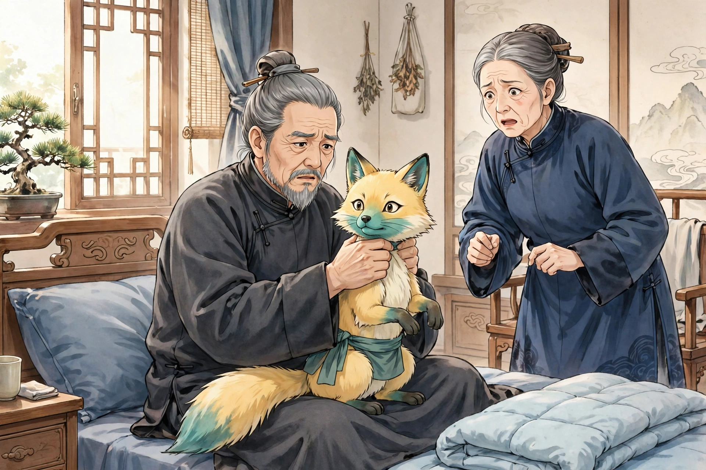

# 捉狐

孙老翁，是我姻亲家清服的伯父，一向很有胆量。有一天，他白天躺着休息，仿佛觉得有什么东西爬上了床，接着就感到身体摇摇晃晃，像驾着云雾一样。他心里暗想：莫非是被狐压住了吗？他微微睁眼偷看，只见那东西大得像猫，一身黄毛，却长着青绿色的嘴，从脚边爬过来。它慢慢地蠕动着爬行，好像生怕把老翁惊醒。不一会儿，它贴上了老翁的身体：碰到脚，脚就发软无力；碰到腿，腿也发软。刚爬到腹部，老翁猛地坐起身，按住它并捉住了它，紧紧握住它的脖子。那东西急得叫唤，却怎么也挣脱不了。老翁赶紧喊夫人来，用带子绑住它的腰。于是老翁握住带子的两头，笑着说：“听说你善于变化，今天我睁着眼在这里看着，看你怎么个变化法。”话还没说完，那东西忽然把肚子缩得像管子一样细，几乎脱身逃走了。老翁大吃一惊，赶紧用力绑紧它；它却又把肚子鼓得比碗还粗，硬得勒不下去；力气稍一松，它又缩了下去。老翁怕它脱身逃走，叫夫人赶紧杀了它。夫人惊慌地四处张望，不知道刀放在哪里。老翁向左边看，用目光示意刀的位置。等他回过头来，手里只剩下一个像环一样的带子，那东西已经踪影全无了。

