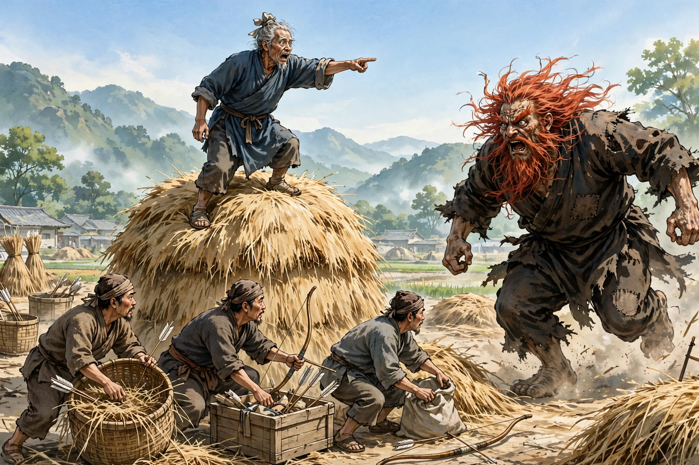

# 荞中怪

长山有个姓安的老翁，生性喜欢干农活。秋天荞麦熟了，他割下来，堆在田埂边上。当时附近村子有人偷庄稼，于是他叫佃户趁着月光，用车把荞麦运到场上去。等佃户装车运走以后，他自己留下来巡逻守夜，就枕着长矛，露天躺着。

眼睛刚合上一点儿，忽然听见有人踩着荞麦根，咋咋地响。他心里怀疑是来偷东西的强徒，急忙抬起头来，只见一个大鬼，身高一丈多，红头发，乱蓬蓬的胡须，离他已经很近了。他吓得厉害，来不及想别的办法，纵身猛地跳起来，狠狠地刺了过去。那鬼像打雷一样叫了一声，就消失了。

他怕那鬼再来，就扛着长矛回去了。在路上迎面遇见佃户，把自己看到的告诉他们，并且告诫他们不要再去。大家还不太相信。第二天，在场上晒麦子的时候，忽然听见空中传来声响，老翁惊叫道：“鬼物来了！”于是他就跑，大家也跟着跑。过了一会儿又聚了回来，老翁叫大家多准备弓弩，等着那鬼再来。第二天，那鬼果然又来了。几支箭一齐射出去，那东西害怕了，就逃走了。两三天里竟然再也没有来。

麦子已经收进了仓库，禾秆杂乱地堆着，老翁叫人把它们收起来堆成垛，他亲自登上垛去踩实，垛高到几尺的时候，忽然远远望见，惊叫道：“鬼物来了！”大家急忙找弓箭，那东西已经奔向老翁。老翁倒下了，那东西咬了他的额头一口就走了。大家一起登上垛去看，只见老翁额头的骨头被去掉了一块，像手掌那么大，人已经昏迷不省人事。把他背回家中，他就死了。后来那东西再也没有出现，也不知道它到底是什么怪物。
