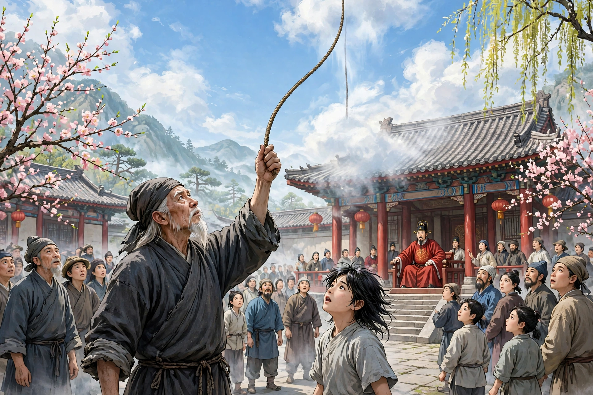

我小时候去郡里应试，正赶上春节。按旧例，头一天，各行各业的商人都要搭着彩楼、吹吹打打去藩司衙门，名叫“演春”。我跟着朋友去看热闹。那天游人挤得像墙一样。堂上坐着四位官员，都穿红衣，东西相向坐着。我当时还小，也不知道他们是什么官，只听见人声嘈杂，鼓乐吵耳朵。忽然来了一个人，领着一个披散着头发的孩子，挑着担子上来，像是有什么话要说；万人的声音闹哄哄的，也听不清他说的是什么，只看见堂上的人都笑了。接着有个穿青衣的人大声叫他表演。那人答应着站起来，问：“演什么戏？”堂上的人互相看了几眼，商量了几句。差吏下来传话，问他擅长什么。他回答说：“能颠倒生物。”差吏把这话回禀了官员。过了一会儿，差吏又下来，传令叫他取桃子。术人答应一声，解开衣服盖在箱子上，故意做出为难的样子，说：“官长实在太不明白事理了！坚冰还没有化开，到哪里去弄桃子？不取吧，又怕被坐在南面的人怪罪。这可怎么办！”他的儿子说：“父亲已经答应了，又怎么推辞呢？”术人闷闷不乐了很久，才说：“我已经盘算得烂熟了。春天刚开始，积雪还没化，人间到哪里去找桃子？只有王母园里，四季都不凋谢，也许还有。要偷的话，只有从天上偷才行。”儿子说：“嘿！天能搭梯子上去吗？”术人说：“有办法。”于是打开箱子，拿出一团绳子，约有几十丈长，理好绳头，朝着空中扔去；绳子立刻悬立在空中，像是有什么东西挂着它。不一会儿，越扔越高，消失在云里；手里的绳子也用完了。他就喊儿子说：“儿啊，来！我老了，身体笨重，不能上去，只好让你去一趟。”于是把绳子交给儿子，说：“拿着这个就能上去。”儿子接过绳子，面有难色，抱怨说：“父亲也太糊涂了！这么一根细绳子，要我抓着它爬上万丈高天。万一中途断了，我的骨头还剩得下吗！”父亲又强行催促他，说：“我已经说漏了嘴，后悔也来不及了。麻烦儿子去一趟。儿子不要怕苦，万一偷得回来，一定有百金的赏赐，到时候给你娶一个美貌的媳妇。”儿子这才拿着绳子，盘旋着往上爬，手挪脚跟，像蜘蛛顺着丝往上爬，渐渐进了云霄，再也看不见了。过了很久，他带下一个桃子来，有碗那么大。术人很高兴，拿去献给公堂。堂上传看很久，也不知道是真是假。忽然绳子落到地上，术人惊叫道：“糟了！上面有人割断了我的绳子，儿子靠什么下来！”过了一会儿，一个东西掉了下来。一看，是他儿子的头。他捧着哭道：“一定是偷桃被看守的人发现了，我的儿子完了！”又过了一会儿，一只脚掉了下来；没多久，肢体纷纷掉下来，再也没有完整的地方了。术人非常悲痛，把肢体一一拾起来放进箱子里，合上盖子，说：“老夫只有这一个儿子，天天跟着我南北游走。现在承蒙严命，没想到遭了这样奇惨的事！只好背回去埋葬了。”于是他上堂跪下，说：“为了桃子，杀了我的儿子！如果可怜小人，资助我葬儿子，我一定结草衔环来报答。”坐在堂上的官员都惊诧不已，各自给了赏金。术人接过来缠在腰上，就敲着箱子喊道：“八八儿，还不出来谢赏，等什么呢？”忽然一个蓬着头的孩子顶开箱盖出来，望着北面叩头，原来就是他的儿子。因为他的法术奇妙，所以直到今天我还记得这件事。后来听说白莲教能做这种法术，想来这术人大概是他们的后代吧。

