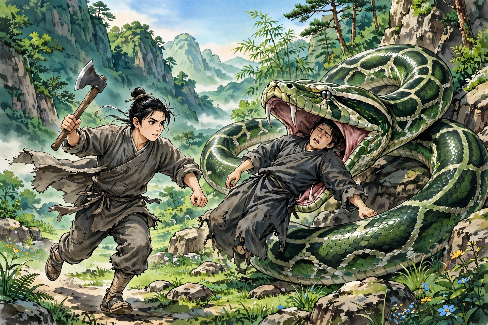
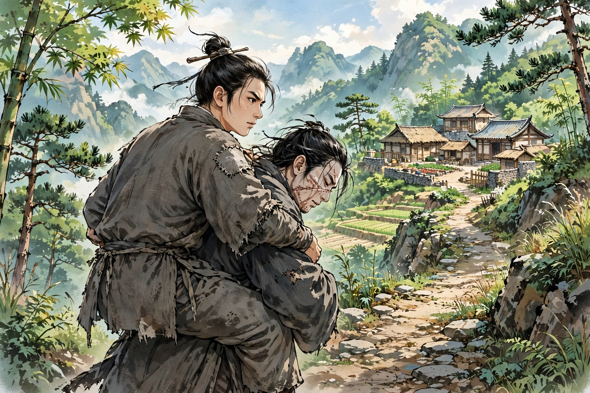

胡田村有一户姓胡的人家，兄弟两人一起进山砍柴，走到深谷里。忽然遇到一条大蟒，哥哥走在前面，被大蟒吞了下去；弟弟一开始吓得想跑，看见哥哥被咬住，便愤怒地抽出砍柴的斧子，去砍蛇的头。蛇头受了伤，却还是不停地吞。好在蛇头虽然已经没入哥哥的身体，到了肩膀那里就再也吞不下去了。弟弟急得没有办法，便用两只手抓住哥哥的脚，使劲和大蟒争夺，终于把哥哥从蛇口里拖了出来。大蟒也受了痛，自己走了。再看哥哥，鼻子和耳朵都已经化掉了，气息奄奄，快要断气。弟弟把哥哥背在肩上走，路上走了十多次歇息的工夫，才回到家里。经过半年医治调养，哥哥才痊愈。到现在，他的脸上还全是伤疤，鼻子和耳朵只剩下孔了。唉！农人之中，竟然有这样重情义的弟弟！也有人说：“大蟒不再害人，是被这份德义感动了。”这话是真的！

