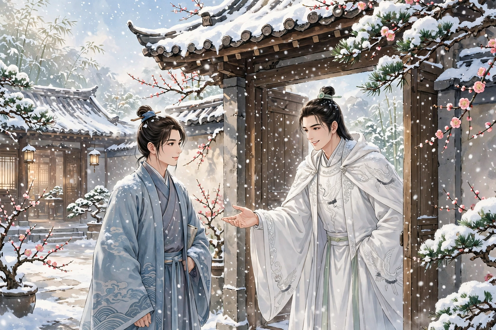
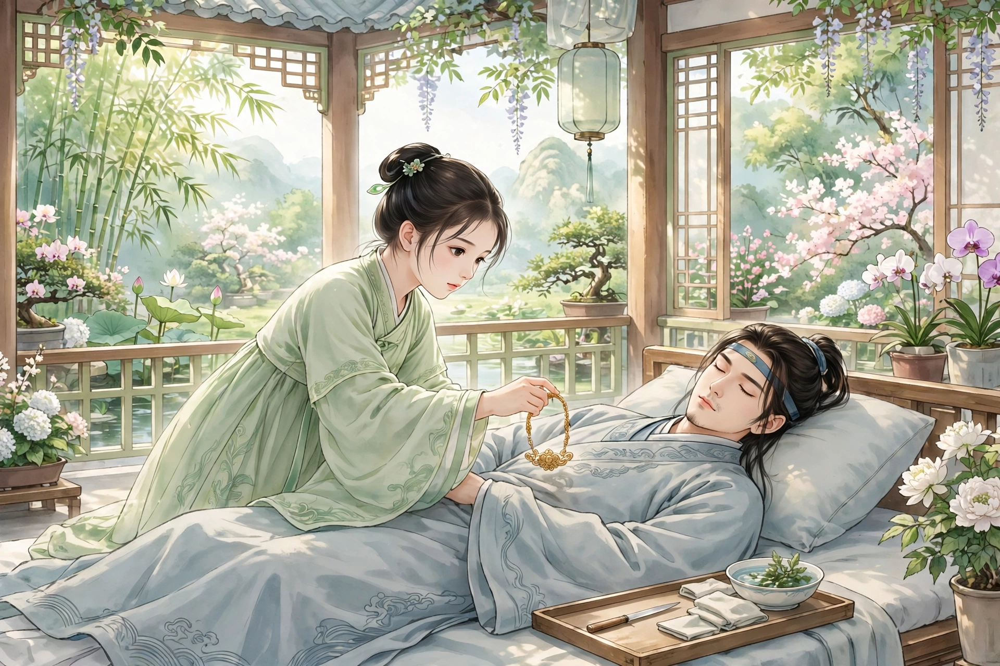

孔生名叫雪笠，是孔圣人的后代。为人含蓄有度，擅长作诗。有个好友在天台做县令，寄信招他前去。孔生去了，县令恰好去世，落魄得回不了家，住在菩陀寺，靠给寺僧抄录为生。寺西百余步有单先生的宅子，单先生本是公子，因为一场大官司而萧条，眷口不多，搬到乡下去住，宅子就空了下来。

有一天大雪纷飞，寂静得没有行人。孔生偶然经过那宅子的门，一个少年出来，风采非常俊美。看见孔生，赶快上前行礼，略加慰问，就请他进去。孔生很喜欢他，欣然跟着进去。房屋都不算很宽敞，处处都悬挂着锦幕，墙上多是古人的书画。案头放着一册书，签上写着《琅嬛琐记》。翻阅一遍，都是平生没有见过的。孔生因为住在单家的宅子，以为少年就是宅主，也没有问清他的门第。少年详细问了孔生的行踪，心里怜惜他，劝他设馆授徒。孔生叹息说：“羁旅之人，谁来做我的曹丘呢？”少年说：“如果不嫌弃我驽钝，愿意拜在门下。”孔生很高兴，不敢当他的老师，请他做朋友。又问：“宅子为什么久久关闭？”少年回答说：“这是单家的宅子，从前因为公子到乡下去住，所以久久空着。我姓皇甫，祖籍陕西。因为家宅被野火烧了，暂时借住在这里安顿。”孔生这才知道他不是单家人。当晚谈笑非常欢快，就留下来同榻而眠。

天刚亮，就有小僮在屋里生起炭火。少年先起身到里面去，孔生还抱着被子坐着。小僮进来禀报：“太翁来了。”孔生惊起。一个老者进来，鬓发花白，向孔生殷勤致谢说：“先生不嫌弃顽儿，肯赐教。小子刚学涂鸦，不要因为是朋友，就按行辈看待。”说完，就送上一套锦衣，貂帽、袜子、鞋子各一件。看孔生洗漱完毕，就叫酒摆菜。几案、榻、裙、衣，不知道叫什么名字，光彩夺目。酒喝了几巡，老者起身告辞，拄着杖走了。吃完饭，公子拿出课业，大多是古文辞，没有时文。问他，笑着说：“我不求进取。”到了傍晚，又斟酒说：“今晚尽情欢乐，明天就不许了。”叫小僮说：“看看太公睡了没有？已经睡了，可以暗暗叫香奴来。”小僮去了，先用绣囊把琵琶拿来。过了一会儿，一个婢女进来，红妆艳丽。公子命她弹《湘妃》，婢女用牙拨弹动，激扬哀烈，节拍不像平常听到的。又命用大觞行酒，直到三更才罢。第二天早起一起读书。公子最聪明，过目成诵，两三个月后，动笔写出的文章警拔绝妙。相约五天喝一次酒，每次喝酒必定招香奴来。一天晚上酒酣气热，孔生目注香奴。公子已经明白他的意思，说：“这个婢女是老父豢养的。兄长远离家乡没有家室，我日夜代为筹划很久了，正应当为君谋一门好亲事。”孔生说：“如果惠好，一定要是像香奴这样的人。”公子笑着说：“君真是见得少而惊怪得多啊。以这个为好，君的愿望也容易满足了。”住了半年，孔生想在郊外游览，到了门口，双扉从外面锁着，问公子，公子说：“家君怕交游扰乱心意，所以谢绝客人。”孔生也就安于此了。

当时正值盛暑湿热，搬到园亭里住斋。孔生胸间肿起像桃子一样，一夜之间大如碗，疼痛呻吟。公子朝夕探视，寝食都废了。又过了几天，创口加重，更加不吃不喝。太翁也来了，相对叹息。公子说：“儿前夜想着先生的病，娇娜妹子能治疗，派人到外祖母那里叫她回来。为什么久久不到？”忽然小僮进来禀报：“娜姑到了，姨母和松姑同来。”父子就赶快到里面去。过了一会儿，引妹妹来看孔生。年纪大约十三四岁，娇波流慧，细柳生姿。孔生望见艳色，皱眉呻吟顿时忘了，精神为之一振。公子就说：“这位兄长是我的良友，不啻同胞，妹子好好医治他。”女子就收起羞容，提起长袖，走到榻前诊视。把握之间，只觉得芳气胜过兰花。女子笑着说：“应当有这样的病，心脉动了。不过病症虽然危险，可以治；只是肤块已经凝结，非割皮削肉不可。”于是脱下臂上的金钏放在患处，慢慢按下去。创口突起一寸多，高出金钏之外，而根部其余的肿，都束在里面，不像先前那样大如碗了。于是一手掀开罗衣，解下佩刀，刀刃薄如纸，握着金钏握着刀，轻轻贴着根部割去，紫血流溢，沾染了床席。孔生贪恋靠近娇姿，不但不觉得痛苦，反而怕割事很快完成，依偎不久。不久割断了腐肉，团团的像树上削下的瘿。又叫水来，洗割处。口吐红丸像弹丸那么大，放在肉上按着旋转。才转一周，觉得热火蒸腾；再转一周，习习作痒；转了三周，已经遍体清凉，沁入骨髓。女子收丸入口，说：“好了！”快步出去了。

孔生跃起跑去致谢，久病好像消失了。可是悬想娇娜的容光，苦苦不能自已。从此废卷痴坐，再没有心思。公子已经看出来，说：“弟为兄物色得一门好亲事。”问：“什么人？”说：“也是弟的眷属。”孔生凝思很久，只说：“不需要！”面壁吟道：“曾经沧海难为水，除却巫山不是云。”公子明白他的意思，说：“家君仰慕鸿才，常常想结为婚姻。只是只有一个小妹妹，年纪太小。有个姨女阿松，年十八岁了，颇不粗陋。如果不相信，松姐每天到园亭来，在前厢可以望见她。”孔生照他的话做，果然看见娇娜偕同一位丽人来，画黛弯蛾，莲钩蹴凤，和娇娜不相上下。孔生非常高兴，求公子做媒。公子过几天从里面出来，祝贺说：“成了。”于是打扫别院，为孔生成亲。这天晚上鼓乐喧闹，尘土飞扬，以为望中的仙人，忽然同床共枕，就怀疑广寒宫殿，未必在云霄之上。合卺之后，非常惬意。

一天晚上公子对孔生说：“切磋的恩惠，没有一天可以忘记。近来单公子解讼归来，索要宅子很急，打算弃此而西去。势难再聚，因此离情萦怀。”孔生愿意跟着他去。公子劝他还乡，孔生为难。公子说：“不要忧虑，可以马上送君上路。”不久，太翁引松娘来，用黄金百两赠给孔生。公子用左右手和孔生夫妇相握，嘱咐闭目不要看。飘然踏空，只觉得耳边风鸣，过了很久，说：“到了。”睁开眼睛，果然看见故里。才知道公子不是人。欢喜地敲家门，母亲出来，完全没想到，又看见美妇，正一起欣慰。回头一看，公子已经不见了。松娘侍奉婆婆孝顺，艳色贤名，声闻远近。

后来孔生考中进士，授延安司李，带着家眷上任。母亲因为路远不去。松娘生了一个儿子名叫小宦。孔生因为忤逆直指而罢官，牵挂着回不了家。偶然到郊野打猎，遇见一个美少年骑着骊驹，频频注视。仔细看，原来是皇甫公子。拉住缰绳停下车马，悲喜交集。邀请孔生到一个村子，树木浓密昏暗，荫蔽天日。进入他家，金沤浮钉，宛然世家。问妹子，已经出嫁；岳母，已经去世。深深感伤悼念。住了一夜告别，偕同妻子一起回来。娇娜也来了，抱着孔生的儿子提着玩弄说：“姐姐乱了我的种了。”孔生拜谢过去的恩德。娇娜笑着说：“姐夫显贵了。创口已经愈合，还没有忘记痛吗？”妹夫吴郎也来拜见。住了两夜才走。

有一天公子面带忧色，对孔生说：“天降凶殃，能相救吗？”孔生不知道是什么事，只是一力承担。公子赶快出去，招一家人都进来，罗拜堂上。孔生非常惊骇，赶紧问。公子说：“我不是人类，是狐狸。如今有雷霆之劫。君肯以身赴难，一门可以望生全；不然，请抱着儿子走开，不要连累。”孔生发誓共生死。于是让孔生持剑站在门口，嘱咐说：“雷霆轰击，不要动！”孔生照他的话做。果然看见阴云白昼昏暗，黑如石磐。回头看旧居，再没有门户，只见高冢巍然，巨穴无底。正错愕间，霹雳一声，摇动山岳，急雨狂风，老树被拔起。孔生目眩耳聋，屹立不动。忽然在繁烟黑絮之中，看见一个鬼物，利喙长爪，从穴中攫取一人出来，随着烟直上。瞥见衣履，想到好像是娇娜。于是急忙跃离地面，用剑击它，随手掉落。忽然崩雷暴裂，孔生倒下死了。

过了一会儿天晴了，娇娜已经能够自己苏醒。看见孔生死在旁边，大哭说：“孔郎为我而死，我活着还有什么意思！”松娘也出来，一起抬孔生回去。娇娜让松娘捧着孔生的头，先用金簪拨开他的牙齿，自己就托着他的下颌，用舌头把红丸送进去，又接吻呵气。红丸随着气息入喉，格格作响，过了一会儿豁然苏醒。看见眷口，恍如梦中醒悟。于是一门团圆，惊定而喜。孔生因为幽旷不可久居，商议一起回乡。满堂都赞成，只有娇娜不乐意。孔生请吴郎一起去，又担心翁媪不肯离开幼子。整天商议没有结果。忽然吴家一个小奴，汗流气促而来。惊问详细，原来吴郎家也在同一天遭劫，一门全都没了。娇娜顿足悲伤，哭泣不止。大家一起慰劝。于是同归的计议就定了。

孔生进城，料理了几天，就连夜收拾行装。回去后用闲园安置公子，常常把门关上；孔生和松娘到了，才打开。孔生和公子兄妹，下棋喝酒谈宴像一家人一样。小宦长大，容貌俊秀，有狐狸的意思。出游都市，大家都知道他是狐儿。

异史氏说：“我对于孔生，不羡慕他得到艳妻，而羡慕他得到腻友。看他的容貌，可以疗饥；听他的声音，可以解颐。得到这样的良友，时常一起谈宴，那么‘色授魂与’，更胜于‘颠倒衣裳’了。”
