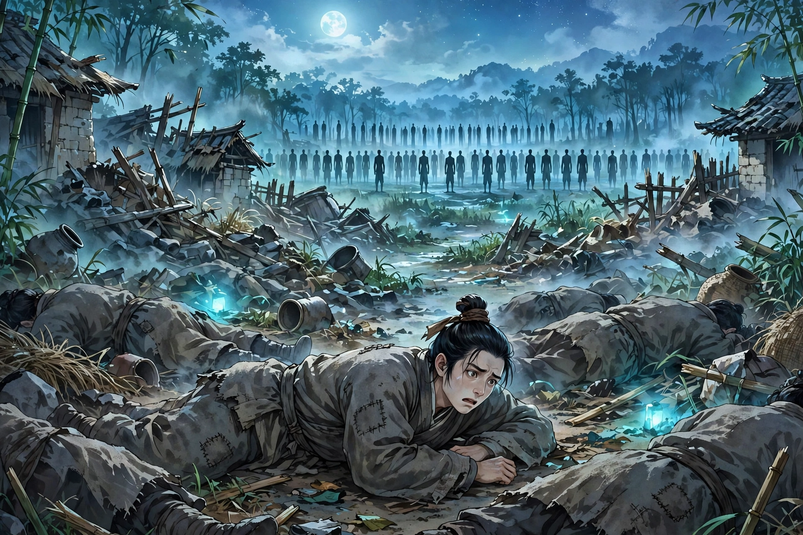
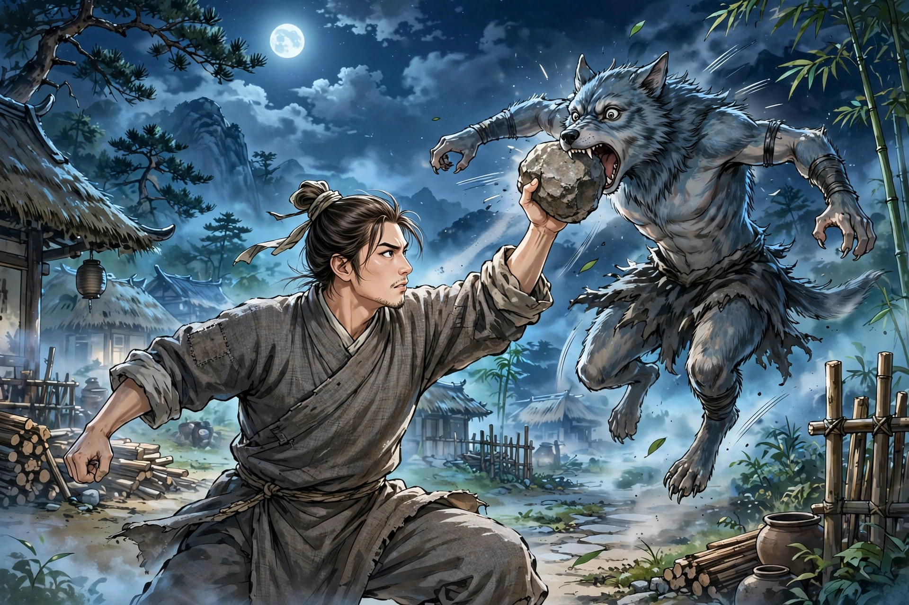

于七之乱的时候，杀人像割麻一样多。乡民李化龙从山里逃回来，正赶上大军夜里进村，怕被连累遭祸，急得没地方躲，就僵直地躺在死人堆里装尸体。兵过去了，他还不敢马上出来。忽然看见缺头断臂的尸体，像树林一样站了起来。其中一具尸体，断了的头还连在肩上，嘴里说道：“野狗子来了，怎么办？”群尸参差不齐地应道：“怎么办！”一会儿又一下子全倒了下去，再没有声息。

李化龙正惊颤着想起来，有个东西来了，兽头人身，趴着啃人头，到处吸脑子。李化龙害怕，把头藏到尸体下面。那东西来拨他的肩膀，想得到他的头。李化龙用力趴着，让它得不到。那东西就推翻尸体移开，头露了出来。李化龙大怕，手在腰下摸索，摸到一块像碗那么大的巨石，握在手里。那东西俯下身想咬，李化龙突然站起来大喊，击它的头，打中了嘴。那东西像鸱鸟一样嚎叫，捂着嘴忍痛逃跑，路上吐血。走近一看，在血中得到两颗牙齿，中间弯曲而两端尖锐，长四寸多。怀揣着带回家给人看，大家都不知道那是什么东西。

