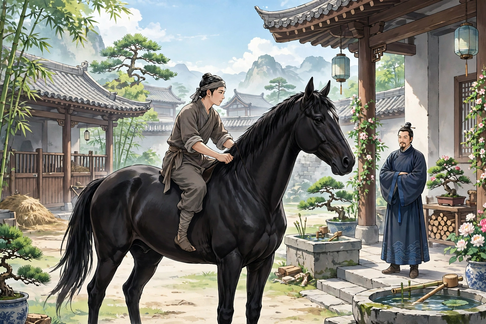
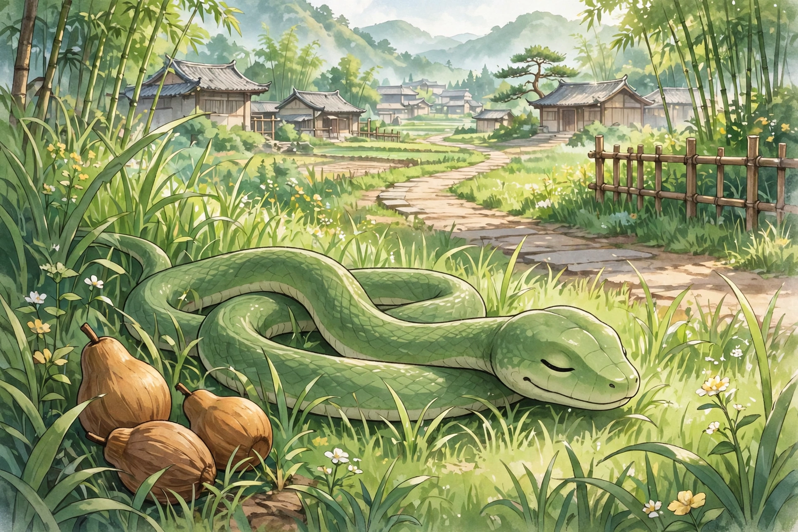

刘孝廉能记得前身的事。他和先父文贲兄是同年，曾经历历地讲过。第一世做缙绅，行为多有玷污。六十二岁死了，初见冥王，冥王待他像乡里的先生一样有礼，赐他坐下，拿茶给他喝。他瞥见冥王盏里的茶色清澈，自己的盏里却浊得像酒。暗暗怀疑，迷魂汤莫非就是这个？趁冥王转过头去，他把盏拿到案角倒了，假装已经喝尽。

一会儿查他前生的恶行记录，冥王大怒，命令群鬼把他拖下去，罚他做马。立刻有厉鬼把他押走。走到一家，门槛很高，过不去。正犹豫的时候，鬼用力打他，痛得他跌倒。自己一看，身子已经在马槽下面了。只听见人说：“黑马生小马驹了，是公的。”心里很明白，却不能说话。觉得非常饿，不得已，就向母马求奶。过了四五年，身子长得高大。很怕鞭打，看见鞭子就害怕逃跑。主人骑他，一定盖上障泥，缓缓地勒着缰绳慢慢走，还不算太苦；只有奴仆和养马的人，不加鞍具就骑着走，两只脚踝夹击，痛彻心腑。于是愤怒得很，三天不吃东西，就死了。

到了冥司，冥王查他罚期未满，责备他逃避，剥了他的皮革，罚他做狗。他心里懊丧，不想走。群鬼乱打他，痛极了逃到野外。自己想不如死了，愤而投向绝壁，跌倒不能起来。自己一看，身子伏在洞里，母狗舔他、护着他，才知道身子已经又生在人世了。稍稍长大，看见秽物也知道脏，然而闻着却香，只是立下念头不吃。做狗一年多，常常愤恨想死，又怕被治逃避之罪。而主人又养着他不肯杀。于是故意咬下主人大腿上的一块肉，主人大怒，用杖打死了他。

冥王审问情形，恼他狂暴，笞打几百下，让他做蛇。关在幽暗的屋子里，暗得不见天日。闷得很，沿着墙爬上去，穿洞出屋。自己一看，身子伏在茂草里，果然已经是蛇了。于是立志不残害生灵，饿了就吞木头的果实。积了一年多，常常想自尽不行，害人而死也不行，想求一个好好死去的办法却没有得到。一天卧在草里，听见车子经过，立刻出来挡在路上，车子驰过压着他，断成两截。

冥王惊讶他来得这么快，于是他趴在地上自己剖白。冥王因为他是无罪被杀而原谅他，准他满了期限再做人，这就是刘公。刘公生下来就能说话，文章书史，看过就能背诵。辛酉年考中孝廉。常常劝人：骑马一定要厚厚地盖上障泥；用腿夹的刑罚，比鞭打更厉害。

异史氏说：“毛角一类的动物里，竟有王公大人在其中。之所以这样，是因为王公大人里面，原本也未必没有毛角一类的在其中。所以卑贱的人行善，就像求花而种树；尊贵的人行善，就像花已开而培土：种树的可以长大，培土的可以长久。不然，就会拉盐车、受羁绊，和它们一起做马。不然，就会吃秽物、受烹割，和它们一起做狗。再不然，就会披鳞甲、葬在鹤鹳肚里，和它们一起做蛇。”
