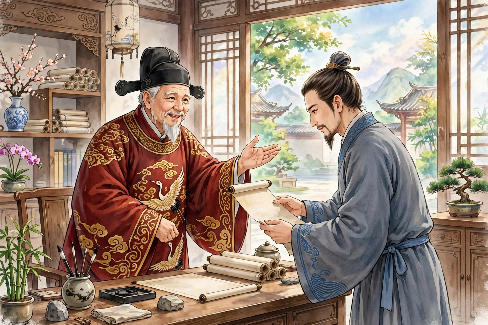

淮阳有个姓叶的书生，名字已经失传了。他写的文章词赋，在当时无人能比，可是运气一直不好，困在科举场里考不出来。

这时关东人丁乘鹤来这个县做县令，看了叶生的文章，觉得奇特，把他叫来谈话，十分高兴，就让他住进官署，供给灯火读书的费用，还常常送钱粮接济他的家。赶上科试，丁公在学使面前替叶生宣扬，于是叶生得了第一名。丁公对他的期望非常迫切，乡试考完后，找来叶生的文章读，拍着节拍连声赞叹。没想到时运限制人，文章也憎恨人的命，放榜以后，叶生依然落第。他失魂落魄地回家，惭愧自己辜负了知己，瘦得只剩骨头，痴痴呆呆像个木偶。丁公听说了，把他叫来安慰，叶生流泪不止。丁公可怜他，和他约定，等自己任期满了进京，就带着他一同北上。叶生十分感激佩服。

他告辞回家，闭门不出。没过多久，就病倒在床。丁公派人问候不断，可是吃了上百副药，一点效果也没有。丁公恰好因为顶撞上官被免职，正要离任离去，就写信给叶生，大意说：“我东归回家的日子已经定了，之所以迟迟不起程，就是在等你。你早上到了，我晚上就出发。”信送到叶生的病床前，叶生拿着信抽泣，托送信的人转告：“我病得很重，很难一下子好起来，请您先出发吧。”送信的人回去禀报，丁公不忍心先走，慢慢等着他。

过了几天，看门的人忽然通报说叶生到了。丁公高兴地迎上去问他，叶生说：“因为我这条贱命生病，劳烦夫子等了我这么久，我心里万分不安。现在幸好可以跟随侍奉在您身边了。”丁公于是收拾行装，定好第二天一早出发。回到家乡，丁公让儿子拜叶生为师，日夜都和叶生在一起。公子名叫再昌，当时十六岁，还不会写文章，可是极其聪明，凡是文章读上两三遍，就一点也不会忘。住了一年，就能提笔成文，再加上丁公的助力，就进了县学。叶生把自己平生为应试准备的文章，全都抄下来教他读。乡试考场上的七道题，没有一道是平时没有准备到的，于是考中了第二名。丁公有一天对叶生说：“先生只拿出自己才学的剩余部分，就让我这孩子成名了。可是黄钟大吕这样宝贵的东西长久被丢弃，又该怎么办呢！”叶生说：“这大概是命。借您的福气为我的文章出一口气，让天下人知道我半生沦落，不是打仗的罪过，我的愿望也就满足了。况且读书人能得到一个知己，就可以没有遗憾，何必一定要脱去布衣，才算是交了好运呢。”丁公因为他客居在外很久了，怕他耽误了每年的岁试，劝他回家去应试，叶生听了惨然不乐。丁公不忍心勉强他，嘱咐公子到了京城，替叶生花钱捐一个国子监监生的资格。公子又在会试中考中，授了部中主政的官，带着叶生到任上，早晚都在一起。

过了一年，叶生参加京城的乡试，竟然考中了举人。正好公子被派到南河办理河务，就对叶生说：“从这里去离您的家乡不远。先生奋发上天，衣锦还乡正是最快慰的事。”叶生也很高兴。选了吉日上路，到了淮阳地界，公子命令仆人牵马送叶生回家。叶生回家看见门户萧条，心里十分悲伤，在庭院中徘徊。妻子拿着簸箕出来，看见叶生，扔下簸箕惊恐地跑开了。叶生凄然说：“我现在已经显贵了。三四年不见面，怎么就一下子不认识我了？”妻子远远地说：“您已经死了很久了，还说什么显贵？之所以这么久还留着您的棺材没有下葬，是因为家里贫穷、孩子年幼罢了。现在阿大也已经长大成人了，就要找地方安葬您了。您不要显灵作怪来吓唬活人。”

叶生听了，怅然惆怅，徘徊着走进屋里，看见灵柩端端正正摆在那里，就扑倒在地消失了。妻子惊讶地看去，只见叶生的衣服、帽子、鞋袜像蝉蜕下来的壳一样散放在地上。她大声痛哭，抱着衣服悲伤地哭起来。儿子从学馆回来，看见几匹马系在家门口，问清了来由，惊骇地跑去告诉母亲。母亲抹着眼泪告诉他，又细细询问跟随的人，才知道了事情的原委。跟随的人回去后，公子听说了，眼泪落在胸前，立刻命人驾车到叶生的家里哭祭，拿出自己的钱操办丧事，按照举人的礼数安葬了叶生，又重重地送给叶生的儿子钱财，替他请老师教他读书，向学使推荐了一番，过了一年，叶生的儿子就进了县学。

异史氏说：“一个人的魂魄追随着知己，竟然忘记自己已经死了吗？听说的人都怀疑，我却深信不疑。同心的倩女，能让魂魄离开枕边；千里之外的好朋友，还能在梦中相识。更何况蚕丝蝇迹一样的字，是读书人呕心沥血写出来的；流水高山一样的知音，是和我们这些读书人性命相通的啊！唉！相遇难以期望，遭逢总不凑巧。行踪孤单，对着影子长久地忧愁；傲骨嶙嶙，搔着头自爱自怜。可叹面目酸涩，引来鬼物嘲弄。屡次处在落第的境地里，那么每一根须发都可以说是丑陋的；一旦落到孙山之外，那么文章就处处都是毛病。自古到今因为痛哭而出名的人，只有卞和；把出众的人才颠倒埋没，善于识别贤才的伯乐又是谁呢？把名帖放在怀里，三年之后字迹磨灭；侧身四望，天下已经没有可以投奔的地方。人生在世上，只须闭着眼睛放开脚步走，听从上天安排的富贵贫贱罢了。天下像叶生这样挺拔却沦落的人，也还有不少，只是哪里能再得到丁乘鹤这样的人，让他生死相随呢？唉！”
