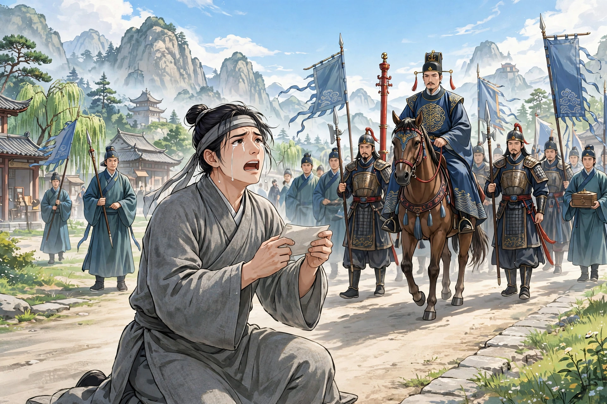

文登的周生和成生从小一起读书，结成了生死之交。成生家贫，所以一年到头都依附着周生生活。按年龄周生年长，成生称周生的妻子为嫂子。逢年过节成生都上堂拜见，就像一家人一样。周生的妻子生了孩子，产后突然去世。后来周生又娶了王氏，成生因为年纪小，从来没有请求见过她。有一天，王氏的弟弟来看望姐姐，在内室摆酒。成生正好来了。家人通报，周生坐着命人请他进来。成生不进去，告辞走了。周生把酒席移到外舍，追上他把他请了回来。刚坐下，就有人报告别墅的仆人被县令重打了。原来先前黄吏部家的放牧佣人，让牛踩了周生的田地，因此互相辱骂。放牧佣人跑去告诉主人，主人捉了周生的仆人送官，于是被打了一顿。周生问清缘故，大怒说：“黄家的放猪奴仆，怎么敢这样！他的先辈曾为我祖父服役；刚一得志，就没人管了吗！”气得胸口发闷，愤然起身，要去找黄家算账。成生按住他劝阻说：“这是一个强横的世界，本来就没有是非可讲。何况如今的官吏有一半是不拿矛和弓的强盗呢？”周生不听。成生再三劝阻，甚至哭了出来，周生才作罢。怒气始终不能消解，翻来覆去一夜没睡。对家人说：“黄家欺负我，就是我的仇人，姑且先放一放。县令是朝廷的官，不是权势人家的官，纵然有争执，也应当双方对质，怎么能像狗听人驱使一样？我也要告他的佣人，看他怎么处置。”家人都怂恿他，计议就定了。写好状子去见县令，县令撕了状子扔在地上。周生大怒，出言冒犯县令。县令羞恼，于是把他逮捕关了起来。

辰时过后，成生去看望周生，才知道他进城打官司。急忙赶去劝阻，周生已经在监狱里了。成生顿足，没有办法。当时抓获了三名海盗，县令和黄家贿赂嘱托他们，让他们诬称周生是同党。按供词上奏，革去了周生的顶戴衣冠，拷打得非常惨。成生进了监狱，和周生相对凄然。商量着去京城告御状。周生说：“我身陷重牢，像鸟在笼子里；虽然有个弱弟弟，也只够给我送牢饭罢了。”成生挺身自任说：“这是我的责任。困难而不去急救，还要朋友做什么！”于是动身。周生的弟弟拿盘缠追送他，他已经走远了。到了京城，没有门路告状。听说皇帝将要出猎，成生预先藏在木市中；等皇帝经过，伏地起舞哀号，于是得到了准许。由驿站送下来，交给部院审理奏报。这时已经过了十个多月，周生已经被诬供判了死刑。部院接到皇帝的批示，大为吃惊，重新提审亲自审问。黄家也吃惊，谋划杀死周生。于是贿赂狱吏，断绝他的饮食；弟弟来送饭，也被严厉禁止。成生又到部院喊冤，才得到提审，周生已经饿得起不来了。部院大人大怒，把狱吏杖打死了。黄家大为恐惧，拿出几千两银子，嘱托营救脱身，因此得以含糊其辞地题请免罪。县令因为枉法被拟定流放。周生被放回家，更加肝胆相照地对待成生。

成生经历了这场官司诉讼，对世情完全灰了心，邀请周生一起隐居。周生沉溺于年轻的妻子，总是迂回地笑他。成生虽然不说话，但心意非常坚决。分别之后，成生几天都不来。周生派人到他家里打听，家人正怀疑他在周生那里；两边都不见，才起了疑心。周生心里知道有异常，派人四处寻访，寺观山谷，几乎找遍了。时常用金帛周济他的儿子。又过了八九年，成生忽然自己来了，戴着黄巾、穿着道袍，俨然一副道骨仙风的样子。周生高兴地拉着他的手臂说：“你到哪里去了，害得我找得几乎遍了？”成生笑着说：“孤云野鹤，栖息没有定所。分别以后幸好还顽健。”周生命人摆酒，略叙别情，想要给他换下道装。成生笑着不说话。周生说：“愚蠢啊！怎么把妻儿抛弃得像破鞋一样？”成生笑着说：“不是这样。人要抛弃我，我又能抛弃谁呢。”问他栖息在哪里，回答说在劳山的上清宫。不久两人抵足而睡，周生梦见成生赤身伏在自己胸口，气得透不过来。惊讶地问他做什么，成生全然不回答。忽然惊醒过来，呼喊成生不应；坐起来寻找，茫然不知他到哪里去了。定了好一会儿，才发觉自己睡在成生的床上，惊骇地说：“昨晚没有喝醉，怎么颠倒到这里来了！”于是呼喊家人。家人点灯来看，俨然就是成生。周生本来胡须很多，用手自己捋一捋，却稀疏得没有几根。拿镜子自己照一照，惊讶地说：“成生在这里，我到哪里去了！”随即大悟，知道成生用幻术招引他隐居。想要回到内宅，弟弟因为他的相貌不同，禁止他不许向前。周生也没有办法自证身份。就命仆人骑马去寻找成生。几天后，进入劳山。马跑得快，仆人跟不上。在树下休息，看见道士往来很多。其中一个道人看着周生，周生就向他打听成生。道士笑着说：“听说过他的名字，好像在上清宫。”说完，就径直走了。周生目送他，看见一箭之外，他又和一个人说话，也没有说几句话就走了。和他说话的人渐渐走近，原来是同社的生员。看见周生，惊愕地说：“几年不见，人们都说你到名山学道，如今还游戏人间吗？”周生讲述了自己的奇遇。生员惊讶地说：“我刚才遇见他，还以为是你呢。走开没有多久，也许还不远。”周生大为惊异，说：“怪哉！怎么自己的面目当面见了却不认识？”仆人寻到，急忙追赶，竟然没有踪迹。一望辽阔，进退难以自主。自己想着无家可归，于是决意穷追到底。而险路再也不能骑马，就把马交给仆人带回去，迤逦自己前往。远远看见一个童子独坐，走近问路，并且告诉他缘故。童子自称是成生的弟子，代为挑着衣粮，引导他一起走。披星戴月，走了很远，三天才到，又不是世人所说的上清宫。当时是十月中旬，山花满路，不像初冬的样子。童子进去通报客人，成生立刻出来，才认出自己的形貌。拉着手进去，摆酒宴谈。看见异彩的禽鸟，驯服得不怕人，声音像笙簧一样，时常来在座上鸣叫。心里非常惊异。然而尘俗的念头急切，没有心思留连。地下有两个蒲团，拉着他并坐。到了二更以后，万虑都寂静了，忽然好像打了一个盹，身体觉得和成生换了位置。怀疑着，自己捋一捋颔下，却是浓密的胡须如故了。天亮以后，豁然想着回去。成生坚决留他。过了三天，才说：“请让我睡一会儿，早早送你走。”刚一合眼，听见成生喊道：“行装已经准备好了。”于是起身跟着他走。

所走的路全然不是旧路，觉得没有多久，家乡已经在望了。成生坐在路旁等候，让他自己回家。周生强留他不得，于是踽踽独行到了家门。敲门没有人应答，想要翻墙，觉得身体飘得像叶子一样，一跃就过去了。接连越过几重墙，才到了卧室，灯烛明亮，妻子还没有睡，低声和人说话。舔破窗纸窥看，原来妻子和一个厮仆一起饮酒，样子非常亲狎。于是怒火如焚；计议要掩捕，又怕孤身一人难以取胜。于是悄悄脱身出来，奔去告诉成生，并且请求他帮助。成生慨然跟着他来，直抵内寝。周生举起石头砸门，里面非常慌张；砸得越急，里面关得越紧。成生用剑一拨，哗地一声顿时打开。周生奔进去，仆人冲门逃走。成在门外，用剑击他，断了他的肩臂。周生抓住妻子拷问，才知道被收监时她就已经和仆人私通了。周生借剑砍下她的头，把肠子挂在庭院的树上。于是跟着成生出来，寻找道路回去。忽然一下子醒来，原来身体还在卧榻上，惊讶地说：“怪梦参差，叫人骇惧！”成生笑着说：“你以为是梦的才是真，你以为是真的倒成了梦。”周生愕然问他。成生拿出剑给他看，溅血还存在。周生惊惧得几乎要死，暗暗怀疑成生张大其词作幻术。成生知道他的心意，于是催促收拾行装送他回家。慢慢走到里门，成生说：“从前那一夜，倚剑相待的地方，不就是这里吗！我厌恶见到污浊，请在这里等你；如果过了下午你还不来，我自己就走了。”周生到了家里，门户萧索，好像没有人居住。回到弟弟家里。弟弟看见哥哥，眼泪立刻落下，说：“哥哥走后，盗贼夜里杀了嫂子，剖肠而去，惨酷得可哀悼。到现在官府还没有捕获。”周生像从梦中醒来，于是把实情告诉他，告诫他不要追究。弟弟错愕了很久。周生问起自己的儿子，就命老媪抱来。周生说：“这个襁褓中的孩子，是宗族血脉所系，弟弟要好好照看他。哥哥要辞别人世了。”于是起身，径直出去。弟弟涕泪追挽，周生笑着走开不顾。到了野外，看见成生，和他一起走。远远回头说：“忍事最乐。”弟弟想要说话，成生大袖一举，就看不见了。弟弟怅然站了好一会儿，痛哭着回去了。

周生的弟弟朴实迟钝，不善于经营家人生计，过了几年，家里更加贫穷。周生的儿子渐渐长大，不能请老师，就自己教他读书。一天，早上到书斋，看见案头有一封信，封缄得很牢固，签题写着“仲氏启”。仔细看，是哥哥的笔迹；打开来看，却空无所有，只看见指甲一枚，长约两指。心里奇怪。把指甲放在砚台上，出去问家人是从哪里来的，都没有人知道。回来看时，砚石灿灿发光，化成了黄金。大惊。用它试铜铁，都是一样。由此大富。用一千两金子赐给成生的儿子，因此相传两家有点金术。
