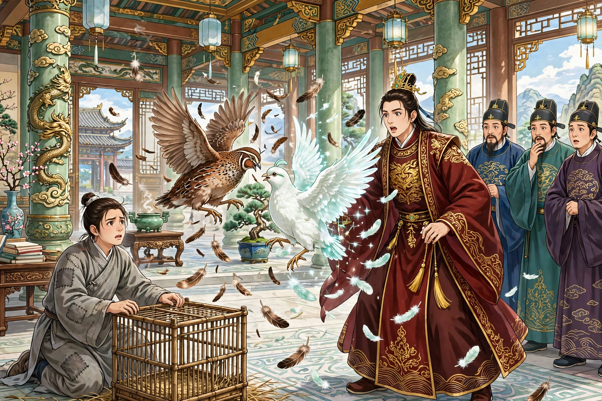

王成是平原一个旧家子弟，生性最懒。家道败落下来，只剩下几间破屋，和妻子睡在粗布被子里，互相埋怨，日子实在难过。正是盛夏闷热的时候，村外原来有一座周家的园子，墙和房子都倒塌了，只剩下一座亭子；村里人大多借宿在里面，王成也在那里。天亮了，睡觉的人都走了；太阳升到三竿那么高，王成才起来，慢慢地想要回家。看见草丛里有一支金钗，捡起来看，上面刻着细字说：“仪宾府造”。王成的祖父做过衡府的仪宾，家里的旧东西大多是这个款式，于是他拿着钗子犹豫不决。

忽然一个老太太来找钗子。王成虽然一向贫穷，但生性耿介，立刻拿出来交给她。老太太很高兴，极力称赞他的美德，说：“这钗子值多少钱呢，是先夫留下的遗物。”问：“你的丈夫是谁？”回答说：“是已故的仪宾王柬之。”王成惊讶地说：“那是我的祖父，怎么会和你相遇？”老太太也惊讶地说：“你就是王柬之的孙子吗？我是狐仙。一百年前，和你祖父相亲相爱。你祖父去世后，我就隐居起来。经过这里丢了钗子，正好落到你手里，难道不是天数吗！”王成也曾听说祖父有过狐妻，相信了她的话，便邀请她到家里看看。老太太答应了。王成叫妻子出来见她，妻子披着破棉絮，脸色菜黄憔悴。老太太叹息说：“唉！王柬之的孙子，竟然穷到这个地步！”又看看灶上没有烟火，说：“家计到了这个地步，靠什么过日子呢？”妻子于是详细诉说贫苦的情形，呜咽着哭起来。老太太把钗子交给妇人，让她先去当了钱买米，三天后再来相见。王成挽留她。老太太说：“你连一个妻子都养不活；我在这里，仰着屋子住着，又有什么好处呢？”就径直走了。王成把缘故告诉妻子，妻子非常害怕。王成讲明其中的道理，让她姑且侍奉老太太，妻子答应了。过了三天，老太太果然来了。拿出几两银子，买了粟和麦各一石。夜里和妇人同睡一张短榻。妇人起初害怕她；可是看她的心意实在恳切，也就不再怀疑了。

第二天，老太太对王成说：“孙子不要懒惰，应该做点小生意，坐吃山空怎么能长久呢？”王成说没有本钱。老太太说：“你祖父在的时候，金银财帛任凭我取；我是个世外人，不需要这些东西，所以从来没有多取。积攒下来的花粉钱四十两，到现在还留着。长久放着也没有用处，可以拿去全部买葛布，定下日子到京城去，能得些微利。”王成听从了，买了五十多匹葛布回来。老太太让他赶紧收拾行装，算计六七天可以到达燕京。嘱咐说：“要勤快不要懒惰，要赶快不要拖延；迟了一天，后悔就来不及了。”王成恭敬地答应，背上货物上路。半路上遇到下雨，衣服鞋子都浸湿了。王成平生没有经历过风霜，疲惫不堪，就暂时在旅店里休息。没想到雨淅淅沥沥下到天黑，屋檐上的雨像绳子一样。过了一夜，泥泞更加厉害。看见来往的行人，踩着泥泞没过小腿，心里害怕辛苦。等到中午，才渐渐干燥，可是阴云又合拢来，雨又大作起来。住了两夜才动身。快到京城时，听说葛布价格飞涨，心里暗暗高兴。进了京城，卸下行装住进客店，店主人很惋惜他来晚了。原来是这样：南边的道路刚刚开通，葛布运到京城的极少。贝勒府急着购买，价格顿时上涨，比平时贵了三倍。前一天刚刚买够，后来的人都失望了。店主人把缘故告诉王成。王成郁郁不得志。第二天，葛布运来的越来越多，价格越发下跌。王成因为没有利润不肯卖。又拖了十多天，算算吃饭的花销越来越多，更加忧愁烦闷。店主人劝他贱卖了，改做别的打算。他听从了，亏了十多两银子，全部卖光了。早上起来，正要打算回家，打开行囊一看，金子没有了。惊慌地告诉店主人。店主人也没有办法。有人劝他告官，让店主人赔偿。王成叹息说：“这是我的命数，和店主人有什么关系呢？”店主人听说后很感激他，赠给他五两银子，安慰他回家。他自己想着没法见祖母，在里里外外踱来踱去，进退两难。

正好看见斗鹌鹑的人，一赌就是几千文；每买一只鹌鹑，总是要一百文钱不止。他心里忽然一动，算算行囊里的钱，只够贩鹌鹑，就和店主人商量。店主人极力怂恿他，并且约定让他白住白吃，不收他的费用。王成很高兴，就动身了。买了满满一担鹌鹑，又进了京城。店主人很高兴，祝贺他很快卖掉。到了夜里，大雨下到天亮。天明时，街上的水像河一样，雨点淋漓还没有停。住了下来等天晴，接连好几天，没有停的时候。起来看看笼子里的鹌鹑，渐渐死去。王成非常害怕，不知道该怎么办才好。第二天，死得更多；只剩下几只，合并到一个笼子里喂养；过了一夜去看，只剩下一只鹌鹑了。就告诉店主人，不觉流下眼泪。店主人也为他扼腕叹息。王成自己想金子花光了没法回家，只想寻死，店主人劝慰他。一起去看鹌鹑，仔细看了说：“这好像是一只好鹌鹑。别的鹌鹑死了，未必不是被它斗死的。你闲着也没有别的事，请养着它；如果它确实好，靠赌斗也可以谋生。”王成照他的话做了。养驯了以后，店主人让他拿到街头，赌酒赌饭。鹌鹑很健壮，总是赢。店主人很高兴，拿金子给王成，让他再和子弟们决斗；三战三胜。半年多，积攒了二十两金子。心里更加宽慰，把鹌鹑看得像性命一样。原来是这样：大亲王喜欢鹌鹑，每逢上元节，总是放民间的养鹌鹑人进府里比斗。店主人对王成说：“现在大富贵可以立刻得到；所不知道的，只在你的命数了。”就把缘故告诉他，带着他一起去。嘱咐说：“如果输了，就垂头丧气地出来罢了。倘若万分之一，鹌鹑斗赢了，大王一定要买它，你不要答应；如果他坚持要买，只看我的头，我点头之后你再答应。”王成说：“好。”到了王府，只见养鹌鹑的人在台阶下肩挨着肩。不一会儿，大王走出大殿。左右的人宣告说：“有愿意斗的就上来。”就有一个人拿着鹌鹑，快步上前。大王命令放鹌鹑，客人也放；略微一腾跃，客人的鹌鹑已经败了。大王大笑。过了一会儿，上去又败了几个人。店主人说：“可以了。”一起上前。大王看了看，说：“眼睛里有怒脉，这是健壮的羽毛，不能轻敌。”命令拿铁嘴的鹌鹑来对付它。一再腾跃之后，大王的鹌鹑掉了羽毛。又选好的鹌鹑，再换再败。大王急忙命令拿宫中的玉鹑。片刻拿了出来，羽毛洁白像鹭鸶，神态俊逸不凡。王成心里发怯，跪下来请求罢斗，说：“大王的鹌鹑，是神物啊，恐怕伤了我的禽鸟，断了我的生计。”大王笑着说：“放开它。即使斗死了，也会厚厚地赔偿你。”王成这才放开它。玉鹑直奔过来。而玉鹑刚来时，它就伏着像发怒的鸡一样等着；玉鹑用力啄它时，它就起身像飞翔的鹤一样击打它；进进退退互相僵持，大约一顿饭的工夫。玉鹑渐渐懈怠，而它的怒气更加厉害，斗得更加急迫。不久，雪白的羽毛纷纷落下，垂着翅膀逃走了。观看的一千人，没有不赞叹羡慕的。大王就索要过来亲自拿着，从嘴到爪，仔细看了一遍，问王成说：“鹌鹑可以卖吗？”回答说：“小人没有固定产业，和它相依为命，不愿意卖。”大王说：“给你重价，可以得到中等人的家产。很愿意吗？”王成低头想了很久，说：“本来不乐意卖；可是大王既然喜欢它，如果能让我得到衣食的生计，又有什么要求呢？”大王问价钱，回答说一千金。大王笑着说：“痴男子！这是什么珍宝，值得一千金呢？”王成说：“大王不把它当作宝贝，我却把它看作连城之璧也不过分。”大王说：“为什么？”说：“小人拿它到市集上，每天得到几两金子，换升斗粮食，一家十多口人，没有冻饿的忧虑，这是什么宝贝能比得上呢？”大王说：“我不让你吃亏，就给你二百金。”王成摇摇头。又加了一百。王成看着店主人，店主人脸色不动。于是说：“承蒙大王的命令，请减去一百的价钱。”大王说：“算了！谁肯用九百换一只鹌鹑呢！”王成把鹌鹑装进袋子里想要走。大王喊道：“养鹌鹑的人来，养鹌鹑的人来！实在给六百，肯就卖，不肯就算了。”王成又看店主人，店主人仍然神色自若。王成心里愿望已经满足，只怕错过时机，说：“用这个数目卖，心里实在不痛快；但是交易不成，就会招来更大的罪过。没办法，就按大王说的办。”大王很高兴，立刻秤了付给他。王成把金子装进口袋，拜谢而出。店主人埋怨说：“我说得怎么样，你就急着自己卖了！再稍微坚持一下，八百金就在手掌里了。”王成回去，把金子掷在案上，请店主人自己取，店主人不受。又一再让给他，才按饭钱算了算收下了。

王成收拾行装回家，到了家里，把所做的事一一说了，拿出金子互相庆贺。老太太命令买良田三百亩，盖房子置办器物，居然像世家一样。老太太每天早起，让王成督促耕种，妇人督促织布；稍有懒惰，就呵斥他们。夫妇俩相安无事，不敢有怨言。过了三年，家里更加富裕。老太太告辞要走。夫妻俩一起挽留她，哭得流下眼泪。老太太也就停了下来。第二天早上等候她，已经不见踪影了。

异史氏说：“富贵都得自勤劳，这一个人却独独因为懒惰而致富，也是从来没有听说过的事。不知道他一贫彻骨，可是本性没有改变，这是上天所以先抛弃他而最终怜悯他的缘故。懒惰之中难道果真有富贵吗！”
