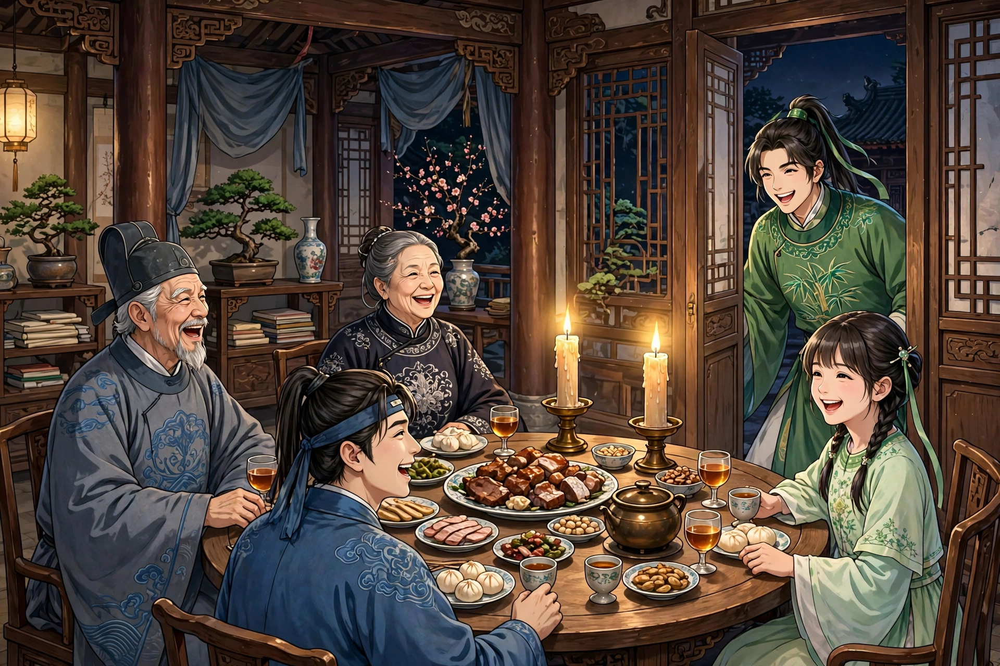
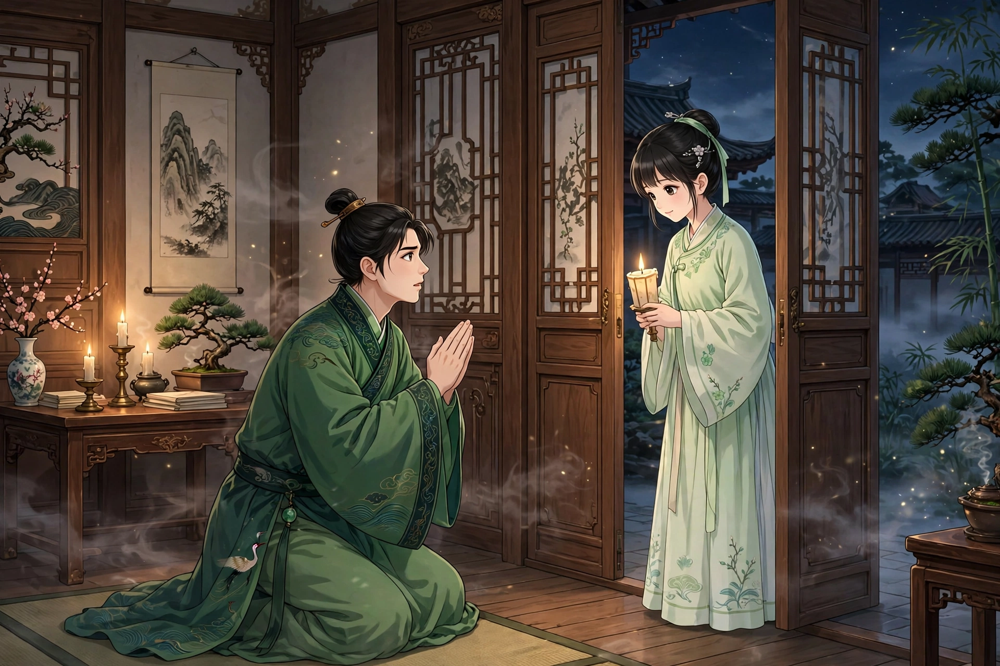
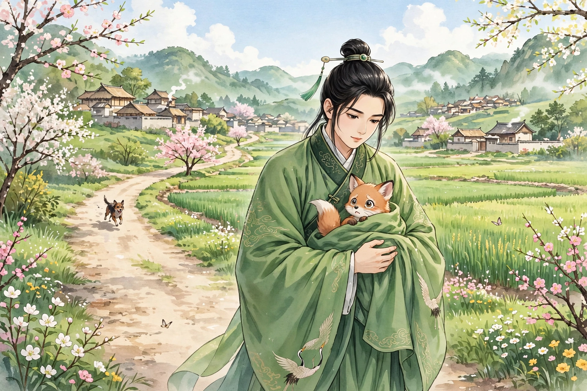

太原有一家姓耿的人家，原本是大家族，宅子宽阔宏大。后来家道衰落，楼房连成一片，大半都空着荒废了。于是生出怪异的事，大堂的门常常自己开合，家人在半夜里常常被惊得喧哗起来。耿家主人为此烦恼，便搬到别墅去住，只留下一个老翁看门。从此这里更加荒凉，有时还会听到笑语歌声。

耿家有个侄子名叫去病，狂放不羁。他嘱咐看门的老翁，只要有什么听见看见的，就跑来告诉他。到了夜里，老翁看见楼上灯光明灭，就跑来报告耿生。耿生想进去察看其中的怪异，老翁劝阻他，他不听。院子里的门户他平素都很熟悉，于是拨开蒿草，曲曲折折地走了进去。登上楼去，一点异常也没有。穿过楼去，听见有人轻声说话。他偷偷去看，只见两支大烛燃烧着，亮得如同白昼。一个老头戴着儒生的帽子朝南坐着，一个老妇人相对而坐，两人都在四十岁上下。朝东坐着一个少年，大约二十岁，右边一个女郎，才十五岁。桌子上摆满了酒肉，大家围坐着谈笑。耿生突然闯进去，笑着喊道：“来了一个不请自到的客人！”众人惊慌地跑开躲藏，只有老头出来喝问道：“你是什么人，闯进人家的内室？”耿生说：“这是我家的内室，是先生占住了。好酒自己喝，也不请主人一下，未免太吝啬了吧？”老头仔细看了他一眼，说：“你不是主人。”耿生说：“我是狂生耿去病，是主人的侄子。”老头致敬说：“久仰大名！”于是请耿生进来，便叫家人换上酒菜，耿生制止了他。老头就给客人斟酒。耿生说：“我们两家是世交，座上的客人不用回避，还请叫出来一起喝酒。”老头喊道：“孝儿！”一会儿少年从外面进来。老头说：“这是我的儿子。”少年作揖坐下。大家略略问了问各自的门第家世。老头自己说：“我姓胡，名叫义君。”耿生素来豪爽，谈论起来风生水起，孝儿也很潇洒，畅谈之间，彼此十分投合喜爱。耿生二十一岁，比孝儿大两岁，于是把他当作弟弟。

老头说：“听说先生的祖上编过《涂山外传》，知道吗？”耿生回答：“知道。”老头说：“我是涂山氏的后代。唐以后，家谱的分支我还能记得，五代以前就没有传下来了。希望公子指教一下。”耿生略略讲述了涂山女子辅佐大禹的功劳，加以润色铺陈，妙语如泉涌出。老头大喜，对儿子说：“今天有幸听到了从未听过的事。公子也不是外人，可以请母亲和青凤一起来听，也让她们知道祖上的功德。”孝儿走进内室。不一会儿，老妇人带着女郎出来。耿生仔细一看，只见女郎体态柔弱而娇美，眼波流转着聪慧，世间没有这样美丽的女子。老头指着妇人说：“这是我的老妻。”又指着女郎说：“这是青凤，是我的侄女。她很聪明，听见看见的，就记得不忘，所以叫她来听。”耿生讲完话开始喝酒，望着女郎，目不转睛。女郎察觉了，就低下头。耿生悄悄踩了一下青凤的小脚，女郎急忙收回脚，也没有恼怒。耿生神志飞扬，不能自制，拍着桌子说：“能娶到这样的妻子，就是面南称王也不换！”老妇人见耿生渐渐醉了，更加狂放，就和女郎一起站起来，急忙掀开帷帐走了。耿生失望了，就向老头告辞出来，可是心里牵挂着，忘不了青凤。

到了夜里，耿生再去，只觉得兰草和麝香的气味还在，可是凝神等了一整夜，寂静无声，没有一点动静。他回家和妻子商量，想带着全家搬到那里去住，希望能再遇到青凤。妻子不答应，耿生就自己搬过去，在楼下读书。夜里正凭着桌子，一个鬼披着头发进来，脸色黑如漆，睁大眼睛看着耿生。耿生笑了笑，用手指蘸了砚台里的墨汁涂在自己脸上，目光明亮地和那鬼对视。那鬼感到惭愧，走了。

第二天夜里，夜已经很深了，耿生吹灭蜡烛想睡，听见楼后有开门闩的声音，砰的一声门开了。耿生急忙起身偷看，只见门半开着。一会儿听见细碎的脚步声，有烛光从房里出来。一看，原来是青凤。青凤突然看见耿生，吃惊地退回去，急忙关上两扇门。耿生长跪着向她致词说：“小生不避险恶，实在是为了你。如今幸好没有别人，能握一下手欢笑一番，死了也没有遗憾。”女郎在远处说：“你恳切的深情，我怎么会不知道？只是叔叔管教严厉，不敢听从你的话。”耿生再三哀求说：“也不敢指望肌肤之亲，只要见一见你的容貌就够了。”女郎似乎答应了，打开门，拉着他的手臂把他拽了进去。耿生狂喜万分，和她相携着走进楼下，把她抱在膝上。女郎说：“幸亏我们有前世的缘分。过了这一夜，再相思也没有用了。”耿生问：“为什么？”女郎说：“叔叔怕你狂放，所以化作厉鬼来吓你，可是你不动摇。如今他已经在别处选好了住处，一家人都在把东西搬到新居去，只有我留守，明天就要出发了。”说完，她想走，说：“恐怕叔叔回来了。”耿生强留住她，想和她亲近。两人正在争执的时候，老头突然进来。女郎羞愧害怕，无地自容，低下头倚着床，捻着衣带不说话。老头怒道：“贱丫头败坏我家门风！还不快走，鞭子随后就到！”女郎低着头急忙走了，老头也出去了。耿生跟在后面听，只听见老头百般辱骂，又听见青凤小声啜泣。耿生心里像刀割一样，大声说：“罪过在我身上，和青凤有什么关系？要是宽恕青凤，就是刀劈斧砍，我也愿意一个人承受！”很久之后寂静无声，耿生才回去睡觉。从此宅子里再也没有一点声息了。

耿生的叔叔听说了，觉得新奇，愿意把宅子卖给他住，不计较价钱。耿生高兴了，带着全家搬了过去。住了一年多，很是惬意，可是没有一刻忘记青凤。

正赶上清明节，耿生上坟回来，看见两只小狐狸，被一只狗追逼着。其中一只逃到荒野里去了，另一只在路上慌急乱转。望见耿生，依恋地哀叫着，耷拉着耳朵，缩着头，好像在乞求援救。耿生怜惜它，掀开衣襟，把它抱在怀里带回家。关上门，把它放在床上，原来就是青凤。耿生大喜，上前慰问。女郎说：“刚才和丫鬟玩耍，遇上了这样的大灾难。要不是郎君，一定会葬身犬腹。希望你不要因为我不是同类而厌恶我。”耿生说：“我日夜思念你，连梦里都牵挂着。见了你就像得到了异宝，怎么会厌恶呢！”女郎说：“这也是天数。要不是遇到颠覆灾难，怎么能跟你在一起？不过很幸运，丫鬟一定以为我已经死了，我可以和你订下终身的约了。”耿生高兴了，另外收拾出一处宅子安顿她。

过了两年多，耿生正在夜里读书，孝儿忽然进来。耿生放下书卷，惊讶地问他从哪里来。孝儿伏在地上，悲伤地说：“家父遇到横祸，除了先生没有人能救。他本来想亲自来恳求，又怕不被接纳，所以让我来。”耿生问：“什么事？”孝儿说：“公子认识莫三郎吗？”耿生说：“这是我同年家的子侄。”孝儿说：“明天他要经过这里，如果携带有猎获的狐狸，希望先生把狐狸留下来。”耿生说：“楼下受辱的事，我至今耿耿于怀，别的事我不敢过问。一定要我出力，非得青凤来不可！”孝儿流着泪说：“青凤妹妹已经死在野外三年了！”耿生拂袖说：“既然这样，恨就更深了！”拿起书卷高声吟诵，再也不理睬他。孝儿站起来，失声痛哭，掩着脸走了。耿生到青凤住处，把这件事告诉了她。女郎脸色变了，说：“到底救不救他？”耿生说：“救还是要救，刚才不答应，也不过是借此报复他从前的横暴罢了。”女郎于是高兴地说：“我从小成了孤儿，靠叔叔抚养成人。从前虽然获罪，也是家规应当如此。”耿生说：“的确是这样，可是总让人心里不能没有芥蒂。你要是真的死了，我一定不救他。”女郎笑着说：“你真忍心！”

第二天，莫三郎果然来了，马的胸带饰着镂金，弓袋饰着虎皮，仆从很是威风。耿生到门口迎接他。见他猎获的禽兽很多，其中有一只黑狐狸，血把皮毛染红了，摸一摸，皮肉还温热。耿生便假托自己的皮袍破了，想求得狐狸皮来补缀。莫三郎慨然解下来送给他。耿生立即交给青凤，自己陪客人喝酒。客人走了以后，女郎把狐狸抱在怀里，三天后狐狸苏醒过来，辗转着又化成了老头。老头睁眼看见青凤，怀疑自己不是在人间。女郎详细说了其中的缘由。老头于是下拜，惭愧地为从前的过错谢罪。高兴地看着女郎说：“我一直说你没有死，现在果然如此。”女郎对耿生说：“先生如果想着我，还请把那座楼宅借给我们住，让我能报答叔叔的养育之恩。”耿生答应了她。老头红着脸谢别走了。到了夜里，果然全家都搬来了。从此像一家人父子一样，再也没有猜忌了。耿生住在书斋里，孝儿时常和他一起谈笑饮宴。耿生正妻生的儿子渐渐长大，就让孝儿做他的老师。孝儿循循善诱，很有老师的风范。

