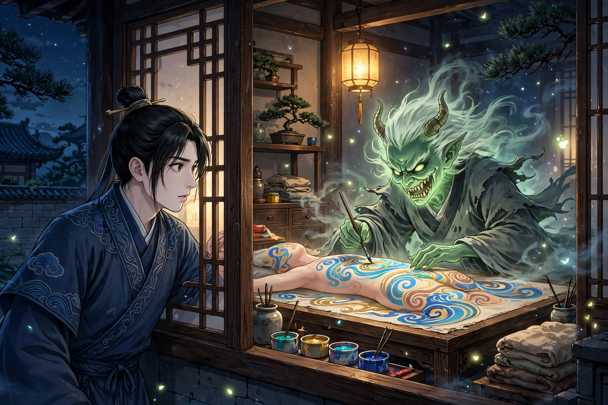

太原有个姓王的书生，清早出门，遇见一个年轻女子，抱着包袱独自赶路，走得很吃力。他急忙追上去，只见她十五六岁，容貌姝丽，心里不由爱慕起来。他问她为什么一大清早独自踽踽而行，她说赶路的人解不开愁忧，何必多问。他问她有什么愁忧，或许可以为她效力，她黯然说，父母贪图财物，把她卖给了富贵人家，正妻妒忌得很，早晚辱骂责打，实在忍受不了，只好远远逃走。他问她要去哪里，她说流亡的人哪里有定所。他说自己的住所不远，请她屈驾前往，她高兴地跟着他去了。他替她提着包袱，把她领回家。她见屋里没有别人，问他为什么没有家眷，他说这里只是书斋。她说这里很好，如果可怜她、让她活下去，须得秘密不泄露，他答应了，便和她同住，让她藏在密室里，过了几天也没有人知道。他悄悄告诉了妻子，妻子陈氏疑心她是富贵人家的妾，劝他打发她走，他不听。偶然到集市上，遇见一个道士，道士看着他很惊愕，问他遇见了什么，他说没有。道士说，你身上邪气萦绕，怎么说没有？他又极力辩白，道士这才离去。

道士说，惑乱啊，世上本来就有死期将到还不觉悟的人。王生觉得道士的话奇怪，颇有些怀疑那女子，转念一想，明明是个丽人，怎么会是妖？料想道士是借驱邪的名义来骗取吃食。不久，他到了书斋门前，门从里面闩着，进不去，心里疑心起来。于是翻过矮墙，见室门也关着，便踮着脚从窗户偷看，只见一个狰狞的鬼，面色翠绿，牙齿参差像锯子，把一张人皮铺在床上，拿着彩笔描绘。过了一会儿，鬼掷下笔，举起人皮像抖衣服一样，披在身上，就化成了女子。王生看到这情形，大为害怕，像野兽一样伏着爬了出来，急忙追赶道士，不知他往哪里去了，到处寻找，在野外遇见了他，长跪着乞求搭救。道士说，请把她驱除吧，这东西也很苦，好不容易才找到替身，我也不忍心伤她的性命。于是把蝇拂交给王生，叫他挂在寝门上，临别时约好在青帝庙相会。王生回去，不敢进书斋，就睡在内室，把拂子悬在门上。一更左右，听见门外有细碎的声响，自己不敢去看，叫妻子去看，只见那女子来了，望着拂子不敢进来，站着咬牙切齿，很久才离去。过了一会儿又回来，骂道，道士吓我！

难道吞进口的东西还要吐出来吗？她取下拂子打碎，破门而入，直接登上王生的床，剖开他的肚子，取出他的心脏离去。妻子大哭，婢女点烛进来一看，王生已经死了，陈氏惊骇得流泪不敢出声。第二天，叫弟弟二郎跑去告诉道士。道士怒道，我本来怜惜她，鬼子竟敢这样！就跟着二郎来了，那女子已经不知去向。过了一会儿，道士抬头四望，说，幸好逃得不远。问，南院是谁家？二郎说，是我住的地方。道士说，她现在就在你那里。二郎愕然，以为不会有。道士问，曾经有没有一个不认识的人来过？二郎说，我去青帝庙了，实在不知道，应当回去问问。去了不久回来，说，果然有，清早来了一个老妇人，想受雇在家里做工，家里人留住了她，现在还在。道士说，就是那个东西了。于是和他一起前去，仗着木剑，站在庭院中间，喊道，作孽的鬼，把我的拂子还来！老妇人在屋里，惊惶失色，出门想逃。道士追击她，老妇人倒下，人皮哗的一声脱落，化成了厉鬼，躺着像猪一样嚎叫。道士用木剑斩下她的头，她的身体变成浓烟，堆满了地面。

道士拿出一个葫芦，拔掉塞子，放在烟里，烟飗飗地像被口吸气一样，转瞬间烟都尽了，道士塞上塞子放进袋子里。大家一起看那张人皮，眉目手足，无不齐全。道士把它卷起来，像卷画轴一样，也放进袋子里，就要告别离去。陈氏在门口拜迎，哭着求使丈夫复活的办法。道士推辞说不能。陈氏更加悲伤，伏在地上不起。道士沉思说，我的法术浅薄，实在不能使死人复活，我指一个人给你，或许能够，前往求他必定有效。问，是什么人？道士说，市上有一个疯子，时常睡在粪土里，试着去叩拜哀求他，倘若他狂妄地侮辱夫人，夫人不要发怒。二郎也知道这个人，于是告别道士，和嫂子一起前去。只见乞人在路上颠狂地唱歌，鼻涕有三尺长，污秽得不能靠近。陈氏膝行着上前，乞人笑道，美人爱我吗？陈氏告诉他缘故，他又大笑道，人人都是丈夫，救活他做什么？陈氏再三哀求，他说，奇怪啊，人死了却来向我求活，我是阎摩吗！怒气冲冲地用杖打陈氏，陈氏忍痛承受。市上的人渐渐聚集得像墙一样。乞人咳出一把痰唾，举到陈氏口边说，吃下去。

陈氏满脸涨红，很为难。既想起道士的嘱咐，就勉强吞了下去，只觉得入喉的东西硬得像一团棉絮，格格地落下去，停结在胸间。乞人大笑道，美人爱我啊！就起身走了，不再理睬，跟踪他进了庙里，逼着求他，却不知他在哪里，前前后后暗中搜寻，全无踪兆，惭愧怨恨地回来了。既悲悼丈夫死得惨，又后悔吃了痰唾的羞耻，俯仰哀啼，只愿立刻死去。正要收拾血污敛尸，家人们远远望着，没有敢靠近的。陈氏抱着尸体收拾肠子，一边整理一边哭，哭到声音嘶哑，忽然想呕吐，只觉得胸膈里结着的东西猛地奔涌而出，来不及回头，已经落进了胸腔。惊讶地看时，原来是一颗人心，在胸腔里突突地跳动，热气蒸腾像烟一样。她大为惊异，急忙用两手合住胸腔，极力抱挤，稍一松懈，热气就氤氲地从缝里冒出来。于是撕开缯帛急忙束紧，用手抚摸尸体，渐渐有了温度，盖上被子。半夜打开看，已经有了鼻息，天明时竟然活了过来。他说起话来恍惚像做梦一样，只觉得心里隐隐作痛。看破裂的地方，痂结得像铜钱一样，不久就痊愈了。

异史氏说，愚蠢啊世人，明明是妖，却以为是美。迷惑啊愚人，明明是忠，却以为是妄。然而贪爱别人的美色而去捕捉的人，他的妻子也将要甘心吃别人的唾沫了。天道是报应循环的，只是愚昧而迷惑的人不觉悟，可悲啊！

