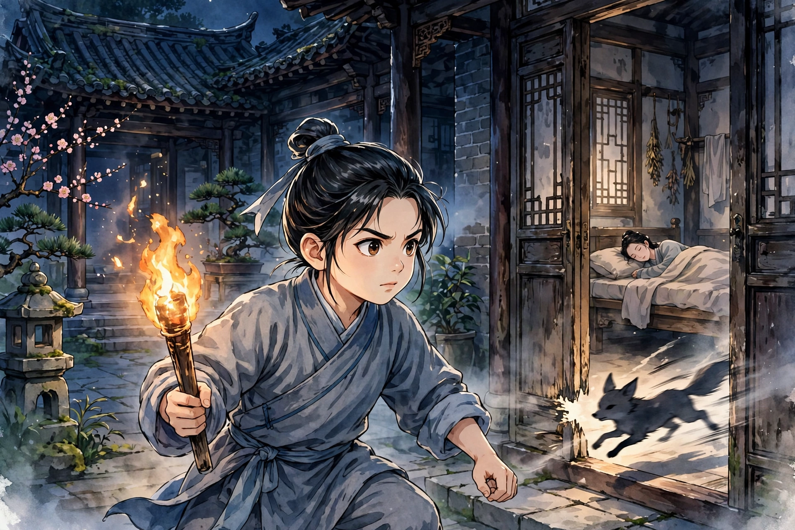

楚地有一位在外经商的人，妻子独自住在家里。一天夜里，她梦见有人与她亲近，醒来一摸，是个矮小的人。看他的情形，与常人不同，知道是狐狸。不久，狐狸下了床，门还没有开，就已经不见了。到了傍晚，妻子请做饭的老妇人来陪伴。她有个十岁的儿子，平常睡在另外的床上，也叫来一起住。夜深了，老妇人和儿子都睡着了，狐狸又来了。妻子喃喃地说着像梦话一样的话。老妇人醒来，呼唤她，狐狸就走了。从此，妻子的神情恍惚，像丢了魂一样。到了夜里，就不敢熄灯，还告诫儿子睡觉不要睡得太熟。夜深了，儿子和老妇人靠着墙打了个盹。醒来一看，妻子不见了，以为她是出去解手，等了很久还不回来，才起了疑心。老妇人害怕，不敢去找。儿子拿着火把到处照，到了另一间屋子，只见母亲赤身躺在里面。走近扶她，她也不害羞。从此她就发了狂，又唱又哭又叫又骂，一天里千奇百怪。夜里厌恶和人同住，另外给儿子安排了床，老妇人也被打发走了。儿子每当听见母亲说笑，就起来点灯。母亲反而生气地责骂儿子，儿子也不在意。后来她玩闹起来没有节制，整天学着小孩子的样子，用砖石垒在窗户上，劝阻也不听。有人拿掉一块石头，她就滚在地上娇声啼哭，没有人敢惹她。过了几天，两扇窗户全被堵死了，一点光亮也没有。接着她又用泥涂塞墙上的孔洞，整天忙个不停，一点也不觉得累。涂完了，没有事可做，就拿起厨刀霍霍地磨。见了她的人都厌恶她的顽劣，不把她当正常人看待。儿子在半夜把刀藏在怀里，用瓢盖住灯，等母亲说梦话，急忙点起灯，关上门大声喊叫。过了很久没有异样，才离开门口，扬言假装要搜查的样子。忽然有一个东西，像狸猫一样，猛地奔向门缝。儿子急忙击打它，只断了它约二寸长的尾巴，湿血还在滴。起初挑灯起来的时候，母亲就开口骂人，儿子装作没听见。击打没有击中，懊恨地睡下了。自己想，虽然没有立刻杀死它，也可以侥幸它不再来了。到了天明，看血迹越过墙去了。顺着血迹追踪，进了何家的园子。到了夜里果然不再来了，儿子暗暗高兴。只是母亲痴痴地躺着，像死了一样。不久，经商的人回来了，到床边问候。妻子谩骂他，把他当仇人看待。儿子把情形告诉了他。老翁吃惊，请了医生来医治。妻子把药泻出来，还开口骂人。于是暗地里把药放进汤水里混着给她喝，几天后渐渐安静下来。父子俩都很高兴，一天夜里睡醒，妻子又不见了，父子俩又在别室找到了她。从此她又发了狂，不愿意和丈夫同住一室。到了傍晚，竟然奔到别室去。拉她回来，骂得更厉害了。老翁没有办法，把别室的门全都锁上。妻子奔过去，门却自己打开了。老翁很忧虑，驱邪祈禳的办法都用尽了，一点效果也没有。儿子在傍晚悄悄进了何家的园子，伏在草丛里，打算探查狐狸的所在。月亮刚升起来，忽然听见有人说话。暗地里拨开蓬草，看见两个人来喝酒，一个长着长胡须的奴仆捧着酒壶，穿着老棕色的衣服。话都说得很细很隐约，不太能听清楚。过了一会儿，听见一个人说：“明天可以取一瓶白酒来。”不久，两人都走了，只有长胡须的独自留下，脱了衣服躺在石头上。仔细看他，四肢都像人，只是尾巴垂在后部。儿子想回去，又怕狐狸察觉，就整夜伏在那里。天还没亮，又听见两个人依次回来，低声说着话进了竹丛。儿子才回去。老翁问他去了哪里，回答说：“住在伯父家。”恰好跟着父亲进城，看见帽子铺挂着狐狸尾巴，请求老翁买下来。老翁不理他。儿子拉着父亲的衣服，娇声吵闹。老翁不忍心过分违拗他，就买了下来。父亲在市场里做买卖，儿子在旁边玩耍，趁着父亲回头不注意，偷了钱去，买了白酒，寄放在铺子的走廊里。有个舅舅住在城里，一向以打猎为业，儿子跑到他家。舅舅出门去了。舅母问起母亲的病，儿子回答说：“连日来稍微好些了。又因为老鼠咬坏了衣服，气得哭个不停，所以派我来讨猎药。”舅母打开柜子，拿出一点钱，包好交给儿子。儿子嫌少。舅母想做汤饼给儿子吃。儿子瞅着屋里没人，自己打开药包，偷偷抓了一大把藏在怀里。就赶去告诉舅母，叫她不要生火做饭，“父亲等在市场里，来不及吃饭。”于是走了，暗地里把药放进酒里。在市场里游逛，到了傍晚才回来。父亲问他去了哪里，托词说在舅舅家。儿子从此每天在市场店铺间游逛。一天，看见长胡须的混在人群里。儿子看准了，暗地里跟上他。渐渐和他说话，问他的住处。回答说：“北村。”他也问儿子，儿子假装说：“山洞。”长胡须的奇怪他住在山洞里。儿子笑着说：“我世代住在洞府里，你难道不是吗？”那人更加吃惊，就问他的姓氏。儿子说：“我是胡家的孩子。曾经在什么地方，看见你跟着两位郎君，难道忘了吗？”那人仔细打量他，半信半疑。儿子微微掀开下衣，稍稍露出假尾巴，说：“我们这一类混迹在人中间，只是这东西还在，实在可恨。”那人问：“在市场里想干什么？”儿子说：“父亲派我来买酒。”那人也说自己是来买酒的。儿子问：“买到了吗？”回答说：“我们大多贫穷，所以常常偷的时候多。”儿子说：“这差事也很辛苦，担惊受怕。”那人说：“受主人派遣，不得不这样。”于是问：“主人是谁？”回答说：“就是先前所见的两位郎君兄弟。一个私通北郭王家的妇人，一个住在东村某翁家里。翁家的儿子很可恶，被断了尾巴，十天才痊愈，现在又去了。”说完，想告别，说：“不要耽误我的事。”儿子说：“偷来难，不如买来容易。我先前买的寄放在走廊下，恭敬地送给你。我袋子里还有余钱，不愁买酒。”那人惭愧得无以回报。儿子说：“我本来是同类，何必吝惜这点东西？有空的时候，还应当和你痛饮一番。”就和他一起去，取了酒交给他，才回去。到了夜里，母亲竟然安安稳稳地睡着，不再奔出去了。儿子心里知道有异样，告诉父亲一起去查看，只见两只狐狸死在亭子上，一只狐狸死在草丛里，嘴里还不断有血流出来。酒瓶还在，拿起来摇一摇，还没有喝完。父亲惊讶地问：“为什么不早告诉我？”儿子说：“这东西最灵敏，一泄露，它就知道了。”老翁高兴地说：“我的儿子，是讨伐狐狸的陈平啊。”于是父子俩把狐狸扛了回去。看见一只狐狸秃了半条尾巴，刀痕清清楚楚。从此就安宁了。只是妻子消瘦得厉害，心智渐渐明白了，只是咳嗽加重，呕出几升痰，不久就死了。北郭王家的妇人，先前被狐狸作祟，到这时一问，狐狸绝迹了，病也就好了。老翁从此觉得儿子奇特，教他骑马射箭。后来他显贵到了总戎。

