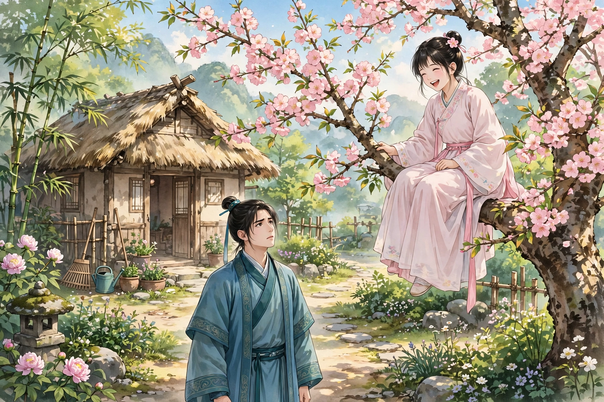

王子服是莒县罗店人，从小没了父亲。他十分聪明，十四岁就进了县学，母亲最疼爱他，平常不让他到郊野去游玩。他聘定了萧家的姑娘，还没出嫁就死了，所以一直没有娶妻。正赶上元宵节，舅舅家的儿子吴生邀他一同去看灯。刚到村外，舅舅家有个仆人来，把吴生叫走了。王子服见游玩的女子像云一样多，乘着兴致独自游逛。有个女郎带着丫鬟，拈着一枝梅花，容貌华美绝代，笑容可掬。王子服注视着她不移开眼睛，竟然忘了顾忌。女郎走过去几步，回头对丫鬟说：“这个郎君目光灼灼，像个贼！”把花丢在地上，笑着说话自去了。

王子服捡起花怅然若失，神魂都丢了，闷闷不乐地回了家。到家，把花藏在枕头底下，垂着头睡下。不说话也不吃饭。母亲为他担忧。祭祀禳灾越发厉害，他的肌肉皮肤迅速消瘦。医生诊视，开药发汗，他还是恍恍惚惚像迷了一样。母亲抚着他问是什么缘故，他默默不答。正好吴生来了，母亲嘱咐他暗中细问。吴生来到床前，王子服见了他才稍稍好些。吴生走到床边安慰开解，渐渐追问究竟。王子服全都吐露了实情，并且求他谋划。吴生笑着说：“你的心意也太痴了！这个愿望有什么难实现的？我替你去寻访。她徒步在野外，一定不是世家大族。如果还没有许配人家，事情本来就好办；即使不然，拼着用重金贿赂，计策一定能成功。只要你病好了，成事包在我身上。”王子服听了，不觉露出笑容。吴生出来告诉母亲，到处寻访女子的居处，可是附近寻访遍了，也没有一点踪迹。母亲大为担忧，没有办法可想。然而自从吴生走后，王子服的脸色顿时开朗，饭也略微吃得进去了。过了几天，吴生又来了。王子服问他谋划得怎样，吴生哄他说：“已经打听到了。我当是谁，原来是我姑母家的女儿，就是你姨妹一辈，如今还待字闺中。虽然是内亲，有婚姻的嫌忌，实在告诉他们，没有不成的。”王子服喜形于色，问：“住在什么地方？”吴生编造说：“西南山中，离这里大约三十多里。”王子服又再三嘱托，吴生挺身自任而去。

王子服从此饮食渐渐增加，一天天恢复。查看枕头底下，花虽然干枯了，却没有凋落。他凝神把玩，像见到了那个人一样。怪吴生一直不来，便写信招他。吴生推托着不肯应招。王子服恼怒起来，闷闷不乐。母亲担心他旧病复发，急忙为他议亲。略一商量，他就摇头不愿，只天天盼着吴生。吴生始终没有消息，他越发怨恨。转念一想：三十里并不远，何必仰仗别人？怀里揣着梅花，负气自己前去，家里人也不知道。孤零零独自走着，没有地方问路，只朝着南山走去。走了大约三十多里，只见乱山重叠，空翠清凉沁人肌肤，寂静得没有行人，只有鸟道。远远望见谷底，丛花乱树中间，隐隐约约有个小村落。下山进了村子，见房舍不多，都是茅屋，样子却很雅致。朝北的一家，门前都是垂柳，墙里桃花杏花格外繁茂，中间夹着修竹；野鸟在里面啁啾鸣叫。他猜想这是园亭，不敢贸然进去。回头看对门，有一块巨石光滑洁净，便坐在上面稍作休息。忽然听见墙里有个女子，大声喊着“小荣”，声音娇细。正在凝神听着的时候，一个女郎从东边往西边走，手里拿着一朵杏花，低头自己簪戴。抬头看见王子服，便不再簪了，含笑拈着花进去了。他仔细一看，正是元宵节路上遇见的女子。心里骤然欢喜。但想着没有进门的门路；想喊一声姨母，又顾虑从没有往来，怕有差错。门里没有人可以问。他坐着站着徘徊，从早上到太阳偏西，望眼欲穿，竟然忘了饥渴。不时看见女子露出半边脸来偷看，好像奇怪他还不走。忽然一个老妇人扶着拐杖出来，看着王子服说：“哪里来的郎君，听说从早上就来了，直到现在。想要干什么？莫非饿了吗？”王子服急忙起身作揖，回答说：“是来探亲的。”老妇人耳聋听不见。又大声说了。老妇人才问：“贵亲姓什么？”王子服答不上来。老妇人笑着说：“奇怪啊！连姓名都不知道，还有什么亲可探？我看郎君，也不过是个书呆子。不如跟我来，吃点粗粮，家里有张短床可以睡。等到明天回去，问清了姓氏，再来探访，也不晚。”王子服正饿着想吃东西，又可以从此渐渐接近美人，大喜。跟着老妇人进去，见门里用白石砌成路，夹道都是红花，片片落在台阶上；曲曲折折往西走，又打开一道门，豆棚花架满院子。恭敬地请客人进屋，只见粉壁明亮如镜；窗外的海棠枝条花朵，探进屋里；褥子几榻，没有不干净光洁的。刚坐下，就有人从窗外隐隐约约偷看。老妇人喊：“小荣！快去做黍饭。”外面有丫鬟高声答应。坐着的时候，一一陈述宗族世系。老妇人说：“郎君的外祖父，莫非姓吴？”王子服说：“是。”老妇人惊讶地说：“原来是我的外甥！你的母亲，是我的妹妹。近年来因为家境贫穷，又没有三尺高的男儿，于是音信隔绝。外甥长成这样了，还不相识。”王子服说：“这次来就是为了姨母，匆忙之间忘了姓氏。”老妇人说：“老身姓秦，并没有亲生儿女；仅存的一个弱女，也是庶出的。她的母亲改嫁了，留给我抚养。倒也不笨，只是缺少教训，嬉闹不知事理。过一会儿，叫她来拜见。”

不久，丫鬟端上饭来，菜肴丰盛。老妇人劝王子服吃完，丫鬟来收拾餐具。老妇人说：“叫宁姑来。”丫鬟答应着去了。过了很久，听见门外隐隐有笑声。老妇人又喊：“婴宁，你姨兄在这里。”门外嗤嗤地笑个不停。丫鬟推着她进来，她还掩着嘴，笑得止不住。老妇人瞪着眼睛说：“有客人在，吵吵闹闹，这是什么样子？”女子忍着笑站着，王子服向她作揖。老妇人说：“这是王郎，你姨母的儿子。一家人还不相识，真可笑。”王子服问：“妹妹今年几岁了？”老妇人没能理解。王子服又说了一遍，女子又笑得抬不起头。老妇人对王子服说：“我说她缺少教训，从这里就可以看出来了。年纪已经十六岁，呆痴得简直像婴儿一样。”王子服说：“比外甥小一岁。”老妇人说：“外甥已经十七岁了，莫非是庚午年属马的吗？”王子服点头答应。又问：“外甥的妻子是谁？”王子服回答：“还没有。”老妇人说：“像外甥这样的人才相貌，怎么十七岁了还没有订亲？婴宁也没有婆家，正相般配；可惜有内亲的嫌忌。”王子服没有说话，眼睛盯着婴宁，顾不上看别的。丫鬟对女子小声说：“目光灼灼，贼腔还没有改！”女子又大笑起来，回头对丫鬟说：“看看碧桃开了没有？”立刻站起来，用袖子掩着嘴，碎步连连地出去了。到了门外，笑声才放纵起来。老妇人也站起来，叫丫鬟铺被，给王子服安置住处。说：“外甥来一趟不容易，应该留三五天，慢慢送你回去。如果嫌幽静闷人，屋后有个小园，可以供你消遣；有书可以读。”第二天，到了屋后，果然有个半亩大的园子，细草像毡子一样铺着，杨花撒在小路上；有三间草屋，花木环绕着那个地方。穿花小步走着，听见树顶上有窸窸窣窣的声音，抬头一看，原来婴宁在树上。见王子服来了，她狂笑得几乎要掉下来。王子服说：“不要这样，会掉下来的！”女子一边下树一边笑，止不住自己。快到地面的时候，失手掉了下来，笑才停住。王子服扶住她，暗暗捏了一下她的手腕。女子又笑起来，靠着树不能走，好久才停下来。王子服等她的笑停歇了，才从袖子里拿出那枝花给她看。女子接过花，说：“枯了。留着它干什么？”王子服说：“这是元宵节妹妹遗下的，所以保存着。”女子问：“保存着是什么意思？”王子服说：“是表示相爱不忘。自从元宵节相遇，我思念成病，自料要化为异物；没想到能见到你的容颜，希望你垂怜。”女子说：“这是很小的事。至亲之间，有什么可吝惜的？等郎君走的时候，园子里的花，应当叫老仆来，折一大捆背着送你。”王子服说：“妹妹痴吗？”女子说：“怎么就是痴呢？”王子服说：“我不是爱花，是爱拈花的人。”女子说：“葭莩之情，爱还用说吗。”王子服说：“我说的爱，不是亲戚之间的爱，而是夫妻之爱。”女子说：“有什么不同吗？”王子服说：“夜里共枕同席罢了。”女子低头想了很久，说：“我不习惯和生人睡在一起。”话还没有说完，丫鬟悄悄到了，王子服惶恐地跑开了。一会儿，在老妇人那里会合。老妇人问：“到哪里去了？”女子回答说在园子里说话。老妇人说：“饭熟了很久了，有什么长话，周遮到这种地步。”女子说：“大哥想要我和他同睡。”话还没有说完，王子服大为窘迫，急忙瞪着眼睛看她。女子微微笑着停住了。幸亏老妇人没有听见，还絮絮叨叨地追问。王子服急忙用别的话掩饰过去，并且小声责备女子。女子说：“刚才这话不应该说吗？”王子服说：“这是背着人的话。”女子说：“背着别人，难道还能背着老母亲吗？再说睡觉也是常事，有什么可避讳的？”王子服恨她痴呆，没有办法可以开导她。饭刚吃完，家里人带着双卫来找王子服了。

先前，母亲等王子服久久不回来，开始怀疑；在村里搜寻了几遍，竟然没有踪迹。于是去问吴生。吴生想起从前说过的话，就教他们到西南山村去寻找。经历了好几个村子，才到这里。王子服出门，正好相遇，便进去告诉老妇人，并且请她让女子一同回去。老妇人高兴地说：“我有这个心愿，不是朝夕之间的事了。只是残年之躯不能远行，能让外甥带着妹妹去，认一认姨母，太好了！”她喊婴宁。婴宁笑着来了。老妇人说：“有什么喜事，笑个不停？要是不笑，就该是个完人了。”又用目光责备她。接着说：“大哥想带你一同去，可以收拾行装。”又拿酒食款待家里来的人，才送他们出去说：“姨母家田产丰厚，能养活闲人。到了那里暂且不要回来，小小地学一点诗礼，也是讨好翁姑的好事。就烦请姨母，为你择一个好配偶。”两个人于是出发。到了山坳，回头看，还隐约看见老妇人倚着门向北张望。

回到家，母亲看见美貌的女子，吃惊地问是谁。王子服用姨母的女儿来回答。母亲说：“先前吴郎和你说的话，是骗人的。我没有姐姐，哪里来的外甥？”问女子，女子说：“我不是母亲生的。父亲姓秦，去世的时候，我还在襁褓里，不能记得。”母亲说：“我有一个姐姐嫁给秦家，确实不错，可是已经去世很久了，怎么能又活着？”于是仔细询问面貌、痣赘，一一都符合。又怀疑说：“是这样了。可是已经去世多年，怎么能还活着？”正在疑虑的时候，吴生来了，女子避进屋里。吴生问清了缘故，怅然了很久。忽然说：“这个女子名叫婴宁吗？”王子服说是。吴生急忙称这是怪事。问他怎么知道，吴生说：“秦家姑母去世之后，姑父独居，被狐狸迷惑，病瘦而死。狐狸生了个女儿名叫婴宁，裹在襁褓里睡在床上，家里人都看见过。姑父死后，狐狸还时常来；后来求了天师的符贴在墙上，狐狸就带着女儿走了。莫非就是她吗？”大家彼此疑虑参半。只听见屋里吃吃地笑，都是婴宁的笑声。母亲说：“这个女子也太天真烂漫了。”吴生请求见她一面。母亲进屋，女子还大笑着不理睬。母亲催她出来，她才极力忍着笑，又对着墙壁站了一会儿，才出来。刚一拜见，忽然又跑进去，放声大笑。满屋的妇女，都为之粲然一笑。吴生请求前往察看她的异处，顺便做媒。找到村子那里，房屋全都没有了，只剩下山花零落。吴生想起姑母埋葬的地方，仿佛不远；可是坟墓湮没了，没法辨认，惊叹着回来了。母亲怀疑她是鬼。进去告诉吴生的话，女子一点也没有惊骇的意思；又同情她没有家，也全然没有悲伤的意思，只是一味天真地笑着。大家都摸不透她。母亲叫她和少女们一同睡。每天天刚亮她就来问安，做女红精巧绝伦。只是爱笑，禁止也止不住；可是笑起来嫣然动人，狂放却不损伤她的妩媚，人人都喜欢她。邻家的女子和少妇，都争着迎接她。母亲选了吉日准备为他们成婚，可是终究怕她是鬼物。悄悄在日光下偷看她，形影一点也没有异常。到了成婚那天，叫她穿着华美的衣服行新妇的礼；女子笑得厉害，不能俯仰，只好作罢。王子服因为她天真痴呆，怕她泄露房中的私事；可是女子却十分守密，不肯说一句话。每当母亲忧愁发怒，女子一到，一笑就化解了。奴婢犯了小过错，怕遭到鞭打，就请求去母亲那里说话；有罪的婢女投奔见她，常常能免罪。而她爱花成癖，到处向亲戚搜罗花种；偷偷典当了金钗，购买好花种，几个月下来，台阶石缝、篱笆厕所旁边，没有一处不是花。

屋后有一架木香花，本来是西边邻居家的。女子常常攀登上去，摘下来供簪戴玩赏。母亲有时看见，就呵斥她。女子始终不改。一天，西边人家的儿子看见她，凝视得倾倒。女子不回避反而笑。西边人家的儿子以为女子的心意已经属于自己，心里更加放荡。女子指着墙底笑着下来，西边人家的儿子以为这是约定的地方，非常高兴。到了黄昏他前去，女子果然在那里。他走近想要亲近，只觉得下身像锥子刺一样，痛彻心扉，大叫一声倒下了。仔细一看不是女子，而是一根枯木躺在墙边，他碰到的原来是水淋出来的窟窿。邻居的父亲听见声音，急忙跑来追问，他呻吟着不说话。妻子来了，他才把实情告诉她。点火照着窟窿，看见里面有一只大蝎子，像小螃蟹一样。老翁打碎木头捉住杀了它。背着儿子回到家里，半夜里儿子就死了。邻居告了王子服，揭发婴宁的妖异。县令素来敬仰王子服的才华，深知他是笃行之士，认为邻居老翁的控告是诬告，将要杖责他。王子服为他求情，才放他出来。母亲对女子说：“天真狂放到了这种地步，早知道过分的喜乐会潜伏着忧患。县令英明，幸好没有牵连；假如遇到糊涂的官长，一定会逮捕妇女到公堂上对质，我儿有什么脸面见亲戚？”女子神色严肃，发誓不再笑。母亲说：“人没有不笑的，只是笑要有时。”可是女子从此竟然不再笑了，即使故意逗她，也终究不笑；然而整天也未尝有忧愁的神色。

一天夜里，女子对着王子服流泪。王子服觉得奇怪，女子哽咽着说：“从前因为相从的日子还浅，说出来恐怕会让你们惊怪。今天看姑母和郎君，都是过分疼爱、没有异心，直说出来大概也没有妨碍吧？我本来是狐狸所生。母亲临走的时候，把我托付给鬼母，相依十多年，才有今天。我又没有兄弟，所依靠的只有郎君。老母亲孤寂地住在山里，没有人怜惜而把她合葬，九泉之下常常为此悲恨。郎君如果不惜花费，使地下的人消除这份怨恨，那么养育女儿的人也就不妨弃置不管了。”王子服答应了她，可是担心坟墓迷失在荒草里。女子只说不用担心。到了约定的日子，夫妻俩抬着棺材前去。女子在荒烟杂草丛生的地方，指明墓处，果然找到了老妇人的尸体，皮肤还保存着。女子抚着尸体痛哭哀伤。抬回来，找到秦家的墓合葬了。当天夜里，王子服梦见老妇人来称谢，醒来告诉女子。女子说：“我夜里见过她，她嘱咐不要惊动郎君。”王子服恨自己没有留住她。女子说：“她是鬼。生人多了，阳气旺盛，怎么能久留？”王子服问小荣，女子说：“她也是狐狸，最狡黠。狐母留下她照看我，常常拿食物来喂我，所以她的恩德我常常不忘。昨天问母亲，说她已经嫁人了。”从此每逢寒食，夫妻俩登上秦家的墓，拜扫没有缺过。女子过了一年生了一个儿子。儿子在怀抱里，不怕生人，见了人就笑，也很有母亲的风范。

异史氏说：“看她孜孜地天真发笑，好像全然没有心肝一样；可是墙下的恶作剧，她的狡黠有谁比得上呢。到了凄切地眷恋鬼母，由笑转为哭，我的婴宁大概是把真情隐藏在笑里了。我私下听说山中有一种草，名叫‘笑矣乎’。闻了它，就会笑个不停。房里种上这一种，那么合欢草、忘忧草，都没有颜色了。如果是能解语的花，倒嫌它做作了。”
