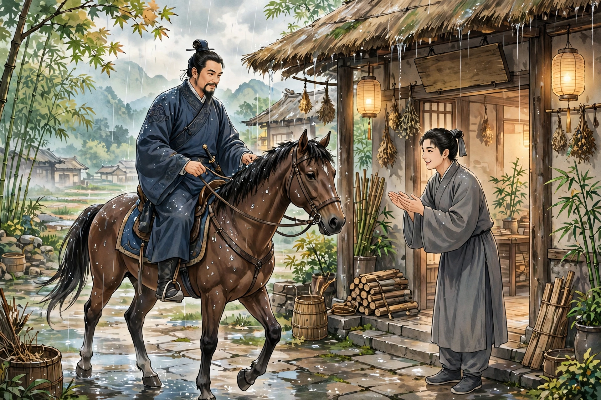

丁前溪是诸城人，家里很有钱粮。他为人游侠好义，仰慕郭解那样的人。御史到行台巡查访察他，丁前溪便逃走了。他到了安丘，遇到下雨，便到旅店里避雨。雨下了一整天都不停。有一个少年过来，招待得十分丰盛。到了黄昏，丁前溪就住在他家里；少年用切碎的豆子喂牲口，给丁前溪的饮食也供应得十分周到。丁前溪问少年的姓字，少年说：“主人姓杨，我是他的内侄。主人喜欢交游，正好出门在外，家里只有娘子在。家里贫穷，不能丰厚地招待客人，还请您体谅。”丁前溪问主人是做什么营生的，少年说家里没有资产，只不过每天设赌场，来谋取一点升斗之利。第二天，雨还是不停，供给也没有松懈。到了傍晚，少年铡草，草捆都是湿的，而且长短很不整齐。丁前溪觉得奇怪。少年说：“实话告诉客人：家里贫穷，没有东西喂牲口，刚才娘子把屋上的茅草撤下来了。”丁前溪更加惊异，以为他们这样做是想得到报酬。天亮后，他拿出金子付给少年，少年不接受；他硬要付，少年才拿了进去。过了一会儿，少年又拿出来还给客人，说：“娘子说：我不是靠这个谋生猎食的人。主人在外面，常常好几天不带一文钱；客人到了我家，怎么能向客人索要报酬呢？”丁前溪赞叹着告别了，嘱咐说：“我是诸城的丁某，主人回来后，请告诉他。有空的时候，希望他来见见我。”

好几年都没有音讯。恰逢年成大饥荒，杨家困顿得很，没有办法可想。妻子随便劝他去投奔丁前溪，杨便听从了。他到了诸城，向守门的人通报了姓名。丁前溪起初茫然记不起来，杨再一说明，才想起来。丁前溪穿上华美的鞋子出来，揖请客人进去。见杨衣衫破烂、鞋后跟都裂开了，便让他住在暖室里，设筵席款待他，礼遇格外隆重。第二天，丁前溪为他制作了冠服，里外都很温暖。杨感念他的义气；可是回想家里的情形，心里更加忧愁，狭隘的心思不免又有一点盼望。住了几天，丁前溪始终不提送别赠礼的事。杨心里十分着急，告诉丁前溪说：“实在不敢隐瞒：我来的时候，家里连一升米都不满。如今蒙您这样周济，固然高兴；可是妻子儿女该怎么办呢！”丁前溪说：“这个不用烦虑，我已经代为料理了。还请您放宽心思多留几天，我当资助您路费。”丁前溪派人去招来许多赌徒，让杨坐着收取赌场的抽头，整整一夜得了百金，才送他回去。杨回到家里，看见妻子衣履鲜明整齐，还有一个小婢女侍候着，大吃一惊，问是怎么回事。妻子说：“自从你走后，第二天就有一队车马送来布帛和粮食，堆满了屋子，说是丁客人所赠送的。还有一个十指灵巧的婢女，供我驱使。”杨感动得不能自已。从此家境小康，不再做旧日的营生了。

异史氏说：“贫穷而好客，嗜酒赌博、漂泊无定的人最能做到；最奇特的，唯独是他的妻子。受了别人的施惠而不报答，那还算人吗？然而一顿饭的恩德都不忘记，丁前溪就有这样的品格。”
