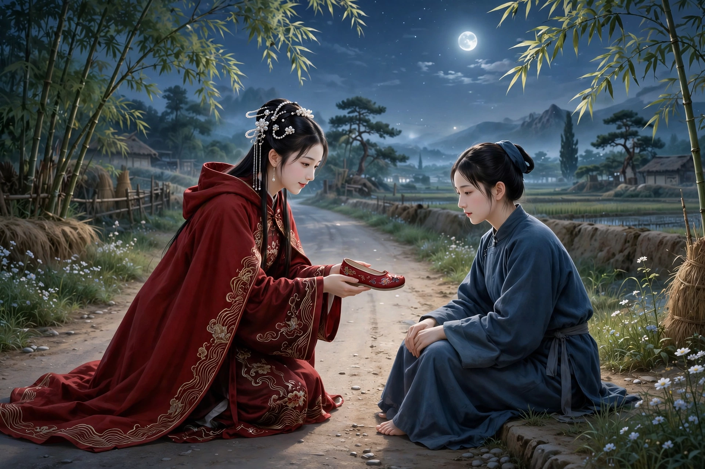
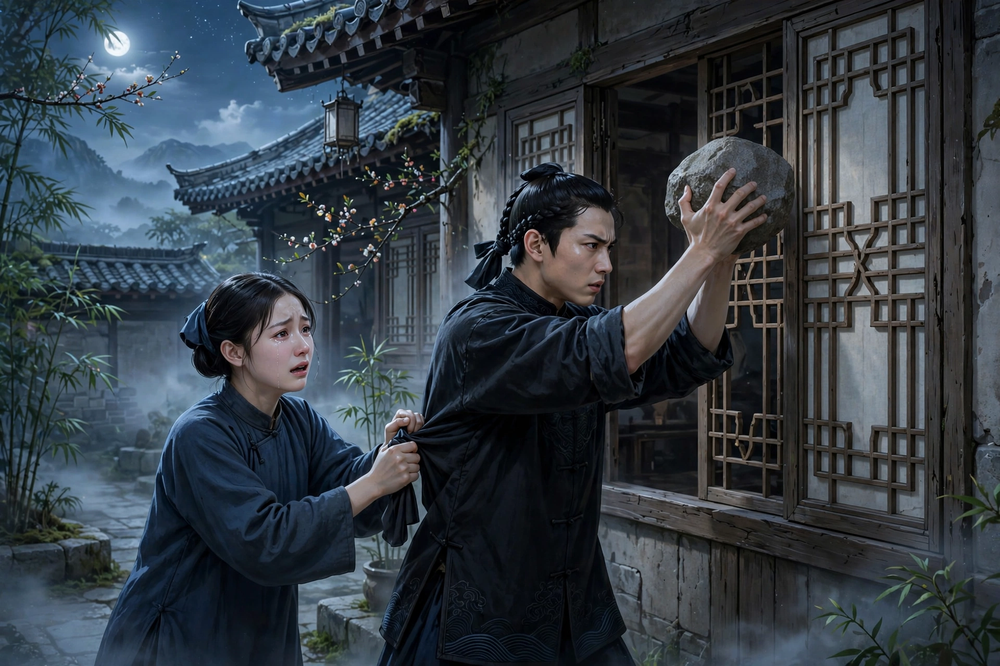
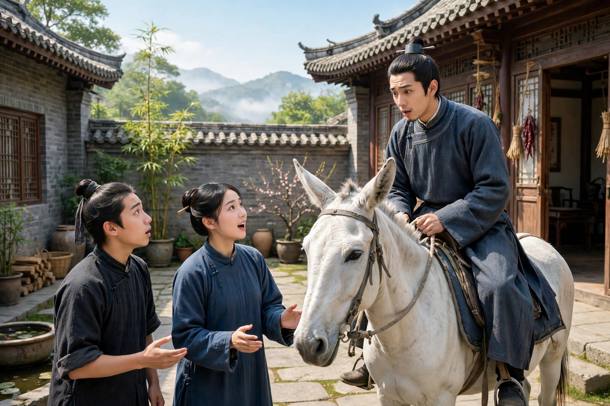

凤阳有一个读书人，背着书箱远出求学。他对妻子说：“半年就回来。”过了十多个月，竟然一点音信也没有。妻子翘首盼望，心情十分迫切。一天夜里，妻子刚躺下，月光透过纱窗摇动着影子，离别的思念萦绕在心头。她正翻来覆去睡不着，忽然有一个美丽的女子，头戴珠饰、身披红色披帛，掀开帷帐走了进来，笑着问：“姐姐，你难道不想见郎君吗？”妻子急忙起身答应她。丽人邀请她一同前去，妻子害怕路远难行。丽人只请她不要顾虑，就拉着妻子的手出门，一起踏着月色走去，约走了一箭远的路程。妻子觉得丽人走得迅速，自己步履艰难，便叫丽人稍等一下，自己正要回去穿上厚底鞋。丽人拉着她坐在路边，自己握住她的脚，脱下自己的鞋借给她穿。妻子高兴地穿上，幸好大小正合适。她重新起身跟着走，健步如飞。不一会儿，看见士人骑着白骡走来。士人看见妻子大吃一惊，急忙下骡，问：“你要去哪里？”妻子说：“是来探望你的。”士人又回头问丽人是谁。妻子还没来得及回答，丽人掩口笑着说：“先不要问讯。娘子一路奔波不容易；郎君半夜里星夜赶路，人和牲口想必都累坏了。我的家不远，请先停下来休息，天亮了再走，也不晚。”

回头看几步之外，就有一处村落，于是三人一同走去，进了一座庭院。丽人催促睡着的婢女起来招待客人，说：“今夜月色明亮，不必点烛，小台石榻可以坐。”士人把骡子拴在檐前的柱子上，就坐了下来。丽人说：“鞋子太大，不合你的脚，路上走着很累赘吧？回去时有代步的牲口，请把鞋还给我吧。”妻子道谢，把鞋还给了她。不一会儿，摆上了酒和果品，丽人斟酒说：“鸾凤久别，团圆就在今夜；一杯浊酒，敬祝贺喜。”士人也举杯酬答，主客谈笑，鞋子交错相碰。士人注视着丽人，多次用轻浮的话挑逗她，夫妻刚刚相聚，却连一句寒暄的话也没有说。丽人也目光流转、含情脉脉，说着迷惑人的隐语。妻子只默默坐着，假装成愚笨的人。过了一会儿渐渐喝醉了，两人的话越来越亲昵。又用大酒杯劝客人喝，士人以喝醉推辞，丽人劝得越发厉害。士人笑着说：“你为我唱一支曲子，我就喝。”丽人不推辞，就用牙板拨动提琴唱道：“黄昏卸得残妆罢，窗外西风冷透纱。听蕉声，一阵一阵细雨下，何处与人闲嗑牙。望穿秋水，不见还家，潸潸泪似麻。又是想他，又是恨他。手拿着红绣鞋儿占鬼卦。”唱完，笑着说：“这是市井里巷的歌谣，不值得污了您的耳朵。只是因为流俗都喜欢，才姑且学着唱罢了。”歌声柔媚，风度轻佻。

士人被迷惑得几乎不能自持。过了一会儿，丽人假装睡意，离开席位，士人也起身，跟着她走了。过了很久还不回来，婢女疲倦了，趴在廊下睡着。妻子独自坐着，孤零零没有伴侣，心里愤恨，很难忍受，想要逃回去，可是夜色迷茫，记不得道路，辗转没有办法自己作主，于是起身偷看，刚走到窗边，就听见断断续续的云雨之声，隐约可以听见。又听下去，听见丈夫把平时和自己亲昵的情形，尽情地向丽人倾吐。妻子到了这一步，手颤抖、心摇动，几乎无法忍受，想着不如出门投进沟壑死去。她愤然正要走，看见弟弟三郎骑马来到，急忙下马询问，妻子把事情全都告诉了他。三郎大怒，立刻带着姐姐回去，直接走进那家，只见房门紧闭，枕边的话还低声细语。三郎举起像斗一样大的巨石，抛向窗棂，三五下就打碎了。里面大声喊道：“郎君的脑袋破了，怎么办？”妻子听了，愕然大哭，对弟弟说：“我不是谋划和你杀死郎君，现在该怎么办？”三郎睁大眼睛说：“你呜呜地催我来，才消了这心里的气，你又护着男人，埋怨弟兄，我不惯受婢女的指使。”转身要走，妻子拉住他的衣服说：“你不带我走，我要去哪里？”三郎把姐姐推倒在地，脱身离去。妻子猛然惊醒，才知道这是一场梦。

第二天，士人果然回来了，骑着白骡。妻子感到奇怪，却没有说出来。当夜士人也做了一个梦，他把所见所遭述说出来，和妻子的梦完全相符，两人互相惊讶奇怪。不久，三郎听说姐夫远归，也来探望。谈话间，三郎对士人说：“昨天夜里梦见你回来，今天果然回来了，也很奇怪。”士人笑着说：“幸好没有被巨石打死。”三郎愕然问起缘故，士人把梦告诉他，三郎十分惊异。原来那天夜里三郎也梦见姐姐哭诉，愤激之下投掷了石头。三个人的梦互相符合，只不知道丽人是什么人罢了。

