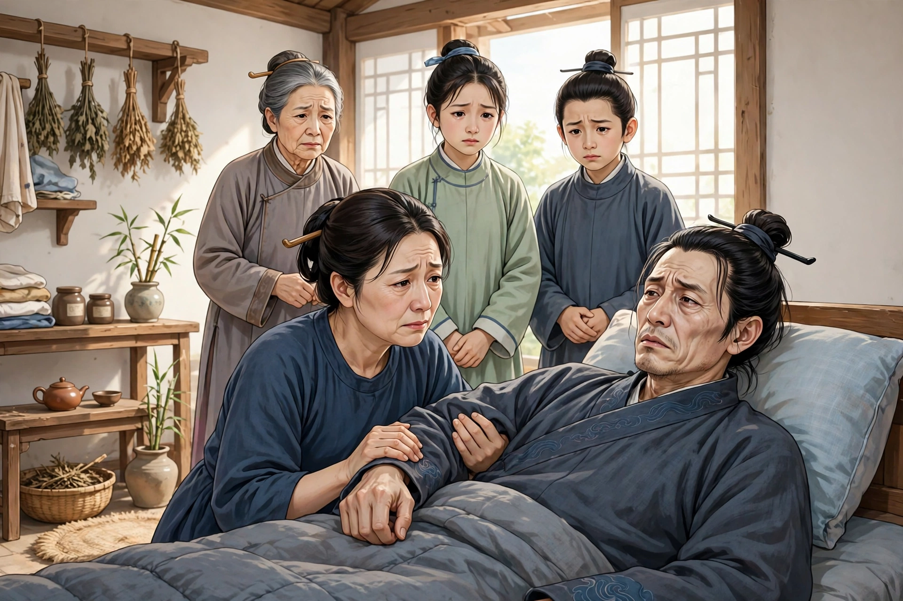
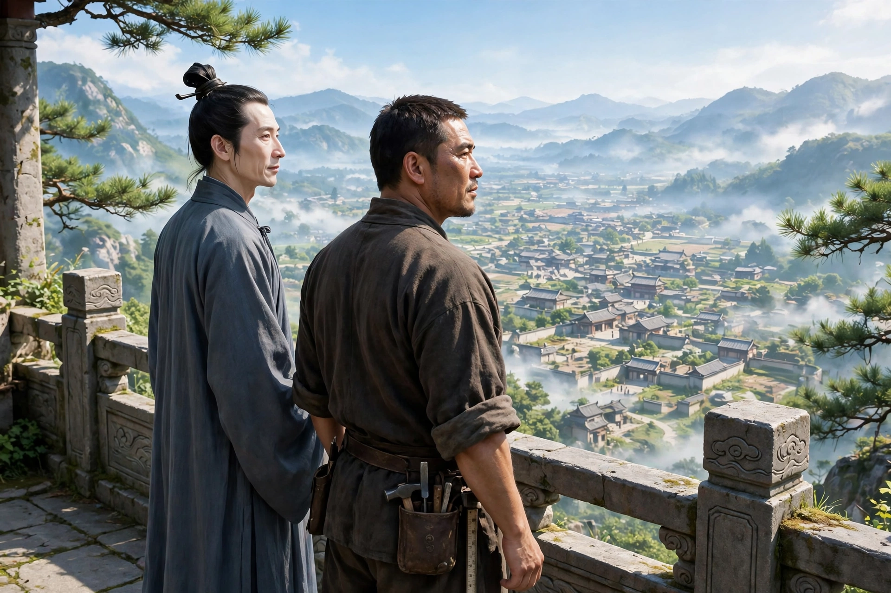

新城人耿十八，病得十分危重，自己知道好不了了，对妻子说：“永别就在早晚之间了。我死之后，你是守节还是改嫁，都由你自己，请你说出你的心意。”妻子默默不说话。耿十八再三追问她，还说：“守节固然好，改嫁也是人之常情，把话说明白了，又有什么妨碍！我就要和你诀别了，你守节，我心里安慰；你改嫁，我的心意也就断了。”妻子这才神色凄惨地说：“家里连一石粮食都没有，你在世的时候还不够用，我拿什么来守节呢？”耿十八听了，立刻一把抓住妻子的手臂，发出含恨的声音说：“你真忍心啊！”话说完就死了。他的手紧紧握着，掰不开。妻子大声号哭。家人赶来，两个人掰他的手指，用力掰开，才松开了。

耿十八自己不知道自己已经死了，走出门，看见十多辆小车，每辆车上各有十个人，就用一方纸写上名字，粘贴在车上。赶车的人看见耿十八，催他上车。耿十八看车里已经有九个人，加上自己正好十个。再看粘贴的名单上，自己的名字排在最后。车子行走时咋咋作响，声音震得耳朵发响，他也不知道要往哪里去。不一会儿到了一处地方，听见有人说：“这是思乡地。”听见这个名字，他起了疑心。又听见赶车的人私下里说：“今天要割三个人。”耿十八又吓了一跳。等到细细听他们的话，全是阴间的事。这才自己醒悟说：“我难道不是已经成了鬼吗？”一下子想到家里，再没有什么可以牵挂的，只有一个年老的母亲，妻子改嫁之后，就没有人奉养她了；想到这里，不觉泪流满面。又过了一会儿，看见有一座高台，高有几仞，来往游玩的人很多；那些头上套着袋子、脚上戴着刑具的人，哭哭啼啼地上上下下，听人说是“望乡台”。众人到了这里，都从车辕上踏下来，纷纷争着登台。赶车的人有的鞭打他们，有的拦住他们，唯独到了耿十八跟前，却催他登台。登了几十级台阶，才到台顶。抬头一望，家里的门庭院落，清清楚楚地出现在眼前。只是内室隐隐约约，像笼罩在烟雾里。他凄惨悲伤，不能自已。回过头来，看见一个穿短衣的人站在他肩膀下面，就向他询问姓名。耿十八把自己的姓名告诉了他。那个人也自己说他是东海的匠人。看见耿十八流泪，问：“有什么事放不下呢？”耿十八又告诉了他。匠人谋划着和他一起跳下高台逃走。耿十八害怕阴间追捕，匠人坚决说不要紧。耿十八又担心台太高，跳下去会摔伤，匠人只叫他跟着自己。于是匠人先跳下去，耿十八果然跟着跳了下去。到了地上，竟然安然无恙。两人高兴没有人察觉。看他们乘坐的车子，还停在台下。两人急忙奔跑，跑了几步，耿十八忽然想到自己的名字还粘在车上，恐怕免不了按名字追捕；于是转身靠近车子，用手指沾上唾沫，涂掉了自己的名字，这才又跑起来，张着嘴喘着粗气，不敢稍稍停下。过了一会儿，进了里巷的门，匠人把他送到他的屋子里。耿十八猛然看见自己的尸体，醒过来苏活了。

他觉得疲乏，又烦躁口渴，突然喊着要水。家人大吃一惊，给他水喝，他喝了一石多，才突然站起来，做出作揖拜谢的样子；接着出门拱手道谢，才回来。回来之后就僵卧不动了。家人因为他的举动异常，怀疑他不是真的活了过来；然而渐渐观察他，却没有什么别的异常。慢慢地走近问他，他才清清楚楚地讲了事情的原委。问：“出门是为什么？”他说：“是去送别匠人。”“喝水为什么那么多？”他说：“开头是为我自己喝的，后来是匠人喝的。”给他汤羹调养，几天之后病就好了。从此他就嫌弃妻子，不再和她同床共枕了。
