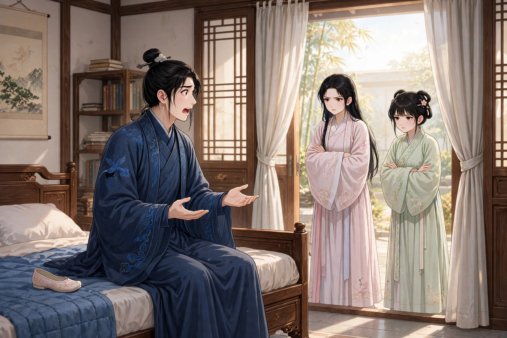
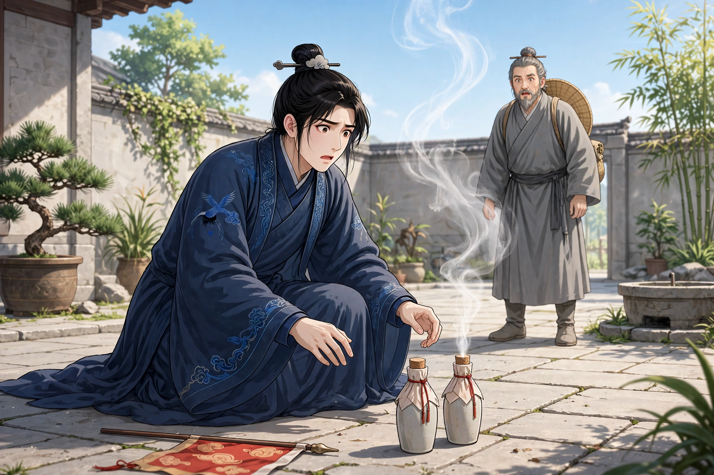

尚生是泰山人，独自住在一间清静的书房里。恰逢一个秋夜，银河高高地挂在天上，明月当空，他在花荫下徘徊，心里生出许多遥远的遐想。忽然一个女子翻墙进来，笑着说：“秀才想什么想得这么深？”尚生走近一看，她容貌华美，简直像仙女一样。他又惊又喜，把她拥进屋里，两人亲热到了极点。她自称姓胡，名叫三姐。问她住在哪里，她只是笑而不说。尚生也就不再追问，只和她约定永远相好。从此夜夜相会，没有一夜空过。一夜，两人并膝坐在灯下，尚生爱她爱得目不转睛。女子笑着说：“你这样直勾勾地看着我做什么？”他说：“我看你就像红叶碧桃一样，哪怕看一整夜也不会厌倦。”三姐说：“我这样粗陋的姿色，竟然蒙你这样青眼相看，要是见了我家四妹，不知会把你迷成什么样子。”尚生更加心动，恨不得立刻见一见四妹的容貌，长跪着苦苦哀求。

第二天晚上，三姐果然带着四姐来了。四姐年纪刚到十五岁，像沾着露水的荷花粉嫩，像笼在烟雾里的杏花润泽，嫣然含笑，妩媚美丽到了极点。尚生狂喜，把她引进来坐下。三姐和尚生一起说笑，四姐只是用手牵着绣带，低着头不说话。不久三姐起身告辞，妹妹想跟着走，尚生拉住她不放，回头对三姐说：“请你帮我说一句话。”三姐就笑着说：“狂郎真是心急啊！妹妹就为你多留一会儿吧。”四姐没有说话，姐姐就走了。两人亲密欢好，之后四姐把手臂当作枕头，彼此倾吐生平，再也没有隐瞒。四姐自称是狐狸，尚生因为依恋她的美貌，也并不觉得奇怪。四姐于是说：“我姐姐狠毒，已经害死了三个人，被她迷惑的人没有不死的。你这样疼爱我，我不忍心看着你灭亡，应当早早和她断绝。”尚生害怕了，问她该怎么办。四姐说：“我虽然是狐狸，却得到了仙人的正法，可以写一道符贴在卧室门上，就能把她挡回去。”于是写了符。到了天亮，三姐来了，看见符就退了回去，说：“这丫头忘恩负义，只顾着新郎，不记得是谁牵的线了。你们两人合该有前世的缘分，我也不和你们结仇，但何必这样呢？”说完径直走了。过了几天，四姐到别处去了，约定隔一天再来。

这一天，尚生偶然出门眺望，山下本来有一片槲树林，苍茫之中走出一个少妇，也颇有风韵。她走近对尚生说：“秀才何必天天这样恋着胡家姊妹？她们又不能给你一文钱。”随即拿一贯钱交给尚生，说：“你先拿回去买好酒，我随后带着小菜来，和你欢聚。”尚生怀揣着钱回去，果然照她说的做了。过了一会儿，妇人果然来了，在桌上摆上烧鸡、咸猪肩各一份，随即抽出小刀，把肉细细切成小块。斟酒调笑，欢洽异常。接着吹灭蜡烛上床，亲热放纵得很。天亮才起来，正坐在床头，提着脚换鞋，忽然听见有人声。仔细听时，人已经进了帷幕，原来是胡家姊妹。妇人乍一看见，仓皇逃走，把鞋子遗落在床上。两个女子于是喝斥说：“骚狐！怎么敢和人同床共寝！”追了出去，过了一会儿才回来。四姐埋怨尚生说：“你太不长进了，和骚狐配成一对，我不能再亲近你了！”于是气冲冲地要走。尚生惶恐地扑上前去，用恳切的话哀求；三姐在旁边替他解围，四姐的怒气才稍稍平息，从此又和从前一样相好。

有一天，一个陕西人骑着驴来到门前，说：“我寻找妖物，已经不是一天两天了，到今天才找到。”尚生的父亲觉得他的话奇异，问他从哪里来。他说：“我平日漂泊在江湖上，游走四方，一年十二个月，常常有八九个月离家在外，被妖物害死了我的弟弟。回来后非常悲恨，发誓一定要找到妖物，把它消灭。奔波了几千里，一直没有踪迹，如今妖物就在你家。不除掉它，还会有人步我弟弟的后尘死去。”当时尚生和女子来往亲密，父母已经微微察觉，听了客人的话非常害怕，就请他进来作法。客人拿出两个瓶子，摆在地上，念了很久符咒，有四团黑雾，分别投进瓶子里。客人高兴地说：“全家都到了。”于是用猪膀胱包住瓶口，封得非常牢固。尚生的父亲也很高兴，坚决留客人吃饭。尚生心里恻然，走近瓶子偷听，听见四姐在瓶子里说：“坐视不救，你怎么这样负心？”尚生心里感动，急忙想打开封口，可是绳结解不开。四姐又说：“不用这样！只要把祭坛上的旗子放倒，用针把猪膀胱刺出一个孔，我就能出来了。”尚生照她的话做了，果然看见一丝白气从孔里出来，冲上云霄而去。客人出来，看见旗子倒在地上，大惊说：“逃走了！这一定是公子做的。”摇着瓶子俯耳听了听，说：“幸好只跑了一个。这东西命中不该死，还可以饶恕。”于是带着瓶子告辞走了。

后来，尚生在田野里监督雇工割麦，远远看见四姐坐在树下。尚生走近她，拉着她的手问候。四姐说：“分别以后，十年过去了，如今我的大丹已经炼成。只是思念你的念头没有忘记，所以再来拜问一次。”尚生想请她一起回去。女子说：“我如今已不是从前，不能再沾染尘世的情缘，以后还会再见的。”话说完，就不知去向了。又过了二十多年，尚生恰好独自居住，看见四姐从外面来了，尚生高兴地和她说话。女子说：“我如今已经名列仙籍，不应当再踏入尘世。只是感念你的情义，特地来告诉你去世的日期。你可以早早安排后事，也不要悲伤。我会度你成为鬼仙，也不会受苦。”说完告辞而去。到了那一天，尚生果然去世了。尚生是友人李文玉的亲戚好友，李文玉曾经亲眼见过他。
