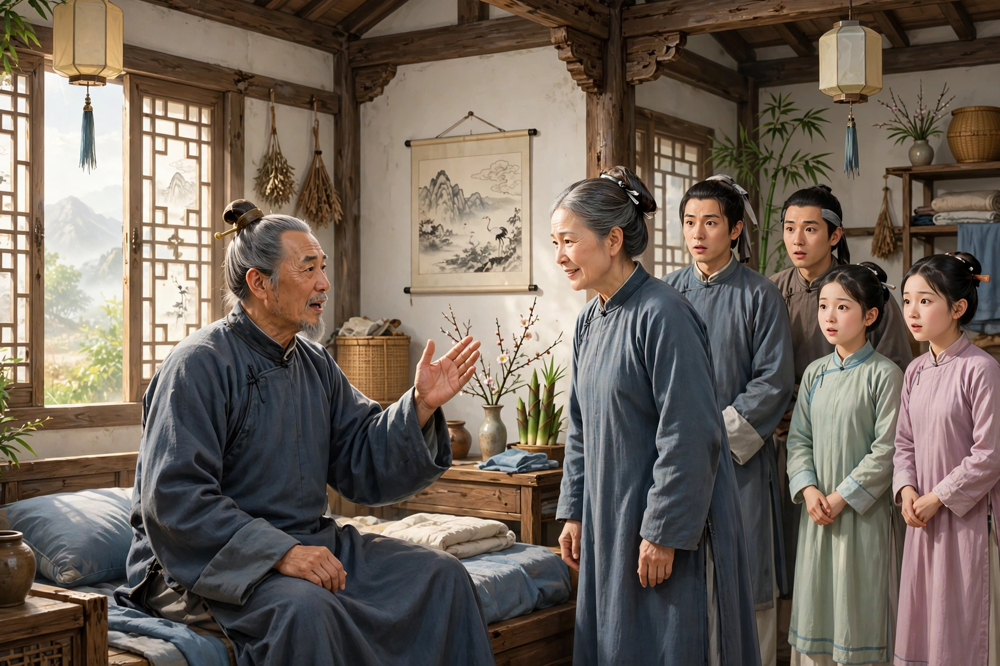
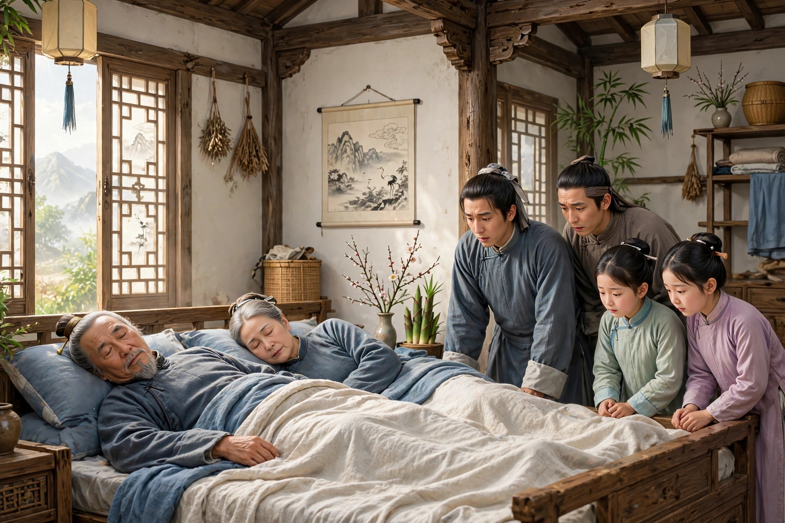

济阳祝村有个姓祝的老头儿，年过五十，因病去世了。家人走进屋里，正给他料理丧服，忽然听见老头儿在屋里急切地喊人。大家奔到停灵的屋里一看，老头儿已经又活过来了。众人高兴地围着他问候。老头儿却只对老伴说：“我刚才走了，本来打定主意不再回来。走了几里路，又转念一想：把你一副老骨头丢在儿女手里，冷了热了都要仰仗别人，也再没什么活头，不如跟我一起走。所以我又回来了，是想带你同去。”大家都以为他是刚活过来，说的是胡话，并没有深信。老头儿又说了几遍。老伴说：“这样也好。只是你刚活过来，怎么就能死呢？”老头儿挥挥手说：“这不难。家里的俗事，你赶快去料理一下。”老伴笑着不肯走。老头儿又催她。她便走出屋外，过了一会儿才进来，哄他说：“都料理妥当了。”老头儿叫她赶快梳妆。老伴不肯走，老头儿催得更急。老伴不忍心违拂他的意思，就穿戴整齐出来了。儿媳和女儿都在暗暗发笑。老头儿把头移到枕头上，用手拍着，叫她躺下。老伴说：“儿女都在这里，两个人直挺挺地并排躺着，这像什么样子？”老头儿捶着床说：“一起死有什么可笑的！”儿女见老头儿着急，就一同劝老伴姑且顺从他的意思。老伴照着做了，并排僵直地躺下。家人又一同笑起来。过了一会儿，只见老伴脸上的笑容忽然收敛了，接着两只眼睛也渐渐闭合，久久没有声息，简直像睡着了一样。众人这才走近细看，只见她的皮肤已经冰凉，鼻子也没有气息了。再试一试老头儿，也是这样，大家这才惊惧起来。康熙二十一年，老头儿的弟媳在毕刺史家帮佣，把这件事说得十分详细。

异史氏说：“这位老头儿莫非平素就有些奇特的品行吗？黄泉路茫茫，去来都由他自己做主，真是奇异啊！况且这位白头老翁想要带她走时，只一呼唤她便去了，这又是何等的从容啊！人在临终的时候，最舍不得告别的，就是床头最亲近的人。假如能推广他的办法，那么分香卖履一类的临终嘱托，就可以不必做了。”
