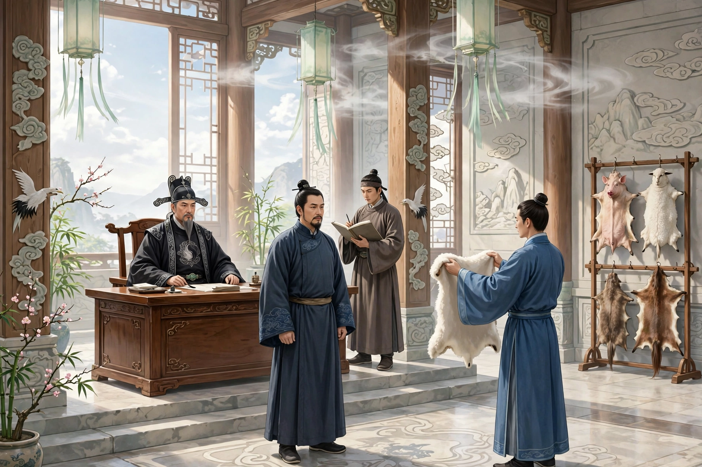
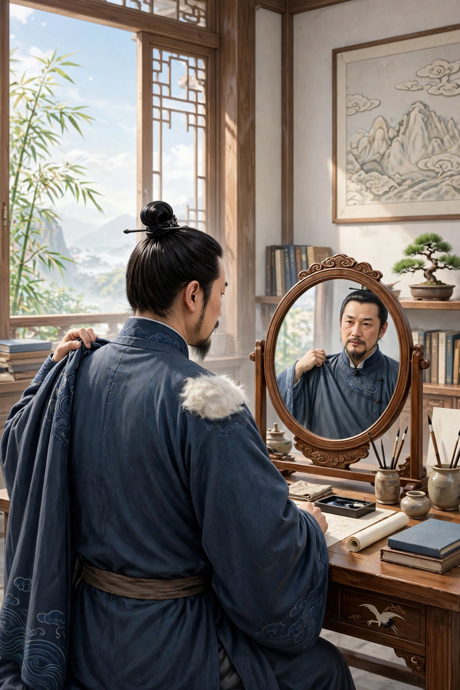

陕右有一位某公，是辛丑年的进士，能够记得自己的前生。他曾经说，前生自己是一个读书人，中年的时候就死了。死后他看见冥王审理案件，大鼎和油锅一类的刑具，和世间传说的一模一样。大殿的东角，设着几座架子，上面搭着猪、羊、狗、马等各种皮。簿吏点名叫人，有的罚做马，有的罚做猪；都把人剥光了，从架子上取下皮披在身上。不久轮到某公，只听冥王说：“这个人应当做羊。”鬼差取来一张白羊皮，按在某公身上盖住。簿吏禀告说：“这个人曾经救过一个人不死。”冥王查对簿籍又看了一遍，指示说：“免了他吧。虽然作恶很多，但这一件善事可以抵赎。”鬼差又来剥他身上的毛皮。皮已经粘在身上，动弹不得。两个鬼捉住他的手臂、按住他的胸口，用力往下剥，痛苦得无法形容；皮一片一片地断裂，没能剥干净。剥下来之后，靠近肩膀的地方还粘着一块巴掌大的羊皮。某公转生之后，背上长出一丛羊毛，剪掉了还会再长出来。

