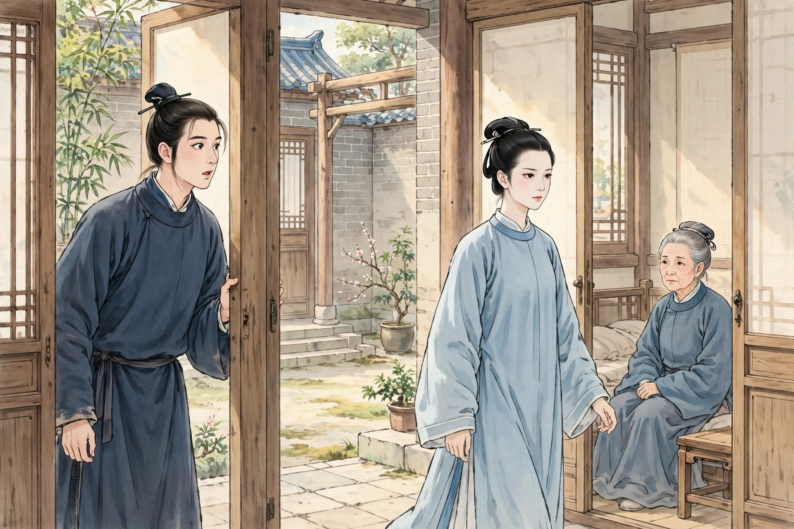
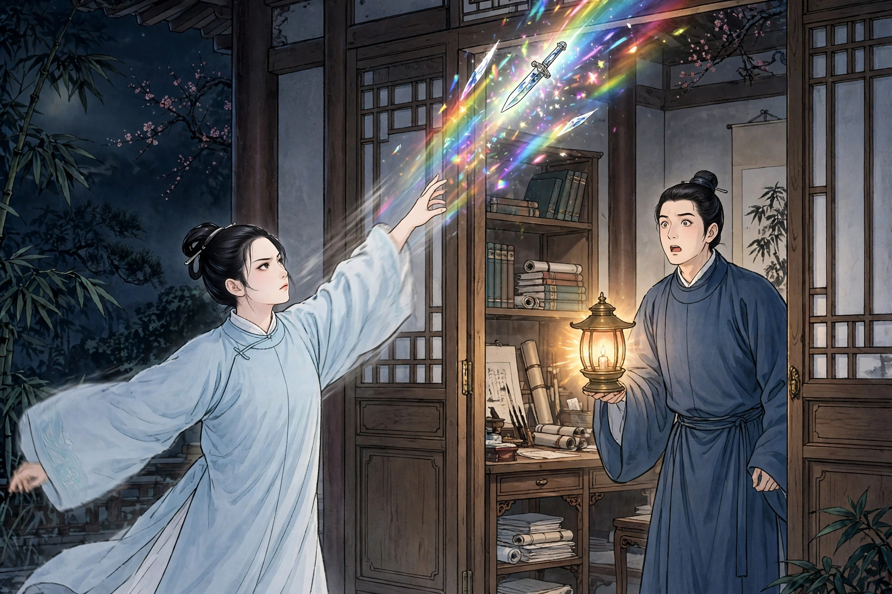
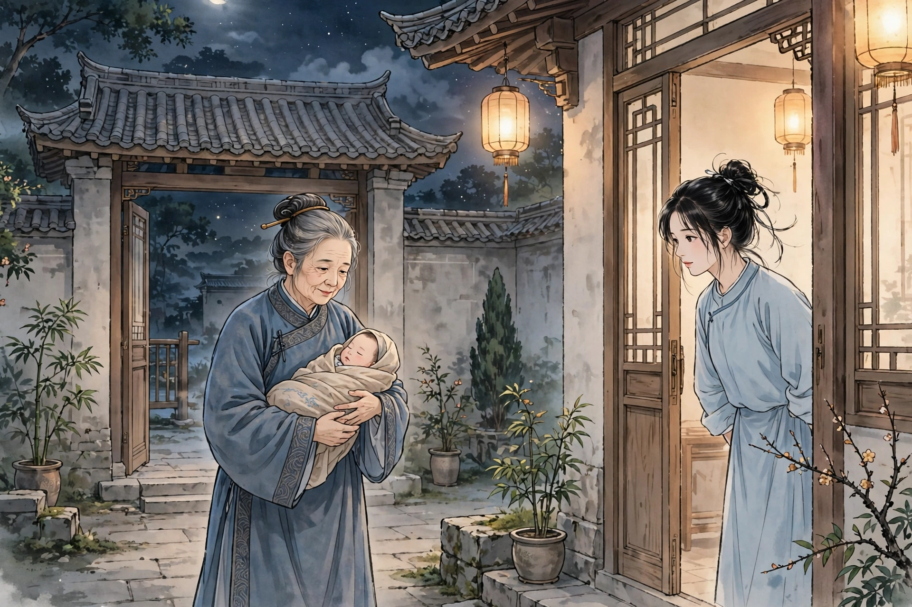

顾生是金陵人，才艺广博，可是家里非常穷。又因为母亲年老，不忍离开母亲膝下，只好每天靠替人写字画画，收些谢礼来养活自己。他已经二十五岁了，还没有娶妻。对门原来有一所空房子，一个老婆婆和一个少女租住在里面。因为她们家没有男子，顾生一直没有打听她们是什么人。有一天，顾生偶然从外面回来，看见那个女郎从母亲房里出来，年纪大约十八九岁，秀美端庄，世上少有匹敌，看见顾生十分回避，可是神情却凛然不可侵犯。顾生进屋问母亲。母亲说：“这是对门的女郎，来向我借剪刀。刚才她说她们家也只有一个母亲。这个女郎不像是穷人家出身。问她为什么还不嫁人，她就拿母亲年老作推辞。明天我去拜访她母亲，顺便把意思透一透；如果她所求不多，你可以代她养活她母亲。”第二天去到她们屋里，她母亲只是一个聋老婆婆。看她们的屋子，连隔夜的粮食都没有。问她们靠什么过活，就是靠女郎的十根手指。顾母慢慢拿一起吃饭的主意来试探，老婆婆的意思像是答应了，转过头去和女郎商量；女郎默不作声，意思很不乐意。顾母就回来了。把女郎的样子细细一想，不禁怀疑说：“这女子莫非是嫌我们穷吗？她不说话也不笑，美得像桃李，可是冷得像霜雪，真是个奇人！”母子俩猜叹了一番，也就罢了。

有一天，顾生坐在书房里，有个少年人来求画。少年容貌很美，举止却颇为轻佻。问他是哪里人，他回答说是“邻村”。从此三两天就来一次，渐渐熟络起来，慢慢就开起玩笑；顾生抱他亲近，他也不怎么拒绝，于是两人就私通了。从此往来十分亲密。正好女郎经过，少年目送着她，问她是谁。顾生回答说是“邻女”。少年说：“这么艳丽，神情又有什么可怕的？”过了一会儿，顾生走进内屋。母亲说：“刚才那女子来讨米，说已经好几天没有生火做饭了。这女子十分孝顺，穷到极点，实在可怜，应该稍稍周济她。”顾生听母亲的话，背了一斗米送到她家门口，转达了母亲的意思。女郎收下了，也没有道谢。女郎常常到顾生家来，看见顾母做衣服鞋子，就替她缝补；出入堂屋，做起事来像个媳妇。顾生越发感激她。每次得到别人送来的吃食，一定分给她母亲，女郎也略不挂在嘴上。顾母正好在隐秘处生了痈疮，日夜号叫。女郎时常到床边看望，替她洗疮敷药，一天三四次。顾母心里很过意不去，可是女郎一点也不嫌脏。顾母说：“唉！怎么才能得到像你这样的新妇，来侍奉我到死呢！”说完，悲咽起来。女郎安慰她说：“郎子这样孝顺，比我们寡母孤女强上百倍了。”顾母说：“床头端屎端尿的活儿，哪里是孝顺儿子能做到的？况且我年纪已经大了，旦夕之间就怕有个风露，实在深深为香火后代担忧。”说话间，顾生进来了。顾母哭着说：“亏欠娘子太多了，你不要忘记报答她的恩德。”顾生向女郎拜伏。女郎说：“你敬重我母亲，我就不必道谢了，你又谢什么呢？”从此顾生越发敬爱她。可是她的举止生硬，丝毫不能亲近。

有一天女郎出门，顾生目不转睛地看着她，女郎忽然回过头来，嫣然一笑。顾生喜出望外，跟着她到了她家，挑逗她，她也不拒绝，两人欣然欢好。事后，她告诫顾生说：“这种事只能有一次，不能再有第二次。”顾生没有答应就回来了。第二天又约她，女郎脸色严厉，理也不理就走了。顾生天天来，时常相遇，女郎一点也不给他好脸色。稍微和她开玩笑，她就冷言冷语，冻得人受不了。忽然在没人的地方，女郎问顾生：“天天来的那个少年是谁？”顾生告诉了她。女郎说：“他举止神态，对我无礼已经不止一次了。因为你和他亲近，我才姑且放过他。请你再传句话给他：再这样下去，就是不想活了！”顾生到了晚上，把话告诉少年，还说：“你一定要谨慎，这个人是不能冒犯的！”少年说：“既然不能冒犯，你又怎么私通了她？”顾生说没有这回事。少年说：“如果没有，那些猥亵的话，又是怎么传到你耳朵里的呢？”顾生答不上来。少年说：“也请你传句话给她：不要假惺惺装模作样；不然，我就到处宣扬。”顾生十分恼怒，神色都露了出来，少年就走了。一天晚上，顾生独自坐着，女郎忽然来了，笑着说：“我和你的情缘还没有断，难道不是天数吗？”顾生狂喜，抱她入怀，忽然听见脚步声纷杂，两人惊起，原来是少年推门进来了。顾生惊问：“你是来做什么的？”少年笑着说：“我是来看贞洁人来的。”又看着女郎说：“今天不怪别人了吗？”女郎眉毛竖起，脸颊涨红，一句话也不说，急忙翻开上衣，露出一只皮囊，随手一掏，掏出一把一尺来长、晶莹的匕首。少年见了，吓得退走。女郎追出门外，四下张望，已经不见踪影。女郎把匕首向空中抛掷，只听戛然一声，光亮像长虹一样，忽然有个东西掉在地上作响。顾生急忙点灯一看，原来是一只白狐，身首已经分开了。顾生大惊。女郎说：“这就是你的那个娈童。我本来已经饶了他，奈何他偏偏不想活了！”她收起刀放回囊里。顾生拉她进屋，说：“刚才妖物败了兴致，请等到明天晚上吧。”女郎出门径自走了。第二天晚上女郎果然来了，两人就亲密结合。顾生问她的本事，女郎说：“这不是你应该知道的。一定要谨慎保密，泄露了恐怕对你没有好处。”又约定嫁娶的事，说：“同床共枕也好，提水汲水也好，不是妻子又是什么呢？已经是夫妻了，何必再说什么嫁娶呢？”顾生说：“莫非是嫌我穷吗？”女郎说：“你固然穷，我又富吗？今夜相聚，正是因为怜惜你穷啊。”临别时嘱咐说：“苟且的事，不能屡次做。我来的时候我自然会来，不该来的时候勉强也没有益处。”后来相遇，顾生每次想拉她私语，女郎总是走开。可是衣服破了、烧柴做饭，她都替他料理，简直就像妻子一样。

过了几个月，女郎的母亲死了，顾生竭力把她葬了。女郎从此独自居住。顾生想着她一个人睡觉可以乱来，就翻墙进去，隔着窗子频频呼唤，始终没有回应。看她的门，空屋子关得紧紧的。顾生暗暗怀疑女郎另有约会。夜里再去，也是这样。于是留下一块佩玉在窗间，就走了。第二天，在顾母那里相遇。女郎出来后，跟在他后面说：“你怀疑我吗？人各有心，不能告诉别人。现在要让你没有疑心，又怎么可能呢？可是有件事急着要你谋划。”顾生问是什么事，女郎说：“我身孕已经八个月了，恐怕旦夕就要生产。‘我自己身份还没有分明’，能替你生孩子，却不能替你养孩子。你可以暗地里告诉母亲，找个乳母，假装是讨个过继的孩子，千万不要说是我生的。”顾生答应了，告诉母亲。母亲笑着说：“这女子真是奇特！明媒正娶她不肯，却偏偏私通我儿子。”高高兴兴地照她的主意等着。又过了一个多月，女郎几天没有来，顾母怀疑起来，去探她的门，只见门窗萧萧地紧闭着。敲了很久，女郎才蓬头垢面从里面出来。顾母进了门，女郎又把门关上了。走进她的屋子，只听床上有婴儿呱呱啼哭。顾母惊问：“生下来几天了？”女郎回答说：“三天。”揭开包被一看，是个男孩，而且丰颐广额。顾母高兴地说：“孩子已经替我养了孙子，你孤身一人，将来靠谁呢？”女郎说：“区区隐情，不敢向老母全盘说出。等到夜里没有人的时候，你可以把孩子抱走。”顾母回去和儿子说了，暗地里都觉得奇异。到了夜里，顾母去把孩子抱了回来。

又过了几个晚上，夜将半的时候，女郎忽然敲门进来，手里提着皮囊，笑着说：“我的大事已经办完了，请从此告别。”顾生急忙问缘故，女郎说：“养母的恩德，时刻不忘在心里。从前我说‘只能有一次，不能再有第二次’，是因为报答不在床第之间。因为你穷得不能成婚，我要替你延续一线香火。本来指望一次就能怀上，不料月事又来了，于是破戒有了第二次。现在你的恩德已经报答了，我的心愿也达成了，没有遗憾了。”顾生问：“囊里是什么东西？”女郎说：“是仇人的头。”打开一看，须发交结，血迹模糊。顾生骇绝，又仔细追问。女郎说：“从前不告诉你，是因为机密的事不严密，怕泄露出去。现在事情已经办成，不妨告诉你：我是浙江人。父亲做司马，被仇人陷害，仇人抄了我们家。我背着老母亲逃出来，隐姓埋名，已经三年了。之所以没有立刻报仇，只是因为还有母亲在；母亲去世以后，又有腹中的一块肉拖累，所以又拖了这么久。前天晚上出去，不是别的，只是因为道路门户还不熟悉，怕出差错罢了。”说完出了门，又嘱咐说：“生的孩子，好好照看他。你福薄没有长寿，这个孩子可以光耀门楣。夜深了，不要惊动老母亲，我走了！”顾生正凄然地想问她去哪里，女郎一闪像电一样，转眼间就不见了。顾生叹惋地呆立着，好像丢了魂魄。第二天告诉母亲，母子俩只是相对叹异罢了。三年后顾生果然死了。儿子十八岁考中进士，还奉养祖母到终老。

异史氏说：“人家里一定要有侠女，才可以养娈童。不然的话，你爱他的美少年，他却爱你的丑猪了！”
