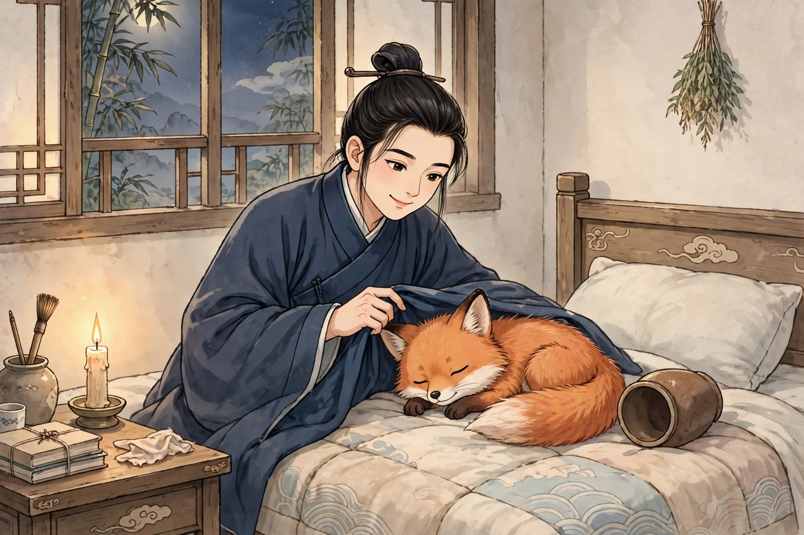
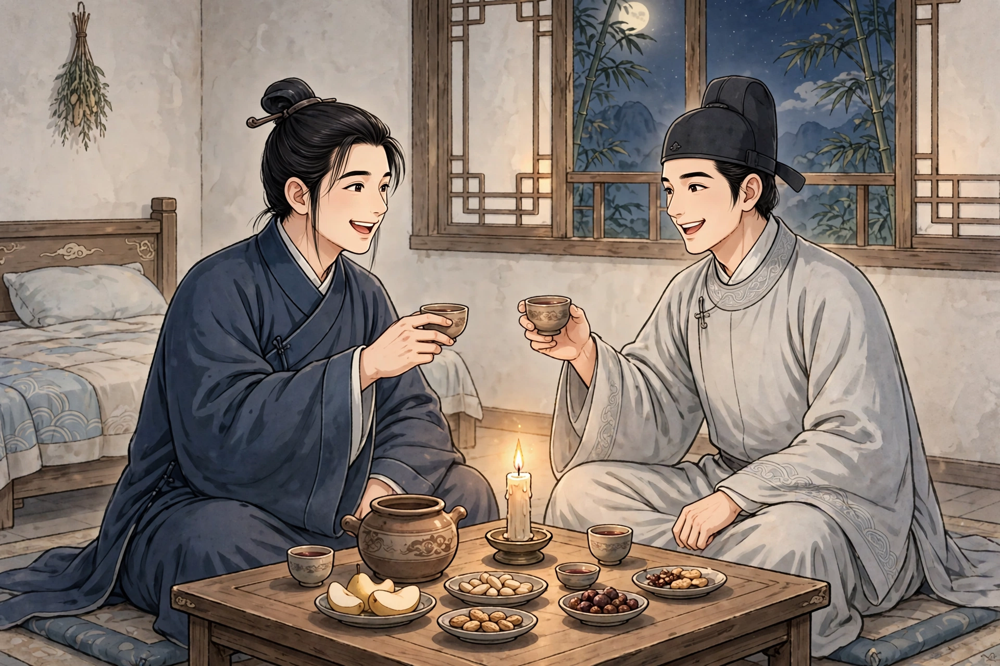

有个姓车的读书人，家里算不上中等富裕，却嗜酒如命，每天夜里要是不喝上三大杯酒，就睡不着觉，所以他床头的酒坛常常不是空的。一夜，他睡醒过来，翻身的时候，觉得好像有人和他躺在一起，他以为是盖在身上的衣服滑落下来了。伸手一摸，却摸到一个毛茸茸的东西，像猫又比猫大，点灯一看，原来是一只狐狸，喝得酩酊大醉，像狗一样趴着睡。再看看酒瓶，酒已经喝空了。车生笑着说：“这倒是我的酒友啊。”他不忍心惊动狐狸，给它盖上衣服，伸出手臂，和它一起睡下，还留着灯，想看看它会变成什么样子。到了半夜，狐狸伸了个懒腰，车生笑着说：“睡得好美啊！”掀开盖着的东西一看，狐狸已经变成了一个戴着儒生帽子的俊美男子。他起身在床前拜谢车生不杀之恩。车生说：“我沉迷于酒，别人都以为我痴傻。你就是我的鲍叔牙啊，如果你不嫌弃我，我们就做酒坛边的好朋友吧。”他把狐狸拉上床，重新睡下，还说：“你可以常常来，不要互相猜疑。”狐狸答应了。车生醒来之后，狐狸已经走了。于是车生准备了上好的酒，专等狐狸来。

到了晚上，狐狸果然来了，两人膝盖挨着膝盖，欢快地痛饮。狐狸酒量豪爽，又善于说笑，于是两人只恨相识太晚。狐狸说：“我屡次叨扰你的好酒，该怎么报答你的恩德呢？”车生说：“一斗酒的欢乐，何必挂在嘴上！”狐狸说：“虽然这样说，你是贫寒的读书人，买酒的钱来得大不容易，我应当为你稍稍谋划一点酒钱。”第二天晚上，狐狸来告诉他说：“离这里往东南七里，路边有遗落的金子，你可以早点去取。”第二天清早，车生前去，果然得到了两块金子，于是买了美味佳肴，来佐夜里的酒。狐狸又告诉他说：“院子后面有埋藏的窖藏，你应该把它挖出来。”车生照着它的话去做，果然得到了上百千钱，高兴地说：“口袋里已经有了钱，就不要再漫无边际地发愁买酒了。”狐狸说：“不是这样，车辙里的水又怎么能够长久地捧取呢？还是应当再谋划谋划。”过些日子，狐狸对车生说：“市面上的荞麦价格便宜，这是可以囤积的奇货。”车生听从了它，收了四十多石荞麦，人们都讥笑他。没过多久，大旱成灾，禾苗豆子都枯死了，只有荞麦可以种，卖荞麦种子，获利十倍。从此车生更加富裕，置办了二百亩肥沃的田地。只是种什么、什么时候种，都要问狐狸：多种麦子，麦子就丰收；多种黍子，黍子就丰收，一切种植的早晚，都由狐狸来决定。两人一天比一天亲密，狐狸称呼车生的妻子为嫂子，看待车生的孩子就像自己的孩子一样。后来车生去世了，狐狸就再也不来了。

