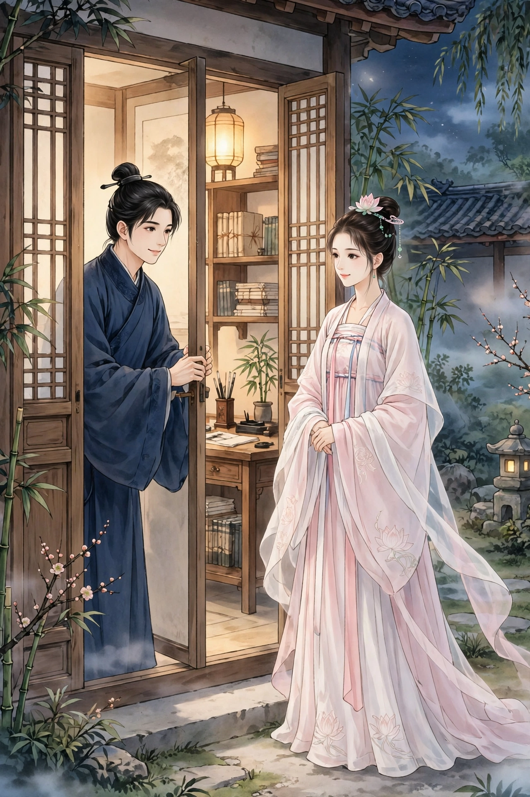
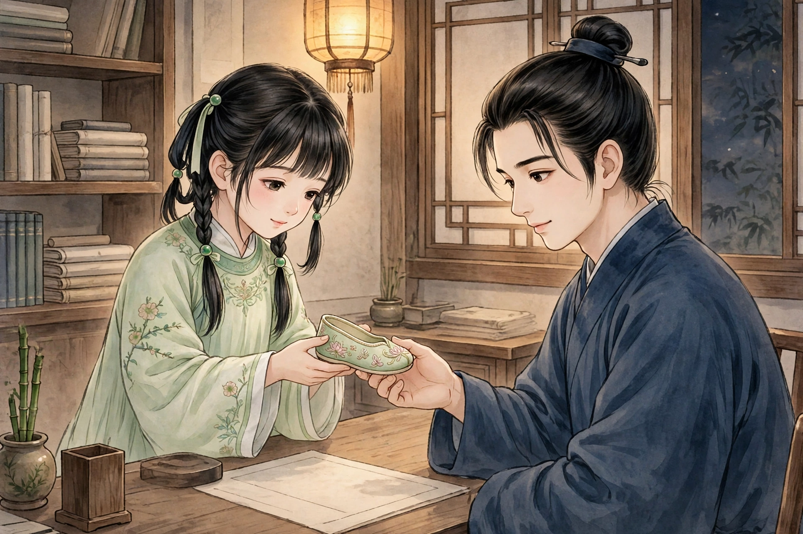
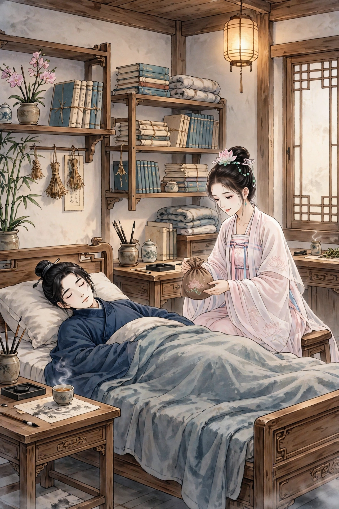
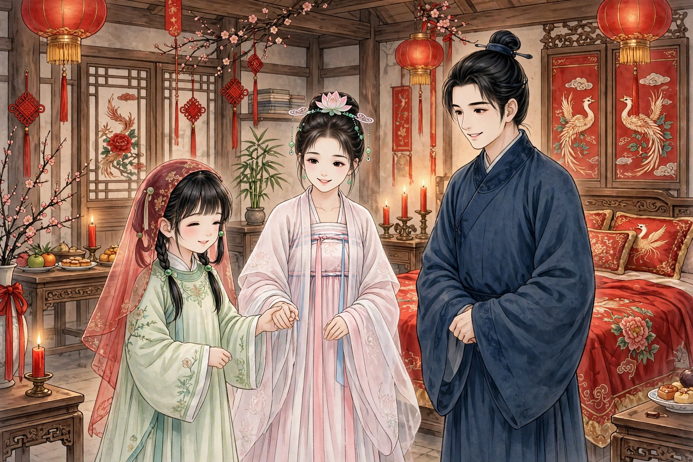

桑生名叫晓，字子明，是沂州人。年少时父亲去世，在红花埠的一处馆舍里读书。桑生性情沉静，喜欢独处，每天只出门两次，到东邻家里吃饭，其余时间都端端正正地坐在屋里。东邻的书生偶然来到他的住处，开玩笑说：“你一个人住着，难道不怕鬼狐吗？”桑生笑着回答：“大丈夫怕什么鬼狐？雄的来了，我有宝剑；雌的来了，我还要开门迎进来呢。”东邻书生回去后，和朋友商量，扶着一位妓女翻墙过来，弹指敲门。桑生隔着门问是谁，妓女自称是鬼。桑生吓得大惊，牙齿打战，发出声响。妓女徘徊了一会儿，自己走了。第二天一早，东邻书生来到桑生的书斋，桑生把所见的事告诉他，还说自己打算搬走。东邻书生拍手大笑说：“你怎么不开门迎进来呢？”桑生这才明白那是假的，于是又安心住了下来。

过了半年，一个女子夜里来敲书斋的门。桑生以为又是朋友的戏弄，开门请她进来，却见是一位倾国倾城的美人。他惊讶地问她从哪里来，她说：“我是莲香，是西边的妓女。”埠上青楼本来就多，桑生便信了她的话。两人熄了灯，上床亲热，十分相好。从此每隔三五夜，莲香便来一次。

一夜，桑生独自坐着沉思，一个女子轻盈地走了进来。桑生以为是莲香，上前迎接说话。走到面前一看，却全然不是：她年纪只有十五六岁，穿着单袖，梳着垂髻，风姿秀美，走起路来若往若还。桑生大吃一惊，怀疑她是狐狸。女子说：“我是良家女子，姓李。仰慕先生的高雅，希望能得到垂青。”桑生很高兴。握住她的手，只觉得冷如冰，问她：“为什么这样凉？”她说：“我年幼体弱单寒，夜里沾了霜露，怎能不凉呢！”接着，她解开罗衫的衣襟，俨然还是处子。她说：“我为了情缘，把如花似玉的身子一朝托付于人。若不嫌我鄙陋，愿长久侍奉在枕席之间。房中可还有别人吗？”桑生说：“没有别人，只有一个邻家的娼妓，而且也不常来。”女子说：“应当谨慎避开她。我和院中的人不一样。先生千万保密不要泄露，她来时我便去，她去时我便来就是了。”

鸡鸣时她要离去，赠给桑生一只绣花鞋，说：“这是我脚上穿的，拿着它玩赏，足以寄托思念。只是有人在时千万不要拿出来玩！”桑生接过来看，只见鞋头翘翘的，像一枚解结的锥子，心里十分喜爱。第二天夜里无人时，他便拿出来仔细把玩。女子忽然飘然而至，于是两人亲昵相谈。从此桑生每次拿出鞋子，女子必定应念而来。桑生觉得奇怪，问她缘故，她笑着说：“不过是恰好到了那个时候罢了。”

一夜，莲香来了，吃惊地说：“郎君的神气为什么这样憔悴？”桑生说：“自己也不觉得。”莲香便告辞，和他约定十天后再来。莲香走后，李氏夜夜都来，没有一夜空闲。她问：“先生的情人为什么许久不来？”桑生把约定的事告诉了她。李氏笑着说：“先生看我和莲香相比，哪个更美？”桑生说：“可以说是各有千秋，难分高下。只是莲卿的肌肤温和。”李氏变了脸色说：“先生说我们两个都美，却当着我的面这样说。她一定是月宫里的仙人，我一定比不上她。”于是两人不欢而散。桑生屈指计算，十天的期限已经满了，便嘱咐李氏不要声张，自己打算暗中偷看。

第二天夜里，莲香果然来了，谈笑十分欢畅。到了就寝的时候，她大惊说：“不好了！十天不见，先生怎么更加憔悴瘦损了？莫非还有别的遭遇吗？”桑生问她约期的缘故。她说：“我是从神气上看出来的，脉搏细碎得像乱丝，这是鬼的病症啊。”第二天夜里，李氏来了，桑生问：“你偷看莲香觉得怎么样？”她说：“美极了。我本来就说世上没有这样的佳人，果然是狐狸。我离开后跟踪她，只见她往南山去，住在洞穴里。”桑生怀疑她是嫉妒，随口应付过去。

过了一夜，桑生开玩笑地对莲香说：“我本来不相信，只是有人说你是狐狸。”莲香急忙问：“是谁说的？”桑生笑着说：“是我自己开玩笑的。”莲香说：“狐狸和人有什么不同？”桑生说：“被狐狸迷惑的人会生病，严重的还会死，所以可怕。”莲香说：“不是这样的。像先生这个年纪，房事之后三天，精气就可以恢复，即使是狐狸又有什么害处？如果天天损耗自己，比狐狸害人更厉害的人也有的是。天下的痨病鬼、瘵病鬼，难道都是被狐狸迷惑死的吗？不过，一定是有人在议论我。”桑生竭力说没有，莲香追问得更加紧迫。桑生不得已，把实情泄露了。莲香说：“我本来就奇怪先生憔悴成这样。可是怎么会一下子到这种地步？莫非不是人吗？先生不要声张，明天夜里，我也要像她偷看我那样偷看她。”这天夜里李氏来了，只说了三两句话，听见窗外有咳嗽声，便急忙消失不见了。莲香走进来说：“先生危险了！她真是鬼物！贪恋她的美貌而不赶快断绝，离死路就不远了！”桑生以为她是嫉妒，默默不说话。莲香说：“我明知道先生忘不了情，可是忍不下心看着先生死去。明天，我会带药来，替先生除去阴毒。幸亏病根还浅，十天病就会好了。请让我同榻而眠，看着先生痊愈。”第二天夜里，莲香果然拿出一点药给桑生吃。顷刻之间，桑生腹泻了三两行，觉得脏腑清爽空虚，精神顿时爽快起来。心里虽然感激她，可是终究不相信李氏是鬼。

莲香夜夜和桑生同衾相偎，桑生想和她亲热，她总是制止。几天后，桑生的皮肤肌肉丰满起来。莲香要告别，殷切地嘱咐他断绝和李氏的来往。桑生假装答应了。等到关上门点起灯，他又拿起鞋子倾心思念。李氏忽然来了。因为几天隔绝，她颇有怨色。桑生说：“她连夜为我治病当医生，请不要怨恨她。情分的好坏还在我这里。”李氏才稍稍高兴起来。桑生在枕上私下说：“我非常爱卿，可是有人说卿是鬼。”李氏结舌了很久，骂道：“一定是那淫狐迷惑了郎君的耳朵！如果不断绝她，我就不来了！”于是呜呜咽咽地哭泣起来。桑生说了许多话安慰她，她才作罢。隔了一夜，莲香来了，知道李氏又来过，生气地说：“先生一定想死吗！”桑生笑着说：“卿为什么嫉妒得这样深？”莲香更加生气地说：“先生种下了死根，我替先生除去它，不嫉妒的人又会怎么样呢？”桑生托词开玩笑说：“她说前些日子的病，是狐狸作祟罢了。”莲香叹息说：“真像先生说的那样，先生执迷不悟，万一有个不测，我纵有百口又怎么能为自己辩解？请从此告辞。一百天后，我再来看先生睡在卧榻上的样子。”怎么留也留不住，她气冲冲地径直走了。从此桑生和李氏日夜必定在一起。约两个多月后，桑生觉得非常困顿。起初还自己宽解自己；日子渐渐过去，身体日益瘦弱，只喝一瓯稀粥。想回家去奉养父母，又恋恋不舍，不忍马上离去。拖延了几天，病势沉重，再也起不来了。邻家的书生见他病得憔悴，每天派馆里的仆人送饭送水。桑生到了这个时候才怀疑李氏，于是对李氏说：“我后悔没有听莲香的话，才到了这个地步！”话说完就闭上了眼睛。过了一会儿又苏醒过来，睁眼四处张望，李氏已经走了，从此便断绝了来往。

桑生瘦弱地躺在空书斋里，思念莲香就像盼望丰年一样。一天，他正凝神思念的时候，忽然有人掀起帘子走了进来，原来是莲香。她站在床边笑着说：“乡下郎君，我难道是胡说的吗！”桑生哽咽了很久，自言知道错了，只求她拯救。莲香说：“病已经深入膏肓，实在没有救治的办法。我姑且来永别，好证明我不是嫉妒。”桑生非常悲伤地说：“枕头底下有一件东西，麻烦你替我毁掉它。”莲香搜出鞋子，拿到灯前反复把玩。李氏女子忽然走了进来，猛然看见莲香，转身想逃。莲香用身体挡住门，李氏窘迫得不知往哪里走。桑生责备数落她，李氏答不上话。莲香笑着说：“我今天才得以和阿姨当面质问。从前说郎君的旧病，未必不是我造成的，现在究竟怎么样？”李氏低头认错。莲香说：“这样美丽的人，竟然因为爱而结下仇怨吗？”李氏立刻扑倒在地，痛哭着请求怜悯搭救。莲香便扶她起来，细细询问她的生平。她说：“我是李通判的女儿，早早就夭折了，埋葬在墙外，像已经死了的春蚕，遗丝还没有断尽。和郎君相好，是我的愿望；害得郎君快要死去，实在不是我的本心。”莲香说：“听说鬼喜欢让人死去，因为死后可以常常相聚，是这样吗？”她说：“不是这样。两个鬼相逢，并没有什么乐趣，如果有乐趣，泉下的少年郎难道还少吗！”莲香说：“痴啊！夜夜和活人相处，活人尚且受不了，何况是鬼！”李氏问：“狐狸能害死人，为什么你用的方法却不会？”莲香说：“那些是采补一类的人，我不是那一类。所以世上有不害人的狐狸，断没有不害人的鬼，因为鬼的阴气太盛了。”桑生听了她们的话，才知道狐和鬼都是真的。幸亏平时经常见惯了，倒也不觉得惊骇。只是想到自己残存的气息像丝一样细，不觉失声大哭起来。莲香回头问：“该怎么处置郎君呢？”李氏羞愧地推辞谢罪。莲香笑着说：“恐怕郎君身体强健起来，爱吃醋的娘子要吃杨梅了。”李氏整了整衣裳说：“如果有医国圣手，能让我不辜负郎君，我便应当埋头到地下去，哪里还敢再在人世间露面呢！”莲香从囊中取出药，说：“我早就知道会有今天，分别后到三山采药，整整三个月，药材才备齐。瘵蛊之病即使到了要死的地步，服了药没有不苏醒的。可是病是怎么得的，还要用怎么得来的东西作药引，不得不转过来求你出力。”李氏问：“需要什么？”莲香说：“樱桃小口中的一点香唾罢了。我先送一丸进去，麻烦你接口唾它一下。”李氏对着桑生的面颊发晕，俯首转侧看着那只鞋子。莲香开玩笑说：“妹妹得意的东西只有这只鞋罢了。”李氏更加羞惭，俯仰之间无地自容。莲香说：“这是平时熟练的本事，现在为什么吝惜呢？”于是把药丸放进桑生的口中，转而催促逼迫她。李氏不得已，唾了一口。莲香说：“再来！”她又唾了一口。一共唾了三四口，药丸已经咽下去了。过了一会儿，桑生的肚子里像雷鸣一样响动。莲香又送进一丸，自己接着用嘴唇把气布给他。桑生觉得丹田火热，精神焕发。莲香说：“好了！”李氏听见鸡鸣，彷徨着离去了。莲香因为桑生刚刚痊愈，还需要调养，在外边吃饭不是办法；于是把户外的门反锁起来，假装桑生已经回家，以断绝交往，日夜守护着他。李氏也每天夜里必定来，供给奉养十分殷勤，对待莲香如同姐姐。莲香也深深怜爱她。住了三个月，桑生健康如初。李氏便连续几夜不来；偶尔来一次，看一眼就走了。相对的时候，也闷闷不乐。莲香常常留她一起睡，她一定不肯。桑生追出去，把她提抱回来，只觉得她的身体轻得像纸扎的人偶。女子无法逃脱，便穿着衣服仰面躺下，脚卷着身体还不到二尺长。莲香更加怜惜她，暗中让桑生亲昵地抱着她，可是摇撼也摇不醒她。桑生睡去后，醒来寻找她，她已经杳无踪影。十多天以后，她再也不来了。桑生思念她的心情十分迫切，常常拿出鞋子一起把玩。莲香说：“这样窈窕可爱的人，我见了尚且怜爱，何况是男子呢。”桑生说：“从前拿出鞋子她就来，我心里固然怀疑，可是终究没有料到她是鬼。现在对着鞋子思念她的容貌，实在令人悲伤。”说着便哭了起来。

在此之前，富室张姓人家的女儿名叫燕儿，年十五岁，没有出汗就死了。整夜过后又苏醒过来，起身四顾，想要奔出去。张家把门锁上，她出不去。女子自己说：“我是通判女儿的魂魄，感念桑郎的眷顾，留下的鞋子还存在他那里。我真是鬼罢了，把我关起来又有什么好处？”因为她的话有来由，便追问她到这里的原因。女子低头徘徊回望，自己也茫然不解。有人说桑生已经病着回家了，女子坚持辩驳那是诬陷，家人十分怀疑。东邻书生听说了，翻墙过去偷看，见桑生正和美人对面说话；他掩进门去逼近，慌乱之间美人已经不见了踪影。东邻书生惊骇地追问。桑生笑着说：“我向来就和先生说过，雌的来了就迎进来罢了。”东邻书生讲述了燕儿的话。桑生便打开门，想去探访，却没有门路。张母听说桑生果然没有回家，更加觉得奇异。于是特意派老仆妇去索取鞋子，桑生便拿出来交给她。燕儿得到了鞋子，非常高兴。试穿它，鞋子比脚小了一寸多，非常吃惊。她揽镜自照，忽然恍然明白自己是借别人的身体活过来的，于是把原委说了出来。母亲这才相信她。女子对着镜子大哭说：“当日的容貌，还颇值得自信，每次见到莲姐姐，还要增添惭愧。现在反而变成这样，做人还不如做鬼呢！”她抱着鞋子号啕大哭，怎么劝也劝不住。她蒙着被子僵硬地躺着。给她饭吃，她也不吃，身体皮肤都肿了起来；一连七天不吃东西，

却始终没有死，而肿胀渐渐消退；觉得饥饿难忍，便又开始吃饭。几天后，全身瘙痒，皮肤全部脱落。早晨起来，睡觉时穿的鞋子掉在地上，找来穿上，却大得没有可比的了。于是试穿从前的鞋子，肥瘦正好吻合，非常高兴。再照镜子，只见眉目面颊，完全像生前的样子，更加高兴。洗漱后去见母亲，见她的人都十分惊讶。莲香听说这件奇事，劝桑生去向张家提亲；可是因为贫富相差悬殊，不敢贸然进言。正逢老母生日，莲香便跟着女婿一行，前去祝寿。老母看到桑生的名字，特意让燕儿隔着帘子认一认客人。桑生最后才到，女子突然跑出来，拉住他的衣袖，想跟着他一起回去。母亲呵斥责骂她，她才羞惭地进去。桑生仔细看她，果然还是从前的模样，不觉流下眼泪，于是拜伏在地不起身。老母扶起他，并不认为这是侮辱。桑生出来后，托女子的舅舅做媒。老母商议选择吉日，让桑生入赘。

桑生回去告诉莲香，并且商量怎么安置。莲香怅然了很久，便想离去。桑生大惊，哭了起来。莲香说：“先生要在别人家里行花烛之礼，我跟着去，又有什么颜面呢？”桑生谋划先和她一起回乡里，然后再迎娶燕儿，莲香才答应跟着他。桑生把实情告诉张家。张家听说他已经有妻子，大怒，加以讥笑责备，燕儿竭力为他辩白，张家才答应他的请求。到了日子，桑生前去亲迎。家里的准备，十分简陋草率；等到回来时，却见从门口到堂上，全都铺着毛毯，成百上千的灯笼烛火，灿烂排列得像锦绣一样。莲香扶着新妇走进青庐，揭开盖头后，大家欢喜得像生平相识一样。莲香陪着喝合卺酒，趁机细问还魂的奇异经过。燕儿说：“那天我抑郁无聊，只因为自己是异物，自觉形体污秽。离开后愤然不回墓中，随风漂泊。每当看见先生便羡慕他。白天依附在草木上，夜里便信步漂浮沉没。偶然到了张家，看见少女躺在床上，靠近附在她身上，不知道竟然能够活过来。”莲香听了，默默地好像有所思虑。过了两个月，莲香生了一个儿子。产后突然得了暴病，一天比一天沉重。她抓住燕儿的手臂说：“怎么敢把这个孽种拖累你，我的儿子就是你的儿子。”燕儿哭了起来，只好安慰她。替她请来巫医，她都拒绝了。病势沉重缠绵，气息像悬着的丝一样。桑生和燕儿都哭了。她忽然睁开眼睛说：“不要这样！儿子喜欢活着，我也喜欢活着。如果有缘，十年后还可以再见面。”话说完就去世了。掀开被子准备收殓，尸体化成了一只狐狸。桑生不忍用异样的眼光看她，厚厚地安葬了她。儿子名叫狐儿，燕儿抚养他如同自己亲生的孩子。每年清明，一定抱着孩子到她的墓前哭泣。

后来桑生在乡试中中举，家境渐渐宽裕。可是燕儿一直没有生育。狐儿颇为聪慧，却身体单弱多病。燕儿常常想让桑生纳妾。一天，婢女忽然说：“门外有一位老妇，带着女儿来求卖身。”燕儿叫她们进来。猛然看见，大惊说：“莲姐姐又出来了吗！”桑生看了她，确实很像，也吃了一惊。问：“年纪几岁？”她回答：“十四岁。”又问：“聘金多少？”老妇说：“老身只有这一块肉，只要能有个好归宿，我也能有个吃饭的地方，将来老骨头不至于丢在沟壑里，就够了。”桑生出了优厚的价钱，把她留了下来。燕儿握着女子的手，走进密室，捏着她的下巴笑着说：“你认识我吗？”她回答：“不认识。”追问她的姓氏，她说：“我姓韦。父亲是徐城卖浆的人，已经死了三年了。”燕儿屈指沉思，莲香去世恰好十四年。又仔细看女子，仪容态度，没有一处不神似。于是拍着她的头顶呼喊：“莲姐姐，莲姐姐！十年相见的约定，应当不会欺骗我！”女子忽然像从梦中醒来，豁然说：“咦！”仔细看着燕儿。桑生笑着说：“这就是‘似曾相识燕归来’啊。”女子含着眼泪说：“是啊。听母亲说，我生下来就能说话，被认为不祥，用狗血给我喝，于是忘记了前生的因缘。今天才像从梦中醒悟过来。娘子莫非就是那个羞于做鬼的李妹妹吗？”大家一起谈论前生，悲喜交集。

一天，正逢寒食节，燕儿说：“这是每年我和郎君哭祭姐姐的日子。”于是和亲人一起登上莲香的墓，荒草离离，树木已经合抱了。女子也叹息起来。燕儿对桑生说：“我和莲姐姐，两世的情好，不忍心分开，应当让她们的白骨同穴而葬。”桑生听从她的话，打开李氏的坟墓得到骸骨，抬回来合葬在一起。亲朋听说这件奇事，穿着吉服来到墓穴，不约而同会聚的有几百人。我在庚戌年南游到沂州，遇到下雨，停留在旅舍里。有位刘生名叫子敬，是我的中表亲戚，拿出同社王子章所写的《桑生传》，约有一万多字，得以读完。这只是其中的大概罢了。

异史氏说：“唉！死去的人求着要活过来，活着的人又求着要死去，天下最难得到的东西，难道不是人身吗？可是拥有这副身体的人，往往随意丢弃它，以至于厚着脸皮活着还不如狐狸，默默无闻地死去还不如鬼。”
