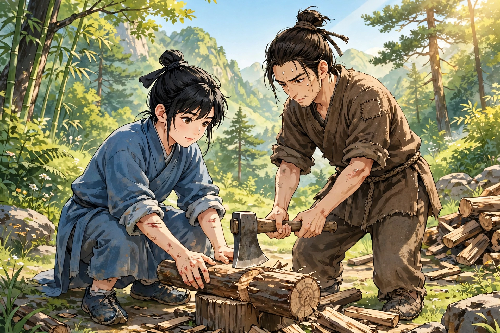
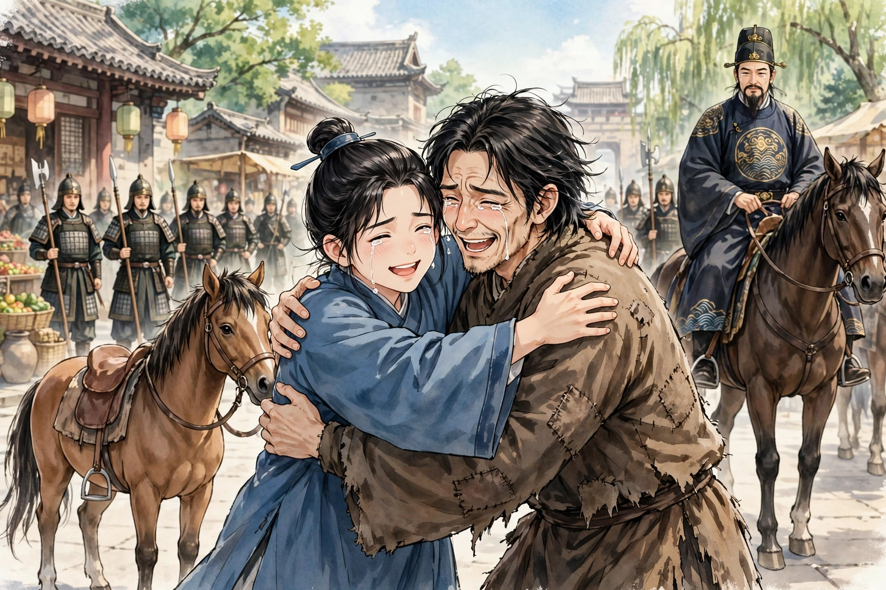
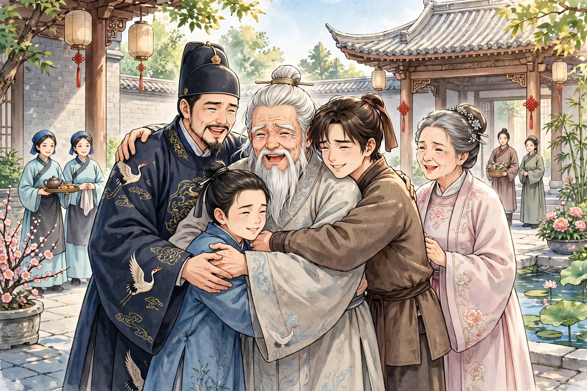

河南有个姓张的人，祖先本是山东人。明朝末年山东大乱，他的妻子被北方的兵掠走了。张某常到河南做买卖，于是就在河南安了家。他在河南娶妻，生了儿子张讷。不久妻子去世，他又娶了继室，生了儿子张诚。继室牛氏性情凶悍，常常嫉恨张讷，像对待奴仆牲口一样对待他，给他吃粗劣的饭菜，让他上山砍柴，每天责令砍够一担柴。砍不够，就鞭打、辱骂他，实在无法忍受。牛氏却暗地里拿好吃的东西喂张诚，让他跟塾师读书。张诚渐渐长大，性情孝顺友爱，不忍心看哥哥辛苦，暗地里劝母亲，母亲却不听。一天，张讷进山砍柴，还没有砍完，遇上大风雨，只好躲在岩石下面，等雨停了，天已经黑了。他肚子里饿得厉害，就背着柴回家。母亲验看柴少了，恼怒不给他饭吃；饥火烧心，他进屋直挺挺地躺下。张诚从学堂回来，看见哥哥神色沮丧，问：“病了吗？”张讷说：“是饿的。”问他缘故，他把实情说了。张诚脸色一变就出去了。过了一会儿，他怀里揣着饼来给哥哥吃。哥哥问饼是从哪里来的。张诚说：“我偷了家里的面，请邻妇做的，你只管吃，不要说出去。”张讷吃了饼，嘱咐弟弟说：“以后不要再这样了，事情泄露会连累弟弟。况且一天吃一顿饭，饿也饿不死。”张诚说：“哥哥本来身体就弱，怎么能多砍柴呢！”第二天，吃过饭后，张诚偷偷跑到山上，来到哥哥砍柴的地方。哥哥看见他，惊讶地问：“你要干什么？”张诚回答说：“要帮哥哥砍柴。”哥哥问：“是谁派你来的？”张诚说：“是我自己来的。”哥哥说：“且不说弟弟不会砍柴，就算会砍，也还是不行。”于是催他回去。张诚不听，用手脚折断柴禾帮助哥哥，还说：“明天我要带斧头来。”哥哥上前阻止他，看见他的手指已经破了，鞋子已经穿了，悲伤地说：“你再不赶快回去，我就用斧头割脖子自杀。”张诚这才回去，哥哥送他到半路，才又返回。张讷砍完柴回家，又到学堂去，嘱咐张诚的老师说：“我弟弟年纪小，应该把他关住，山里虎狼很多。”老师说：“上午不知他到哪里去了，我已经打过他了。”张讷回来对张诚说：“不听我的话，挨打了吧。”张诚笑着说：“没有。”第二天，张诚怀里揣着斧头又去了。哥哥惊骇地说：“我明明告诉你不要来，你怎么又来了？”张诚不回答，只顾急急忙忙砍柴，汗水流满脸颊，一刻也不停歇。约摸砍够一捆，也不告辞就回去了。老师又责打了他，他才把实情告诉老师，老师赞叹他的贤德，就不再禁止他了。哥哥屡次阻止他，他始终不听。

一天，张讷和几个人在山中砍柴，忽然来了一只老虎，众人害怕得趴在地上，老虎竟然把张诚叼走了。老虎背着人走得慢，被张讷追上了，张讷用力用斧头砍它，正中老虎的胯部。老虎疼得狂奔，再也无法追寻，张讷痛哭着返回。众人安慰开解他，他哭得更加悲痛，说：“我弟弟，不同于别人家的弟弟；何况他是为我而死，我还活着干什么！”于是用斧头割自己的脖子。众人急忙抢救，斧头已经入肉一寸多，血涌出来像泉水一样，他昏晕倒地气绝。众人惊骇，撕开他的衣服包扎伤口，一起扶他回家。母亲哭着骂道：“你杀了我的儿子，想在脖子上割一下来搪塞吗！”张讷呻吟着说：“母亲不要烦恼，弟弟死了，我一定不会活着！”众人把他放在床上，伤口疼痛不能入睡，只是白天黑夜靠着墙壁坐着哭泣。父亲怕他也死了，时常到床前喂他一点饭，牛氏见了总是大骂，张讷于是不再吃饭，三天后就死了。村里有个走无常的巫师，张讷在路上遇见了他，向他详细诉说了过去的苦楚，又向他打听弟弟的下落，巫师说没有听说，于是转身带着张讷去了。来到一个都会，看见一个穿黑衫的人从城中出来，巫师拦住他代为询问。黑衫人从随身的袋子里检出名册仔细查看，男女一百多人，并没有姓张的犯人。巫师怀疑在别的名册上。黑衫人说：“这条路归我管，怎么会差错逮捕。”张讷不相信，强迫巫师进入内城。城中新鬼、旧鬼往来熙熙攘攘，也有旧相识，上前询问，始终没有知道的。忽然大家一齐喧哗说：“菩萨到了！”抬头看见云中有一位伟人，毫光上下通彻，顿时觉得世界通明。巫师祝贺说：“大郎有福了！菩萨几十年才进入冥司一次，拔除众生的苦恼，今天正好遇上了。”巫师便拉着张讷跪下。众鬼囚纷纷杂杂，合掌齐声诵念慈悲救苦的声音，喧腾震地。菩萨用杨柳枝遍洒甘露，甘露细如尘埃；一会儿雾收光敛，菩萨就不见了踪影。张讷觉得脖子上沾了甘露，斧头砍的地方不再作痛。巫师于是带着他一同回去，望见里门，才告别而去。张讷死了两天，忽然苏醒过来，把所遇到的事全都说了出来，认为张诚没有死。母亲以为是编造的谎话，反而辱骂他。张讷受了委屈无法申辩，而摸一摸伤口的疤痕已经痊愈。他勉强起身，拜别父亲说：“我将要穿云入海去寻找弟弟，如果见不到他，这辈子就不要指望我回来了。希望父亲还是把我当作死了。”老翁把他拉到空处相对哭泣，没有人敢留他，张讷就去了。

张讷常常在大街小巷打听弟弟的消息，路上盘缠断绝了，就乞讨着前行。过了一年多，到了金陵，衣服破烂百结，弯着腰走在路上。偶然看见十几骑马的人过来，他躲避到路旁。里面一人像个官长，年纪四十岁上下，健壮的兵卒、骏马，前后奔驰护卫。一个少年骑着小马，多次看着张讷。张讷以为他是贵公子，不敢抬头看。少年停住马鞭稍稍停留，忽然下马，喊道：“不是我哥哥吗！”张讷抬头仔细看，正是张诚，握着手痛哭失声。张诚也哭着说：“哥哥怎么漂泊流落到这个地步？”张讷说了实情，张诚更加悲伤。骑马的人都下马询问缘故，告诉了官长。官长命令腾出一匹马给张讷骑，并辔同行回到他的家里，这才详细询问。起初，老虎把张诚叼走，不知什么时候把他放在路旁，张诚在途中躺了一夜，恰逢张别驾从京城来，经过这里，看见他相貌文雅，怜爱地抚摸他，张诚渐渐苏醒。说了自己的家乡住处，离家已经很远了，张别驾于是载着他一同回去，又用药敷他的伤处，几天后才痊愈。张别驾没有儿子，就认他做了儿子。刚才正是跟随张别驾出游回来。张诚把经过全都告诉了哥哥。说话间，张别驾进来了，张讷拜谢不已。张诚走进内室，捧出绸衣给哥哥换上，于是摆酒宴请叙谈。张别驾问：“你们家在河南，有多少壮丁？”张讷说：“没有。父亲年少时是山东人，流落在河南。”张别驾说：“我也是山东人。你们家乡属于哪里？”张讷回答说：“曾听父亲说属于东昌管辖。”张别驾惊讶地说：“我是同乡啊！为什么迁到河南？”张讷说：“明朝末年清兵入境，掠走了前母。父亲遭遇兵火，家室荡然无存。先前在西边做买卖，往来很熟悉，所以就留下来了。”张别驾又惊讶地问：“你父亲叫什么名字？”张讷告诉了他。张别驾瞪大眼睛看着，低头好像疑惑，急忙跑进内室。没过多久，太夫人出来。大家一起跪拜之后，太夫人问张讷说：“你是张炳之的孙子吗？”张讷说：“是。”太夫人大哭，对张别驾说：“这是你的弟弟啊。”张讷兄弟都不能理解。太夫人说：“我嫁给你父亲三年，流离北去，身属黑固山半年，生了你哥哥。又过了半年，黑固山死了，你哥哥补了旗下的官职，升迁到这个官位。现在已经解任了。我时时刻刻思念故乡，于是出了旗籍，恢复了原来的家谱。屡次派人到山东，始终没有找到消息，怎么知道你父亲西迁了呢！”于是对张别驾说：“你把弟弟当作儿子，真是折福啊！”张别驾说：“先前问张诚，张诚从来没有说过是山东人，想是年幼不记得了。”于是按年龄排序：张别驾四十一岁，是长兄；张诚十六岁，最小；张讷二十二岁，是老二。张别驾得了两个弟弟，非常欢喜，和他们同住一处，完全了解了家门离散的原委，准备商量回乡。太夫人担心不被容纳。张别驾说：“能容纳就在一起过，否则就分开过。天下哪有没有父亲的人呢？”

于是张别驾卖了宅院，置办行装，定下日子向西出发。到了家乡，张讷和张诚先骑马回去报信给父亲。父亲自从张讷走后，妻子也不久就死了；独自一个老鳏夫，形影自怜。忽然看见张讷进来，又惊又喜，恍恍惚惚；又看见张诚，喜极了说不出话来，只是流泪。又告诉他张别驾母子也来了，老翁止住哭泣，愕然呆立，不能喜，也不能悲，只是痴痴地站着。没过多久，张别驾进来，拜见之后；太夫人拉着老翁相对哭泣。只见婢女、老妈子、仆人、小卒，屋里屋外挤满了人，坐着站着不知该做什么。张诚不见母亲，问了之后，才知道母亲已经死了，号哭得声音嘶哑、气绝，约一顿饭的工夫才苏醒过来。张别驾拿出钱来建造楼阁，请老师教两个弟弟读书。马在马厩里欢腾，人在屋里喧闹，居然成了一户大户人家。

异史氏说：“我听这件事听到最后，眼泪落了好几次。十多岁的童子，用斧头砍柴帮助哥哥，我感慨地说：‘王览又再现了吗！’于是落了一次泪。到了老虎把张诚叼走，我不禁狂呼说：‘天道怎么昏聩到这种地步！’于是又落了一次泪。等到兄弟突然相遇，就高兴得也落泪。转而又多了一个哥哥，又添了一份悲情，就为张别驾落泪。一家团圆，出乎意料的惊，出乎意料的喜，无从说起的眼泪，就为老翁落泪。不知道后世还有没有像我这样爱流泪的人呢？”
