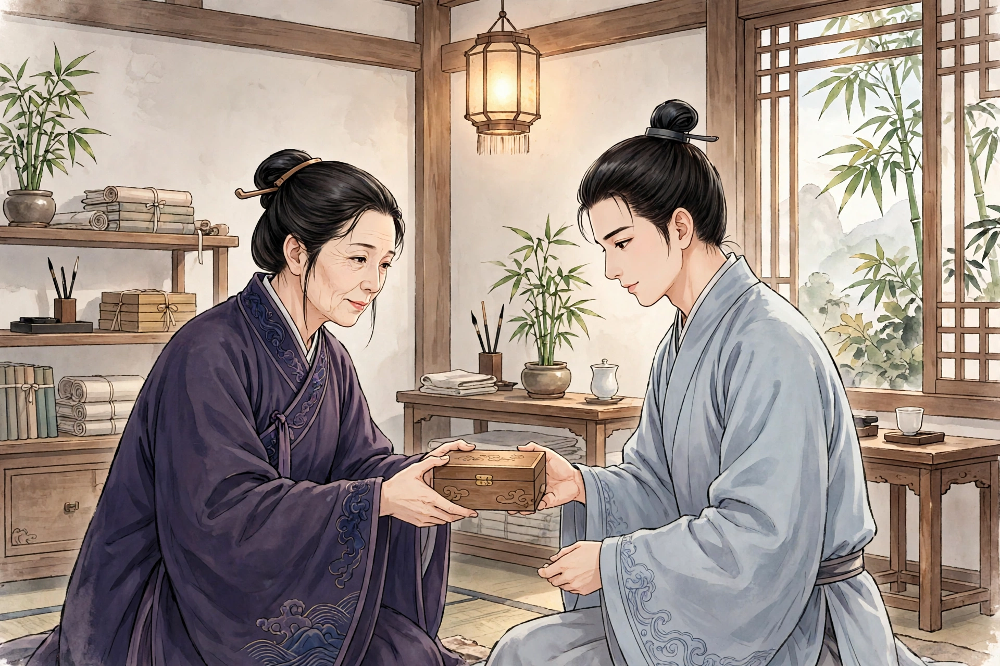

广东有一位缙绅傅家，老爷年过六十，才生下一个儿子，名叫傅廉。傅廉十分聪明，可是天生就是阉人，到了十七岁，下身还只有蚕那么大。远近的人都知道这件事，没有人家肯把女儿嫁给他。傅老爷自认宗嗣已经断绝，日夜忧愁，却一点办法也没有。

傅廉跟着先生读书。有一天先生偶然出门，门外正好有耍猴的人，傅廉看得入了神，把功课都丢下了。估摸着先生快要回来了，他心里害怕，就逃了出去。离家走了几里路，看见一位穿素衣的女郎带着一个小婢走在他前面。女郎一回头，美得非同寻常，走起路来莲步缓慢，傅廉快步超过了她。女郎回头对婢女说：“去问问这位郎君，是不是要到琼州去？”婢女果然上前问他，傅廉问她有什么事。女郎说：“如果你到琼州去，有一封信，麻烦你顺路送到我家门口。我母亲在家，也可以做你的东道主。”傅廉出门本来就没有一定的去处，心想渡海过去也无妨，就答应了。女郎拿出信交给婢女，婢女又转交给了傅廉。问起她的姓名和住处，她说：“我姓华，住在秦女村，离北郭三四里。”傅廉便搭船去了。到了琼州北郭，天已经昏暗了，打听秦女村，竟然没有一个人知道。再往北走四五里，星月已经明亮，芳草遮住了视线，荒野里没有一家客店，处境十分窘迫。看见路边有一座坟墓，本想傍着坟墓过夜，又十分害怕虎狼，于是攀着树爬了上去，蹲坐在树上。听着松声沙沙作响，夜虫悲鸣，心里忐忑不安，后悔得像火烧一样。

忽然听见树下有人说话，往下看，只见庭院赫然在目，一位丽人坐在石头上，两个梳双鬟的婢女挑着画烛，分站在两旁。丽人向左看了一眼说：“今夜月白星稀，华姑送来的团茶，可以煮一盏，来欣赏这个良夜。”傅廉以为她们是鬼魅，毛发都竖了起来，连气都不敢大喘。忽然婢女抬头说：“树上有人！”女郎吃惊地站起来说：“哪里来的大胆小子，暗地里来偷看人！”傅廉大惊，无处躲藏，只好转着圈下了树，伏在地上求饶。女郎走近看了一眼，反而由生气转为欢喜，拉着他一起坐下。仔细看去，她年纪大约十七八岁，姿态艳丽绝伦，听她说话也是本地口音。她问：“郎君要到哪里去？”他回答说：“替人送信。”女郎说：“野外多有强人，露宿实在危险。如果你不嫌弃我这简陋的屋子，愿意请你进来歇脚。”她邀傅廉进屋。屋里只有一张床，叫婢女把两床被子铺在上面。傅廉自惭形秽，愿意睡在下床。女郎笑着说：“难得佳客相逢，我这个女主人怎么敢独自高卧？”傅廉不得已，只好和她同榻而眠，心里惶恐，不敢舒展身体。不一会儿，女郎暗中伸出纤细的手探进被里，轻轻摸了摸他的腿脚，傅廉假装睡着，好像没有察觉。又过了一会儿，她掀开被子进来，摇了摇傅廉，傅廉始终不动，女郎便又悄悄探了探他的下身。于是她停下手来，怅然若失，悄悄出了被子，不久就听见了哭声。傅廉惶愧得无地自容，只恨老天爷让自己有这样的缺陷。女郎叫婢女点上灯。婢女看见她脸上的泪痕，吃惊地问她为什么难受。女郎摇摇头说：“我只是感叹自己的命运罢了。”婢女站在床前，痴痴地望着她的脸色。女郎说：“可以叫郎君醒来，把他送走吧。”傅廉听见这话，更加惭愧，又害怕半夜里茫茫然无处可去。

正筹划的时候，一位妇人推门进来了。婢女说：“华姑来了。”傅廉偷偷看去，她年约五十多岁，风韵犹存。见女郎还没有睡，便开口盘问，女郎没有回答。她又看见床上还躺着一个人，就问：“同床的是什么人？”婢女代为回答：“夜里一位少年郎寄宿在这里。”妇人笑着说：“不知道巧娘已经成了花烛新婚。”看见女郎泪痕未干，吃惊地说：“新婚之夜，哭哭啼啼可不合礼数，莫非郎君粗暴吗？”女郎不说话，哭得更伤心了。妇人想掀开衣服看看傅廉，一抖衣服，信从床上掉了下来。妇人拿起来一看，吃惊地说：“这是我女儿的笔迹！”拆开读了，又惊又叹。女郎问她是怎么回事。妇人说：“这是三姐家里的来信，说吴郎已经死了，她孤单无依，可怎么办呢？”女郎说：“他本来就说替人送信，幸好还没有把他打发走。”妇人叫傅廉起来，仔细追问信是从哪里来的，傅廉都如实说了。妇人说：“远路麻烦你送信，该怎么报答你呢？”又仔细看了看傅廉，笑着问：“你怎么得罪了巧娘？”傅廉说：“我不知道自己有什么罪。”她又追问女郎。女郎叹息说：“可怜我生来嫁给了阉人，丈夫死后又投奔到阉人家里，所以才伤心罢了。”妇人看着傅廉说：“好个机灵的孩子，原来是外表是男子、内里却像女子吗？他是我的客人，不能长久混在别人家里。”于是把傅廉带到东厢，伸手验看了一下。笑着说：“难怪巧娘流泪。不过幸好还有根底，还可以想办法。”她点灯翻遍了箱子柜子，找到一颗黑丸，交给傅廉，叫他马上吞下去，并秘密嘱咐他不要声张，就出去了。傅廉独自躺着思量，不知道这药是治什么病的。将近五更的时候，他刚醒来，觉得脐下一缕热气直冲下身，蠕动着好像有什么东西垂到了腿边；自己伸手一探，身体已经恢复为健全的男子。心里又惊又喜，好像忽然得到了极大的封赏。天色刚亮，妇人就进来了，把炊饼送进傅廉的屋里，叮嘱他耐心坐着，又反锁了房门。出来对巧娘说：“郎君有送信的功劳，我要留下来招三娘来，和你结为姐妹。况且还要把他关起来，免得被人厌烦。”说完就出门去了。傅廉在屋里来回走动，心里无聊，不时凑到门缝边，像笼中的鸟向外张望。看见巧娘，就想招呼她、把自己的变化告诉她，又羞愧得说不出口。一直等到夜深，妇人才带着女儿回来。打开门说：“闷坏郎君了！三娘可以来拜谢了。”那位姑娘迟疑着走了进来，向傅廉行礼。妇人叫他们以兄妹相称。巧娘笑着说：“叫姐妹也可以。”大家一起到堂中，团团坐下饮酒。饮酒的时候，巧娘开玩笑地问：“阉人也会对佳丽动心吗？”傅廉说：“瘸子忘不了鞋子，瞎子忘不了看东西。”大家一起笑了起来。

巧娘因为三娘一路劳顿，催她先去安置。妇人看着三娘，叫她和傅廉同去。三娘羞得满脸通红，不肯走。妇人说：“这是个外表是男子、内里像女子的人，有什么可怕的？”催促他们一起去了。她私下嘱咐傅廉说：“暗地里做我的女婿，明面上做我的儿子，就可以了。”傅廉高兴地拉着三娘的手臂上了床，初试身手，其中的快意可想而知。事后在枕边问三娘：“巧娘是什么人？”三娘说：“她是鬼。才貌无双，可是命运坎坷。她嫁给了毛家的小郎子，那孩子有阉疾，十八岁还不能成人事，因为郁郁不乐，含恨而死。”傅廉吃惊，怀疑三娘也是鬼。三娘说：“实话告诉你，我不是鬼，是狐。巧娘独自居住，没有配偶，我和母亲没有家，借她的屋子栖身。”傅廉大为惊愕。三娘说：“不要害怕，虽然我们是鬼和狐，却不是害人的人。”从此他们每天一起谈笑宴饮。傅廉虽然知道巧娘不是人，心里却爱慕她娟好的容貌，只恨没有机会向她表白。傅廉温文尔雅，善于说笑，很得巧娘怜爱。有一天，华氏母女要到别处去，又把傅廉关在屋里。傅廉闷得难受，隔着门绕着屋子呼唤巧娘。巧娘叫婢女一个一个试钥匙，终于打开了门。傅廉附在她耳边请求单独谈谈。巧娘把婢女打发走了。傅廉拉她到床边，依偎着她。女郎开玩笑地摸了摸他的脐下，说：“可惜好孩子这里是缺的。”话还没有说完，伸手一握，满满当当。她吃惊地说：“从前还渺小不见，怎么忽然就这样了！”傅廉笑着说：“从前羞于见客，所以缩着，如今因为被讥笑谩骂难堪，只好勉强像青蛙发怒一样鼓起来罢了。”于是两人亲近起来。过了一会儿，巧娘生气地说：“现在才知道关门是有原因的。从前华氏母女流荡无家，借我的屋子居住。三娘向我学刺绣，我一点也没有藏私。她竟然这样妒忌！”傅廉劝慰她，又把实情告诉了她。巧娘始终记恨这件事。傅廉说：“要保密，华姑嘱咐我很严。”话还没有说完，华姑就掩进来了。两个人慌忙站起来。华姑瞪着眼睛，问：“是谁开的门？”巧娘笑着主动承认了。华姑更加生气，唠叨不已。巧娘故意笑着说：“阿姥也是个可笑的人！这是个外表是男子、内里像女子的人，能做什么呢？”三娘见母亲和巧娘苦苦相争，心里很不安，用自己一个人在两边调停，终于让双方的怒气都变成了欢喜。巧娘的话虽然愤烈，可是从此屈意侍奉三娘。只是华姑昼夜严加防范，两人的情意得不到舒展，只能眉目传情罢了。

有一天，华姑对傅廉说：“我女儿姊妹两个都已经侍奉你了。想想住在这里不是长久之计，你应当回去告诉父母，早早订下长久的婚约。”说完就收拾行装催傅廉动身。两个女儿相对而立，容颜悲伤。而巧娘尤其难以承受，眼泪滚滚，像断了线的珠子一样，停不下来。华姑制止了她，便拉着傅廉出去了。到了门外，院子已经不见了，只看见荒冢。华姑把他送到船上，说：“你走后，我带着两个女儿在你们县里租房子住。如果你不忘旧情，可以在李氏废园里等着迎亲。”傅廉于是回去了。

当时傅廉的父亲找不到儿子，正十分焦虑，看见儿子回来，喜出望外。傅廉简单说了事情的原委，也提到了和华氏的约定。父亲说：“妖怪的话怎么值得听信？你还能活着回来，只是因为你是阉废之人；不然，早就死了！”傅廉说：“她们虽然是异物，情意却和人一样；况且又聪明美丽，娶了她们也不会被亲戚朋友笑话。”父亲不说话，只是嗤笑他。傅廉退了出来。可是他按捺不住，常常私通婢女；渐渐到了白天也宣淫，存心要让父母听见。有一天，被一个小婢看见了，跑去告诉母亲，母亲不相信，悄悄看了一眼，才大吃一惊。叫来婢女仔细盘问，才完全知道了实情。她高兴极了，逢人就宣扬，以此表明儿子不是阉人，要为他和世族人家议婚。傅廉私下对母亲说：“不是华氏，我不娶。”母亲说：“世上不缺少美妇人，何必娶鬼物呢？”傅廉说：“儿子要不是华姑，就不知道人事，背弃她是不吉利的。”傅廉的父亲听从了他，派一个仆人和一个老妪前去探看。出东郭四五里，找到李氏园子，看见破墙竹树之间，缕缕有炊烟。老妪下了车，直接走到她们的门前，只见母女两人正在擦洗几案，好像在等什么人。老妪行礼转达了主人的话。看见三娘，吃惊地说：“这就是我们家的小主妇吗？我看了都怜爱，难怪公子魂牵梦绕。”接着问起阿姊。华姑叹息说：“她是我的假女儿，三天前，忽然去世了。”于是用酒食招待老妪和仆人。老妪回去后，详细说了三娘的容貌举止，父母都很高兴。最后说了巧娘的死讯，傅廉难过得想要流泪。到了迎亲的夜里，傅廉见了华姑亲自问她，她回答说：“已经投生到北边去了。”傅廉叹息了很久。迎娶三娘回来，可是始终不能忘情于巧娘，凡是有从琼州来的人，一定叫来见面问一问。有人说秦女墓夜里听见鬼哭。傅廉觉得奇怪，进去告诉三娘。三娘沉吟了很久，流下泪来说：“我对不起姐姐了！”傅廉追问她，她回答说：“我母亲和我来的时候，实在没有让她知道。如今的怨哭，莫非就是姐姐吗？从前想告诉你，又怕彰显母亲的过错。”傅廉听了，又悲伤又高兴，立刻叫人备轿，日夜兼程，赶到她的墓前。叩着墓边的树木呼喊说：“巧娘，巧娘！我在这里。”不久看见一位女郎抱着婴儿，从墓穴中出来，抬起头来酸楚地嘶喊，怨望不已。傅廉也流下了眼泪。探问她怀里是谁家的孩子，巧娘说：“这是你留下的孩子，已经出生三个月了。”傅廉叹息说：“误听了华姑的话，让你们母子埋忧在地下，罪过怎么推脱呢！”于是和她同乘一辆车，渡海回去了。抱着孩子告诉母亲，母亲看见孩子，体貌丰伟，不像鬼物，更加高兴。两个女子和睦相处，侍奉婆婆也很孝顺。后来傅廉的父亲病了，请医生来。巧娘说：“这病治不好了，魂魄已经离开身体了。”她督促准备丧葬用具，办完父亲就去世了。儿子长大后，完全像父亲；尤其聪明，十四岁就进了学。高邮的翁紫霞，在广东做客时听说了这件事。地名已经遗漏了，也不知道事情的最终结局了。

