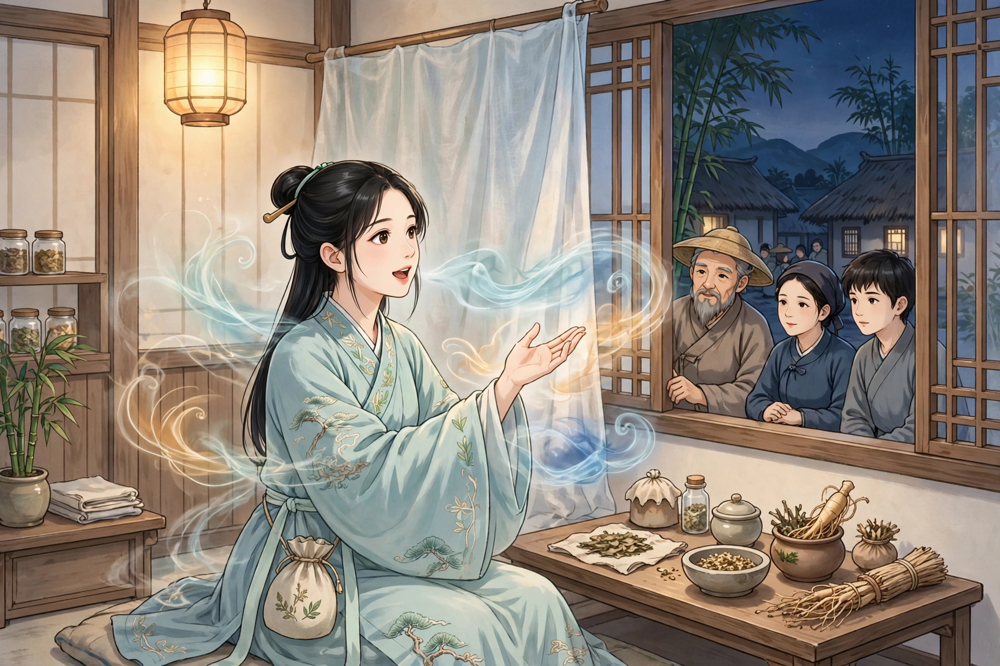
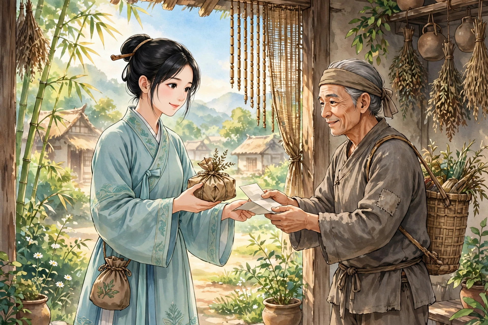

村里来了一个女子，年纪二十四五岁，带着一个药囊，靠卖药行医。有人向她问病，她自己开不出方子，要等到夜里向神仙请教。到了晚上，她把一间小屋打扫干净，把自己关在里面。众人围在门窗外面，侧耳静静地听，只听见里面低声细语，谁也不敢咳嗽，里里外外一点动静都没有。

到了夜里，忽然听见帘子响动。女子在屋里问道：“九姑来了吗？”一个女子答道：“来了。”她又问道：“腊梅跟着九姑来了吗？”像是一个婢女答道：“来了。”三个人絮絮叨叨地说话，声音夹杂在一起，刺刺地响个不停。不一会儿，又听见帘钩响动，女子说：“六姑到了。”乱纷纷的声音说道：“春梅也抱着小郎子来了吗？”一个女子说：“拗哥子！呜呜地不肯睡，一定要跟着娘子来。身子像有百钧那么重，累死人了！”接着就听见女子的殷勤声、九姑的问讯声、六姑的寒暄声、两个婢女的慰劳声、小孩子的喜笑声，一齐嘈杂起来。随即听见女子笑着说：“小郎君也真好玩，大老远地抱着猫儿来了。”过了一会儿，声音渐渐稀疏，帘子又响了，满屋子都哗然说道：“四姑怎么来得这么迟？”有一个小女子细声答道：“路上有千里远，还到处是积水，和阿姑走了这么久才到。阿姑走得又慢。”于是各人道寒问暖的声音、移动座位的声音、招呼添座位的声音，参差交错地一齐响起，满屋子喧闹繁杂，过了一顿饭的工夫才安定下来。

接着就听见女子问病。九姑认为应当用人参，六姑认为应当用黄芪，四姑认为应当用白术。商量了一会儿，就听见九姑叫人拿笔砚来。不一会儿，折纸发出戢戢的声音，拔笔掷笔帽发出丁丁的声音，磨墨发出隆隆的声音；接着把笔扔到桌上，发出震震的响声，便听见抓药包药发出苏苏的声音。

过了一会儿，女子推开帘子，叫病人来，把药和方子交给他。转身回到屋里，就听见三位姑姑告别、三个婢女告别、小孩子哑哑地叫、猫儿唔唔地叫，又一时都响了起来。九姑的声音清亮高越，六姑的声音舒缓苍老，四姑的声音娇柔婉转，连同三个婢女的声音，各有不同的声调，听得清清楚楚，可以分辨。众人都惊讶，以为真的是神仙来了。可是拿了方子回去一试，也并不怎么见效。这就是所说的口技，不过是借它来卖药罢了，然而也实在奇妙啊！

从前王心逸曾经说过：在京城偶然经过集市，听见弦歌声，围观的人像堵墙一样。走近一看，只见一个少年拉长声音唱曲。并没有乐器，只用一个手指按在脸颊边，一边按一边唱，听起来铿锵有力，和弦索的声音没有差别。这也是口技一脉的后辈啊！
