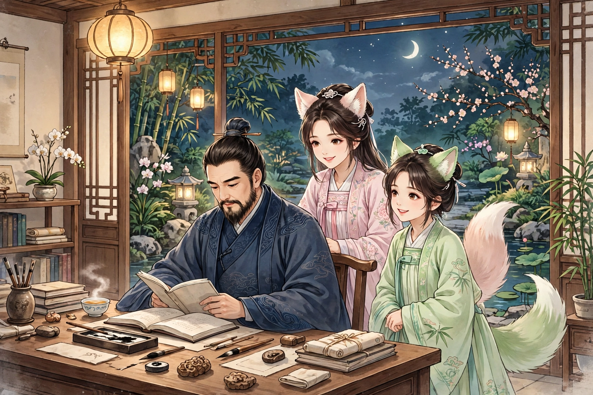
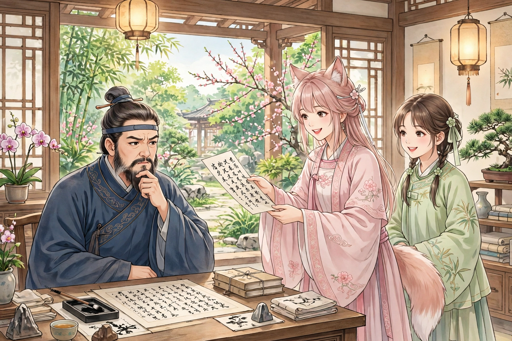

焦生是章丘石虹先生的叔弟，在园子里读书。夜半时分，来了两位美人，容貌都极美。一个约莫十七八岁，一个约莫十四五岁，她们扶着桌子，展开笑容。焦生知道她们是狐，便神色严肃地拒绝了她们。

年长的女子说：“你的胡子像戟一样，怎么没有大丈夫的气概？”焦生说：“我平生不敢亲近妻子以外的女子。”女子笑着说：“迂腐啊！你还守着那些陈腐的规矩吗？下界的鬼神，凡事都把黑说成白，何况是床第之间的琐事呢？”焦生又呵斥她们。女子知道打动不了他，便说：“你是负有盛名的士人，我有一副对联，请你来对，能对出来，我自己就走：戊戌同体，腹中止欠一点。”

焦生凝神思索，对不出来。女子笑着说：“负有盛名的士人原来就是这样吗？我替你对出来好了：己巳连踪，足下何不双挑。”说完一笑而去。
