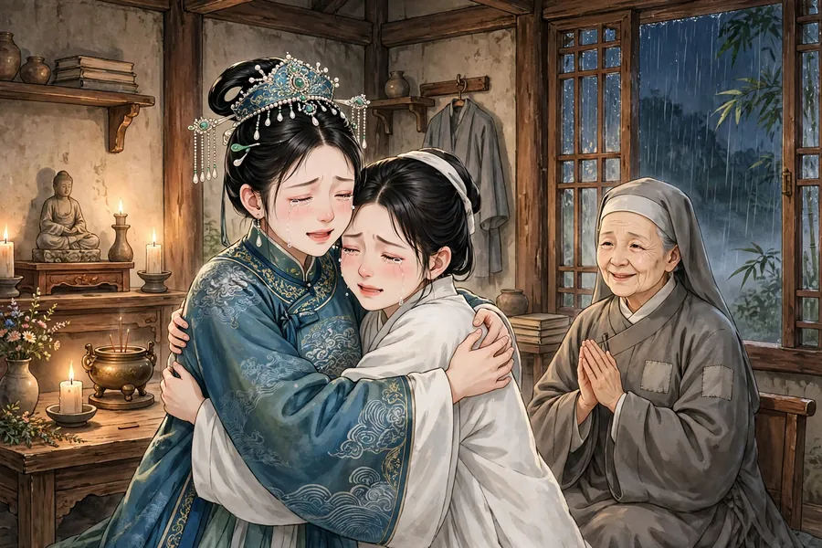

# 130 青梅

## 翻译说明（只写在这里，不写进正文文件）

这篇故事出自清代蒲松龄的《聊斋志异》卷四，篇名《青梅》，以下译文是 Muse 的翻译，只把文言换成今天的话来讲，原意、人物、情节顺序和结局都不改，没有增加人物，没有改动结局。

- 底本与来源：维基文库《聊斋志异/第04卷》直取底本，来源页 https://zh.wikisource.org/wiki/%E8%81%8A%E9%BD%8B%E5%BF%97%E7%95%B0/%E7%AC%AC04%E5%8D%B7 （原地址“聊齋志異/卷四”在维基文库上不存在，实际页面为“第04卷”），转简体字，内容和段落换行不变，未抄现代整理本校注、未抄现代译文。另以维基文库简体页（zh-hans/聊斋志异/第04卷）交叉核对，全文一致。
- 底本字形备注：原文第 6 段“而操作更勤”一句，浏览器初取繁体页时该处字符提取损坏，改以维基文库简体页核对，确为“操作”，与搜索结果引用的繁体页“而操作更勤”一致；第 7 段“己将转沟壑”按维基文库原文照录，未擅改；第 8 段“生㧑谢而退”一字，繁体页为“撝”，OpenCC t2s 转为“㧑”，与维基文库简体页一致。
- 正文文件含图片标记：译文正文直接从故事第一句开始，图片标记只插在段落之间；异史氏曰按原文段落保留在最后。
- 状态：本地草稿，未推 GitHub，未发头条；卷一、卷二、卷三及其他篇未动。
- 有异史氏曰：本篇原文共 11 段，第 11 段为异史氏曰，译文按原文段落保留。

## 人物表（先写人物表，再按人物表生成图片）

- 程生：年轻书生，素色长衫，乌发束髻。只见于图 01。
- 狐女（青梅之母）：年轻女子，青色衣裙，乌发挽髻，玉簪。只见于图 01。
- 青梅：年轻女子，青色衣裙，乌发挽髻；图 04 时已为司李夫人，按原文“珠冠锦衣”着华服、戴珠冠。图 01 为幼年青梅未出场，不画。
- 张生（张介受）：年轻书生，素色长衫，乌发束髻。见于图 02。
- 张母：老年妇人，灰色布衣。见于图 02。
- 阿喜：年轻女子，素衣，乌发挽髻。见于图 04。
- 老尼：老年尼姑，灰色僧衣。见于图 04。

## 图片清单（共 4 张，按篇幅定数）

- images/01.webp：书房内，程生解腰带，狐女从他衣后现身，拢发微笑，对应译文第 1 段（狐女现身、程生与狐狸相好）。
- images/02.webp：简陋农家小屋，张生坐石上吃糠粥，青梅立于门旁看着，张母在屋内、案上放着猪蹄，对应译文第 3 段（青梅见张生啖糠粥、侍奉病父）。
- images/03.webp：明亮小屋窗前，青梅坐绣架前刺绣，针线篮在旁，对应译文第 6 段（青梅嫁入张家、刺绣持家）。
- images/04.webp：暴雨夜庵堂烛光下，珠冠锦衣的青梅与素衣的阿喜重逢相拥而泣，老尼在旁含笑看着，对应译文第 9 段（暴雨庵中重逢、青梅为阿喜易妆）。
- 风格：仙侠、清新、明亮干净，不阴森、不血腥；四图均无文字、无水印。
- 克制处理：张生抱父方便、粪水污衣一节只在文字中如实讲述，图片中不表现任何污秽画面；阿喜被逐、夜奔等情节只在文字中讲述，图片只取重逢一幕。
- 装配位置：图 01 置于译文第 1 段之后，图 02 置于第 3 段之后，图 03 置于第 6 段之后，图 04 置于第 9 段之后；四图都只插在段落之间，不插在段落中间。
- 同脸同服装：青梅四图均为青色衣裙、乌发挽髻（图 04 按原文“珠冠锦衣”改为夫人华服与珠冠，是身份变化，非换装失误）；张生图 02 为素色长衫；以目视核对为准。
- 手机尺寸：01 为 900×600、67KB；02 为 900×600、96KB；03 为 900×600、74KB；04 为 900×600、110KB；合计 346KB，均已去元数据。

## 校验结果（脚本自查）

- 原文段落数：11 段，3317 字（不含换行，含标点；各段 199/119/532/269/484/152/365/422/545/118/112 字）。
- 译文正文段落数：11 段，5109 字（不含换行，含标点；各段 322/185/807/382/732/236/590/671/816/195/173 字）。
- 段落数一致：通过，原文 11 段 = 译文 11 段，换行跟原文走，段内句子连续，不按句分行；异史氏曰为原文第 11 段，译文按段落保留在最后。
- 小标题：通过，译文正文无小标题。
- 新增人物：通过，无新增人物；改结局：通过，结尾仍是张生上书陈情、两人俱封夫人，顺序未改。
- 正文纯净：通过，两正文文件均不含“白话”二字，不含“Muse”，不含来源说明。
- 简体：通过，原文与译文文件已扫查，无繁体残留（OpenCC t2s 再转无变化）。
- 图片标记：通过，译文 .md 含 4 个图片标记  至 ，与 images/ 内的 4 张图一一对应，位置均在段落之间（第 1/3/6/9 段之后）。
- 图片生成：通过，四图均一次生成成功，无失败重跑，文件均非零；尺寸与大小见图片清单。

## 失败项

- 无缺失。本篇原文、译文、README、图片齐全。

## 文件

- 130-青梅-原文.md
- 130-青梅.md
- images/01.webp
- images/02.webp
- images/03.webp
- images/04.webp
- README.md（本文件）
