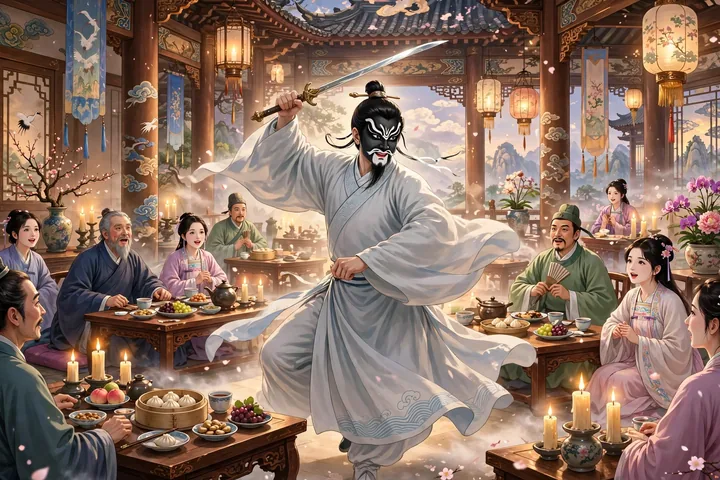
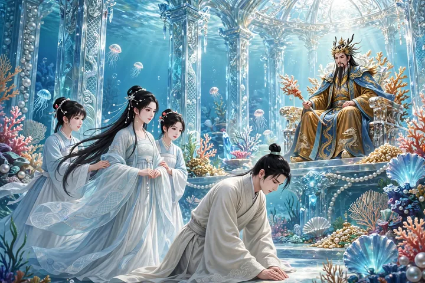
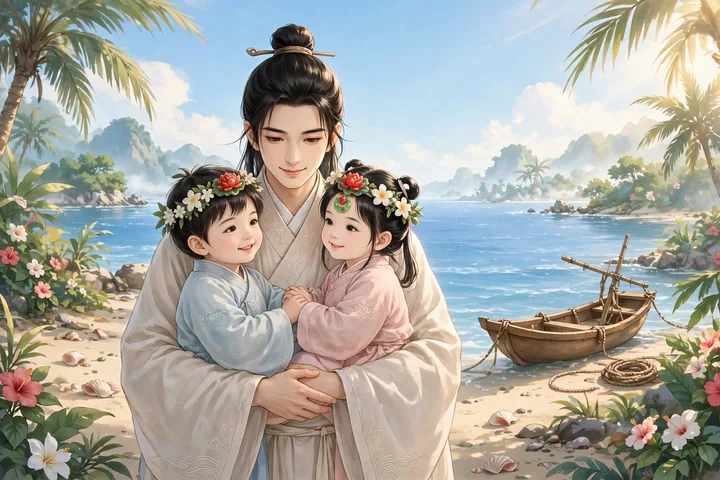

马骥，字龙媒，是个商人的儿子，生得相貌俊美，年轻时性情洒脱，喜欢唱歌跳舞。他常跟着戏班子里的子弟玩，用锦帕包着头，美得像个好女子，因此又得了个“俊人”的外号。十四岁就进了郡学，马上出了名。父亲年老不再经商，回家对他说：“几卷书，饿了不能当饭吃，冷了不能当衣穿，你还是接着做父亲的买卖吧。”马骥从此开始学着做生意，慢慢懂得本钱生利的门道。一次他跟着别人出海，被飓风卷走，飘了几昼夜，来到一座大都会。这里的人都长得奇丑无比，见马骥来了，以为是妖怪，哄叫着跑开了。马骥起初看见他们的模样，也吓得不轻，等明白是这一国的人害怕自己，就反过来拿这个吓唬他们。碰见有人吃饭，他就跑过去，人一惊跑开，他就吃剩下的东西。过了些日子，他走进一个山村，那里人的相貌也有像人的，只是穿得破破烂烂，像叫花子。马骥在树下歇息，村里人不敢上前，只远远地望着他。过了好久，觉得马骥不是吃人的，才慢慢靠近他。马骥笑着跟他们说话，话虽然不同，也有一半能听懂。马骥就把自己的来历告诉了他们，村里人很高兴，挨家挨户去说，来的客人不是会咬人的怪物。可是那些长得奇丑的人远远望见就走开了，始终不敢上前；那些敢来的，口鼻的位置还都和中国人一样，大家摆上酒浆来招待马骥。马骥问他们害怕自己的缘故，他们回答说：“曾听祖父说过，往西二万六千里，有个中国，那里的人相貌大多古怪奇特。只是听人说的，今天才相信是真的。”马骥问他们为什么这样穷，他们说：“我们国家看重的不是文章，而是相貌。长得最美的做上卿；次一等的做地方官；再差一点的，也能得到贵人的宠爱，靠贵人养活妻子儿女。像我们这样的人，刚生下来的时候，父母都认为是不吉利的，常常把孩子丢弃，实在不忍心马上丢掉的，也只是为了留个后代罢了。”马骥问：“这是什么国家？”他们说：“大罗刹国。都城在往北三十里的地方。”马骥请他们带他去看一看。于是第二天天还没亮就起来，和他们一起去了。

天亮时，才走到都城。都城用黑石砌墙，黑得像墨，楼阁将近一百尺高。可是很少有瓦，屋顶盖的是红石，捡起残块在指甲上磨一磨，和丹砂没什么两样。这时正赶上退朝，朝里有车马出来，村里人指着说：“这是相国。”只见相国两只耳朵都长在脑后，鼻子有三个孔，眼睫毛盖住眼睛，像帘子一样。又出来几骑人马，村里人说：“这是大夫。”按次序一一指给他看官职，个个都狰狞古怪。可是官位越低，相貌也越不那么丑。没过多久，马骥回到村里，街上的人望见他，叫喊着奔跑跌倒，像碰见了怪物。村里人再三解释，城里的人才敢远远地站着看。回到村里以后，全国都知道来了个异乡人，于是士大夫们都争着想见识见识，就让村里人把马骥请来。每到一家，看门的人就把门关上，男人女人从门缝里偷偷窥看、窃窃私语，整整一天，没有一个人敢请他进门。村里人说：“这里有个执戟郎，曾经替先王出使过外国，见过的人多，也许不怕你。”于是去拜访执戟郎家。执戟郎果然很高兴，把他当作上等客人来接待。看他的相貌，像八九十岁的人，眼珠突出，胡须卷曲得像刺猬。他说：“我年轻时奉王命出使的次数最多，唯独没有到过中华。如今一百二十多岁了，又能见到上国的人物，这件事不能不禀告天子。可是我隐居在山林里，十多年没有上朝了，明天一早我替你去走一趟。”于是摆上酒菜，按主客的礼节招待他。酒喝了几巡，出来十多个歌舞的女子，轮番歌舞。她们的相貌像夜叉，都用白锦包着头，拖着红衣裳到地上。唱的是什么词听不懂，腔调节拍古怪离奇。主人看着很高兴，问道：“中国也有这样的音乐吗？”马骥说：“有。”主人请他学着唱一唱，于是马骥敲着桌子打节拍，唱了一曲。主人高兴地说：“怪了！这声音像凤凰鸣叫、龙在长啸，从来没有听过。”

第二天，执戟郎上朝，把马骥推荐给国王。国王很高兴，颁下诏书，有两三个大夫说他相貌古怪，怕惊动了圣体，国王就作罢了。执戟郎出来告诉马骥，心里很为他惋惜。住了很久，一次马骥和主人喝酒喝醉了，拿起剑跳起舞来，用煤涂黑了脸，扮成张飞。主人认为很美，说：“请你扮成张飞去见宰相，得到厚禄不难。”马骥说：“开玩笑还可以，怎么能改变面貌去求荣华富贵呢？”主人再三劝他，马骥就答应了。主人设下酒宴，邀请当权的人，让马骥画好脸等着。客人来了，叫马骥出来见客。客人惊讶地说：“怪了！怎么先前那么丑，现在这么美呢！”于是和他一起喝酒，非常高兴。马骥起舞歌唱“弋阳曲”，满座的人没有不倾倒的。第二天，大臣们一起上书推荐马骥，国王很高兴，用旌节把他召来。见了面，国王问他中国治国安邦的道理，马骥委婉详细地陈述上来，很受赞叹，国王在离宫赐宴。酒喝得正酣，国王说：“听说你擅长雅乐，能让我听一听吗？”马骥马上起舞，也学着用白锦包头，唱起靡靡的曲调。国王非常高兴，当天就拜他为下大夫。常常和他私下宴饮，恩宠很不一般。时间久了，官僚们知道他的面貌是假的，到他所到之处，常常看见有人交头接耳，不怎么和他亲近往来。马骥到了这般孤立的地步，心里很不自在。于是上书请求退休，国王不答应；他又请求休假，国王就给了他三个月的假。

于是马骥坐着驿车、带着金宝，回到村里。村里人跪着迎接他。马骥把金钱分给从前和他交好的人，欢呼声像打雷一样。村里人说：“我们这些小人受了大夫的赏赐，明天去赶海市，应当求些珍玩来报答您。”马骥问：“海市是什么地方？”村里人说：“是海里的集市，四海的鲛人聚集起来卖珠宝。周围十二个国家，都来这里做买卖。集市里有许多神仙在游玩。云霞遮住了天，波涛时时涌起。贵人们爱惜自己，不敢冒这个险，都是把金帛交给我们这些人，代他们买奇珍异宝。现在离集市的日子不远了。”马骥问他们怎么知道的，村里人说：“每回看见海上有朱红色的鸟飞来飞去，七天后就是海市。”马骥问了出发的日期，想一起去看看，村里人劝他爱惜自己。马骥说：“我本来就是沧海上的客人，怕什么风浪？”没过多久，果然有人上门来托他代买东西，于是他带着钱财上了船。船能容纳几十个人，平底高栏，十个人摇橹，激起的水像箭一样快。一共走了三天，远远望见水云荡漾之中，楼阁层层叠叠，做买卖的船聚集得像蚂蚁一样。不一会儿到了城下，看见城墙上的砖都和人一样长，敌楼高得接上云天。把船系好走进去，看见集市上陈列的东西，奇珍异宝，光芒射人眼睛，大多是人世间没有的。

有个少年骑着骏马来了，集市上的人都奔跑躲避，说是“东洋三世子”。三世子经过时，看了马骥一眼，说：“这不是外国人。”马上就有随从前来问他的乡籍。马骥在路边行礼，把自己的家世一一说了。三世子高兴地说：“承蒙您光临，缘分不浅！”于是给马骥一匹马，请他并骑同行。出了西城，刚到岛边，所骑的马嘶叫着跃入水中。马骥大惊失声，只见海水从中分开，像墙一样直立。忽然看见一座宫殿，用玳瑁做梁，用鲂鱼的鳞做瓦，四壁晶莹明亮，照见人影，光彩夺目。下马行礼进去，抬头看见龙君坐在上面，三世子启奏说：“臣到集市上游玩，得到一位中华的贤士，带来拜见大王。”马骥上前拜舞。龙君说：“先生是文学之士，一定能胜任屈原、宋玉那样的职位。想请您用大笔写一篇《海市赋》，千万不要吝惜珠玉般的文辞。”马骥磕头领命。龙君赐给他水晶做的砚台、龙须做的笔，纸光亮像雪，墨香像兰花。马骥立刻写成一千多字的赋，献到殿上。龙君拍着节拍说：“先生雄才大略，给水国增添了光彩！”于是召集龙族的众人，在采霞宫设宴。酒菜上了几巡，龙君举着酒杯对客人说：“寡人疼爱的女儿，还没有好夫婿，想把她托付给先生。先生如果有意呢？”马骥离席，感激又惭愧，只唯唯答应。龙君看了看左右说了几句。没过多久，几个宫女扶着一位女郎出来，佩环叮当，鼓乐大作。女郎拜完偷偷看他一眼，实在是个仙人。女郎拜过就走了。过了一会儿酒宴散了，两个丫鬟挑着画灯，领马骥进了偏宫，女郎浓妆打扮，坐在那里等他。珊瑚做的床上装饰着八宝，帐外的流苏上缀着像斗那么大的明珠，被褥又香又软。天刚亮，小丫鬟和梳着妖髻的侍女跑进来挤满了屋子。马骥起来，赶去朝拜致谢。龙君拜他为驸马都尉。龙君把他的赋传到各海，各海的龙君都派专人来祝贺，争着写信请驸马去喝酒。马骥穿着绣花的衣裳，骑着青虬，鸣锣开道出来。几十名武士骑着马，背着雕弓，扛着白棒，光彩耀眼，簇拥着他。马上弹着筝，车里奏起玉器的乐声。三天里，走遍了各海。从此“龙媒”的名字，传遍了四海。宫里有一棵玉树，粗得合抱才围得过来，树干莹澈得像白琉璃，中间有一根淡黄色的树心，比手臂略细，叶子像碧玉，有一枚铜钱那么厚，细碎繁密，遮出浓浓的树荫。马骥常常和龙女在树下放声歌咏。花开满树，形状像薝葡花。每一片花瓣落下来，锵然作响。捡起来看，像赤红玛瑙雕成的，光彩可爱。时常有异鸟飞来鸣叫，羽毛金碧相间，尾巴比身子还长，声音像哀婉的玉磬，听得人心里发酸。马骥听见了，就想起故乡。于是对龙女说：“出来已经三年了，父母远隔，每次想起来，就泪流满面、汗湿脊背。你能跟我回去吗？”龙女说：“仙界和尘世路途隔绝，不能相依。我也不忍心因为鱼水之爱，夺走你膝下的欢乐。让我慢慢想办法吧。”马骥听了，忍不住流下泪来。龙女也叹息说：“这种情形，是不能两全的啊！”第二天，马骥从外面回来。龙王说：“听说驸马想念故乡，明天一早就收拾行装，可以吗？”马骥谢道：“我是个旅居的孤臣，承蒙您过分宠爱，报答的心意结在肺腑。容我暂且回去探望父母，再图相聚。”到了晚上，龙女摆酒话别。马骥约定后会，龙女说：“情缘已经尽了。”马骥非常悲伤，龙女说：“回去奉养双亲，是为了见你的孝心，人生聚散，一百年也像旦夕一样，何必做儿女般的哀泣呢？此后我为你守贞，你为我守义，两地同心，就是夫妻，何必朝夕相守，才叫作白头偕老呢？如果违背这个盟约，婚姻就不吉利。倘若担心家里没有人操持，纳个婢女就可以了。还有一件事要嘱咐你：我如今有了身孕，好像有好征兆，请你给孩子取个名字。”马骥说：“如果是女儿可以叫龙宫，如果是儿子可以叫福海。”龙女讨一件东西做信物，马骥把在罗刹国得到的赤玉莲花一对拿出来，交给龙女。龙女说：“三年后四月八日，你应当泛舟到南岛，我把孩子还给你。”龙女用鱼皮做成袋子，装满珠宝，交给马骥说：“好好收藏，几代人吃用不尽。”天刚亮，龙王设宴饯行，送的东西很丰厚。马骥拜别出宫，龙女坐着白羊拉的车，送他到海边。马骥上岸下马，龙女说了声珍重，回车就走了，不一会儿就远了，海水重新合上，再也看不见了。马骥于是回家。

自从马骥出海，家里人都以为他已经死了；等他回来，家里人都很惊异。幸好父母都还健在，只是妻子已经去世了。这才明白龙女“守义”的话，原来她早就知道了。父亲想再给马骥娶妻，马骥不肯，只纳了一个婢女。他牢牢记着三年之期，泛舟到岛上。看见两个孩子坐在水面上，拍着水嬉笑，既不沉下去也不动。走近拉他们，孩子呀呀地叫着，抓住马骥的手臂，跳进他怀里。另一个大哭起来，好像怪马骥不先拉他。马骥也把他拉上来。仔细看，一个男孩一个女孩，相貌都很俊秀。额上的花冠上缀着玉，就是那对赤玉莲花。背后有个锦囊，拆开看，里面有一封信，写着：“公婆都还安好。匆匆三年，红尘永远隔绝；盈盈一水，青鸟难以传递消息。把思念当成梦，翘首盼望成了辛劳。茫茫的蓝天，有恨又能怎么样呢！想想奔月的嫦娥，还要独守桂宫；投梭的织女，还在为银河叹息。我是什么人，怎能永远美好？想到这里，又破涕为笑。分别后两个月，竟然生了一对双胞胎。如今他们在怀抱里呀呀学语，已经懂得言笑；找枣子抓梨子吃，没有母亲也能活。恭敬地把他们还给您。从前您送的赤玉莲花，装饰在花冠上作为信物。抱着孩子跪在膝头时，就像我还在您左右。听说您能信守旧约，我的心愿也就安慰了。我这一生绝不改变主意，至死也不会有二心。妆奁里的珍物，不再藏着兰膏；镜子里的新妆，早就不再涂脂抹粉。您像出征的人，我像等待的妇人，即使把我放在一边不理会，又怎么能说不是夫妻呢？只是想着公婆已经抱上了孙子，却一次也没有见过新媳妇，按情理来说，也是一件缺憾的事。明年婆婆下葬的时候，我应当去坟前拜祭，尽一尽做媳妇的职责。从那以后，‘龙宫’没有病痛，不少可以把握的日期；‘福海’长寿，也许还有往来的路。望您珍重，话说不尽。”马骥反复读着信，流下泪来。两个孩子抱着他的脖子说：“回家去吧！”马骥更加悲痛地抚摸着他们，说：“孩子知道家在哪里吗？”孩子哭着，呀呀地说要回家。马骥看见海水茫茫，无边无际，雾里的人影渺茫，烟波中的路已经断绝。抱着孩子摇船回去，心里怅然。

马骥知道母亲寿命不长了，送终的东西都预备齐全，墓里种了一百多棵松树和槚树。过了一年，母亲果然去世了。灵柩到了殡宫，有个穿着丧服的女子在墓穴前哭拜。大家惊讶地看着她，忽然风声大作、雷声轰鸣，接着下起急雨，转眼间她就不见了。新种的松柏大多枯死了，到这时都活了过来。福海稍稍长大，常常想念母亲，忽然自己跳进海里，几天后才回来。龙宫因为是女子不能去，常常关上门哭泣。一天白天忽然昏暗下来，龙女急忙进来，制止她说：“孩子已经成家了，哭什么呢？”于是赐给她八尺高的珊瑚一株、龙脑香一帖、明珠一百粒、八宝嵌金的盒子一双，作为嫁妆。马骥听见了，突然闯进来，拉着龙女的手抽泣。过了一会儿，迅雷击破了屋子，龙女已经不见了。

异史氏说：“拿着花一样的面孔去迎合别人，世上的人情就像鬼一样。喜欢舔痔疮的癖好，全天下都是一样的。‘小惭小好，大惭大好’。如果公然带着胡须眉毛到城里去游玩，不被吓得跑开的人能有几个呢！那个陵阳的痴人，要抱着价值连城的美玉到哪里去哭呢？唉！显荣富贵，应当到蜃楼海市里去求啊！”
