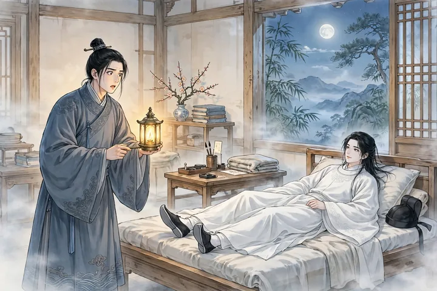
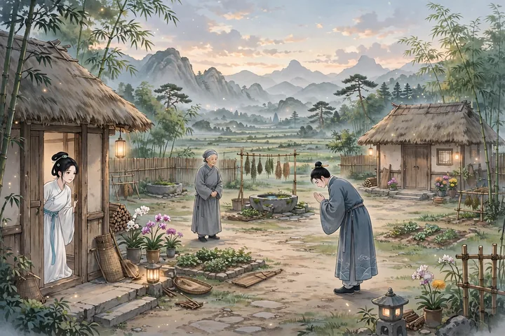
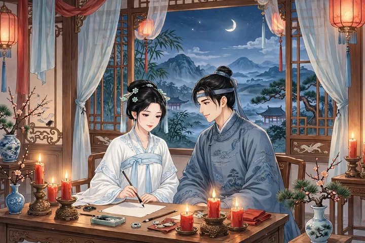
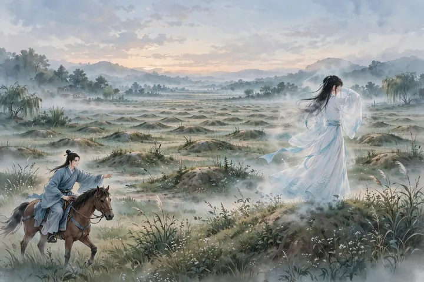

于七的案子牵连坐罪被杀的人，栖霞、莱阳两县最多。有一天，几百名囚犯一起被杀在演武场上，碧血流满地面，白骨堆得撑天。上官动了慈悲心，捐钱买棺木收殓，济南城里的木材店一时木料都卖空了。因为这样，被处死的鬼魂大多葬在南郊。甲寅年间，有个莱阳的书生到稷下来，他的两三个亲友也在被杀的人数里面，于是他买了纸钱，到荒郊野外去祭奠，就在下院的僧舍里借住。第二天，他进城去办事，天黑了还没有回来。忽然有个少年到他住处来拜访，看见书生不在，脱了帽子，穿着鞋就仰面躺到床上。仆人问他是谁，他闭着眼睛不答话。过了一会儿书生回来，天色昏暗，看不大清楚，就走到床边问他，那少年睁开眼睛说：“我等你家主人，你这个仆人啰啰嗦嗦地逼问，我难道是强盗吗！”书生笑着说：“主人就是我。”少年立刻起身戴上帽子，作揖坐下，极其热情地寒暄，听他的声音，好像从前认识。急忙叫人点灯来一看，原来是同县的朱生，也是死在于七那场灾难里的。书生大惊，转身要跑，朱生拉住他说：“我和你是文字之交，怎么这样薄情？我虽然是鬼，对老朋友的思念还耿耿不忘。今天有件事求你，希望你不要因为我是异类就嫌弃我。”书生这才坐下来，问他有什么事。朱生说：“令外甥女守寡没有丈夫，我想娶她做我的妻子。屡次托媒人去说，总是以没有尊长做主为借口推辞。希望你不吝惜一句话成全我。”先前，书生有个外甥女，很早就没了母亲，寄托给书生抚养，十五岁才回到她自己家里。被抓到济南的时候，听说父亲被处死了，惊吓过度就死了。书生说：“她自有父亲，你找我干什么？”朱生说：“她父亲给伯父的儿子迁葬去了，如今不在这里。”问：“外甥女现在靠谁生活？”说：“和邻居的老婆婆同住。”书生担心活人不能给鬼做媒。朱生说：“如果你答应了，还要劳烦你亲自走一趟。”说完起身握住书生的手，书生再三推辞，问：“去哪里？”说：“你只管走就是了。”书生勉强跟着他去了。

往北走了一里多路，有个大村落，约有几十上百户人家。来到一座宅院门前，朱生用手指弹门，立刻有个老婆婆出来，把两扇门大开着，问朱生：“什么事？”说：“麻烦你通报娘子，说她舅舅来了。”老婆婆转身进去，过了一会儿又出来，请书生进去，回头对朱生说：“两间茅草屋太小了，劳烦公子在门外稍坐等候。”书生跟着她进去。看见半亩荒凉的庭院，排列着两间小屋。外甥女迎到门口啜泣，书生也哭了，屋里灯火明亮。外甥女容貌清秀洁净，和活着的时候一样，凝视着书生含泪，遍问舅舅舅母的情况。书生说：“都平安无事，只是你舅母去世了。”外甥女又呜咽着说：“我从小受舅舅舅母抚养，还没有报答一分，没想到先葬身在沟壑里，实在遗憾。前年伯伯家的大哥迁父亲的坟去了，把我丢在一边全不顾念，几百里外，我孤零零得像秋天的燕子。舅舅不嫌弃我这个沉沦的魂魄，又蒙你赐给我金帛，我已经得到了。”书生把朱生的话告诉她，外甥女低头不说话。老婆婆说：“公子从前托杨老婆婆来过三五回，我看是桩好事。小娘子不肯自己草草决定，有舅舅做主，这才心里满意。”说话间，一个十七八岁的女郎，跟着一个青衣丫鬟匆匆掩进门来，一瞥看见书生，转身要跑。外甥女拉住她的衣襟说：“不用这样！这是舅舅。”书生向她作揖，女郎也敛衽还礼。外甥女说：“九娘，是栖霞公孙家的。她爹是旧家子弟，如今也是个‘穷波斯’，落魄不得意。早晚和我来往。”书生看着她，笑起来像弯弯的秋月，害羞得脸上晕起朝霞，真是天上的人。书生说：“一看就知道是大家闺秀，蜗居陋巷里的人家怎么会有这样娟秀美丽的女子！”外甥女笑着说：“还是个女学士，诗词都写得极高。昨天还得了她的指教。”九娘微微一笑说：“小丫头无端败坏人，教舅舅笑话了。”外甥女又笑着说：“舅舅死了妻子还没续娶，这样的小娘子，能不能合你的意？”九娘笑着跑出去了，说：“丫头疯疯癫癫的！”走了，虽然话近乎戏谑，书生却十分喜欢她，外甥女似乎微微察觉了，就说：“九娘才貌无双，舅舅如果不嫌弃她是粪土一样的人，我就去向她母亲求亲。”书生大喜，只是担心人鬼难以结为夫妻。外甥女说：“不要紧，她和舅舅有前世的缘分。”书生这才出来。外甥女送他，说：“五天以后，月明人静的时候，会派人来迎接你。”书生走到门外，不见朱生了。抬头向西望，月亮衔着半轮，昏黄中还认得出旧路。看见南边一座宅院，朱生坐在门前的石头上，起身迎接说：“等候已久，我的寒舍就劳烦你光临了。”于是两人携手进去，殷勤地道谢。朱生拿出金爵一只、晋珠一百枚，说：“没有别的长物，聊当作聘礼。”接着又说：“家里有浊酒，只是幽冥中的东西，不值得款待嘉宾，怎么办！”书生推辞谢绝退了出来。朱生送到半路，才告别。

书生回去，僧人和仆人围上来问，他隐瞒说：“说鬼的人胡说八道，我刚才不过是和朋友喝酒去了。”五天以后，朱生果然来了，穿戴整齐摇着扇子，十分高兴。刚到门口，看见书生就望尘下拜。笑着说：“你的喜事已经成了，庆贺就在眼前，还要烦劳你走一趟。”书生说：“没有回音，也没下过聘，怎么就成了亲？”朱生说：“我已经替你下过聘了。”书生深深感激，跟着他一起去了。一直走到外甥女的卧房，只见外甥女盛装迎接，笑着。书生问：“什么时候出嫁的？”外甥女说：“三天了。”朱生拿出所赠的珍珠，给外甥女添妆。外甥女三次推辞才接受，对书生说：“我把舅舅的意思告诉了公孙老夫人，老夫人大为高兴。只是说自己年老，没有别的骨肉，不愿意九娘远嫁，希望今天晚上舅舅到她家里去入赘。她家没有男子，正好可以和郎君一起住过去。”朱生就引路前去。村子快走完了，一座宅院的门开了，两人登上堂屋。不一会儿有人通报：“老夫人来了。”有两个青衣丫鬟扶着老妇人上台阶。书生想行大礼拜见，老夫人说：“我老迈龙钟，不能行礼，就免去这些客套吧。”她指使青衣丫鬟，摆酒设宴，大会宾客。朱生叫家人另外拿出菜肴，摆在书生面前；又另外设了一壶酒，轮流给客人敬酒。筵席上的饭菜，和人世间没什么两样。只是主人自己举杯，从不劝人进酒。

不久宴席散了，朱生回去。青衣丫鬟引书生进屋，只见九娘在华烛下凝神等待。两人一见倾心，极尽欢爱缠绵。起初，九娘母女俩，本来是被解送进京的。到了郡里，母亲经受不住困苦死了，九娘也自刎而死。九娘在枕上追述往事，哽咽得睡不着觉，于是口占了两首绝句：“昔日罗裳化作尘，空将业果恨前身。十年露冷枫林月，此夜初逢画阁春。”“白杨风雨绕孤坟，谁想阳台更作云？忽启镂金箱里看，血腥犹染旧罗裙。”天快亮了，九娘就催促说：“你应该去了，不要惊动仆人。”从此以后白天来晚上去，欢爱缠绵到了极点。

一天晚上书生问九娘：“这个村子叫什么名字？”九娘说：“莱霞里。村里多是两处新来的鬼魂，所以用这个名字。”书生听了叹息。九娘悲伤地说：“千里之外的柔弱魂魄，飘游没有归宿，母子孤零零的，说起来让人伤心。希望你念在一夜恩情，把我和母亲的尸骨收回去，葬在你家坟墓旁边，让我们百年有个依托，死了也不朽。”书生答应了。九娘说：“人鬼走的路不同，你不宜久留。”于是拿一只罗袜送给书生，挥泪催他告别。书生凄然走出来，悲痛得不忍回去。于是顺路去敲朱生的门。朱生赤脚出来迎接；外甥女也起来了，云鬓蓬松，惊讶地来问候。书生怅惘了好一会儿，才说出九娘的话。外甥女说：“舅母不说，我也早晚想着这件事。这里不是人世间，不可久留。”于是两人相对流泪，书生也含泪告别。回到住处躺下，辗转反侧到天亮。想去找九娘的坟墓，却忘了问坟墓的标记。到了夜里再去，千坟累累，竟然迷失了村路，叹恨而回。打开罗袜一看，被风一吹就寸寸断裂，腐烂得像灰烬一样，于是收拾行装向东回去了。

半年不能忘怀，书生又回到稷门，希望能再遇到九娘。到了南郊，天色已晚，在树下休息，走到丛葬的地方去。只见坟墓万座相连，荒草遮住了视线，鬼火狐鸣，吓得人心惊。书生惊悼地回到住处。失意地游荡，调转马头向东走。走了里把路，远远看见一个女子站在丘墓上，神情意态，很像九娘。书生挥鞭走近一看，果然是九娘。下马和她说话，九娘径直走开，好像不认识他。再走近一些，九娘面带怒色，举袖遮住自己。书生急忙喊“九娘”，她就烟一样消散了。

异史氏说：“香草埋在罗裙里，血满胸怀；东山的佩玉，泪水浸湿泥沙。自古有孝子忠臣，到死也不被君父谅解。公孙九娘难道是因为背负着尸骨的托付，而怨恨不释怀吗？脾膈之间的东西，不能掏出来给人看，真是冤枉啊！”
