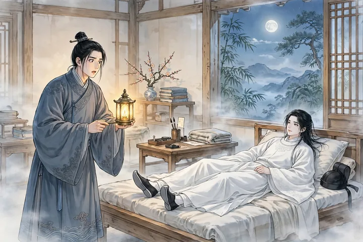

# 135 公孙九娘

## 翻译说明（只写在这里，不写进正文文件）

这篇故事出自清代蒲松龄的《聊斋志异》卷四，篇名《公孙九娘》，以下译文是 Muse 的翻译，只把文言换成今天的话来讲，原意、人物、情节顺序和结局都不改，没有增加人物，没有改动结局。

- 底本与来源：原文取自维基文库《聊斋志异/第04卷》直取底本，转简体；并以诗典古文分篇页（https://www.shidianguwen.com/zhang-jie-xiang-qing/2630171.html）逐字交叉核对，全文一致（引号按卷四已推篇目惯例用「」，诗典古文页用的是“”，已统一改回「」）。未抄现代整理本校注、未抄现代译文。分段按维基文库卷四页：全篇 7 段（含异史氏曰 1 段）。
- 正文文件含图片标记：译文正文直接从故事第一句开始，图片标记只插在段落之间；图 1 在第 1 段之后，图 2 在第 2 段之后，图 3 在第 4 段之后，图 4 在第 6 段之后。
- 状态：本地草稿，未推 GitHub，未发头条；卷一、卷二、卷三及其他篇未动。
- 有异史氏曰：按原文段落保留在译文末段。

## 人物表（先写人物表，再按人物表生成图片）

- 莱阳生：年轻书生，青灰长袍，黑发束髻。见于图 01（持灯惊视）、图 02（庭中作揖）、图 03（烛下相伴）、图 04（马上伸手）；四图同人同服。
- 朱生：同邑少年，面色苍白，白袍。只见于图 01（仰卧床上）。
- 外甥女：年轻女子，面色苍白，浅灰蓝衣裙。只在文字中出现，图中未画。
- 公孙九娘：年轻女子，白衣浅蓝腰带，黑发高髻，容貌清秀、神情忧伤。见于图 02（门边含羞探身）、图 03（华烛下执笔写诗）、图 04（坟头举袖自障）；三图同人同脸同服。
- 邻媪：白发老妇，灰布衣。只见于图 02（庭中站立）。
- 老夫人：年迈老妇，深色袍服。只在文字中出现，图中未画。

## 图片清单（共 4 张，按篇幅定数）

- images/01.webp：夜里书生住处，青灰袍书生持灯惊视，白袍少年仰卧床上，月光窗外，对应译文第 1 段（朱生夜访、灯下相认）。
- images/02.webp：黄昏鬼村荒庭，两间茅屋，门边白衣浅蓝腰带的九娘含羞探身，灰衣老媪庭中站立，青灰袍书生躬身作揖，对应译文第 2 段（村中相见、初见九娘）。
- images/03.webp：华烛洞房夜，白衣九娘执笔写诗，青灰袍书生在旁凝视，红烛高烧，对应译文第 4 段（华烛之夜、口占两绝）。
- images/04.webp：黄昏南郊葬地，万坟相连，白衣九娘立于丘墓举袖自障、身形如烟，青灰袍书生骑马伸手，对应译文第 6 段（坟头重逢、烟然灭去）。
- 风格：仙侠、清新、明亮干净，不阴森、不血腥；四图均无文字、无水印。
- 克制处理：于七屠杀、母女自刎只在文字中讲述，图片不作血腥表现；图 04 取坟头重逢一幕，意境凄婉而不惊吓。
- 装配位置：图 1 在译文第 1 段之后，图 2 在第 2 段之后，图 3 在第 4 段之后，图 4 在第 6 段之后；图都不插在段落中间。
- 同脸同服装：九娘三图均为白衣浅蓝腰带、黑发高髻；书生四图均为青灰长袍；以目视核对为准。
- 手机尺寸：01 为 720×480、63KB；02 为 720×480、87KB；03 为 720×480、80KB；04 为 720×480、58KB；合计 290KB，均已去元数据。

## 校验结果（脚本自查）

- 原文段落数：7 段，2317 字（不含换行，含标点）。
- 译文正文段落数：7 段，3348 字（不含换行，含标点，不含图片标记）。
- 段落数一致：通过，原文 7 段 = 译文 7 段，换行跟原文走，段内句子连续，不按句分行；异史氏曰保留在末段。
- 小标题：通过，译文正文无小标题。
- 新增人物：通过，无新增人物；改结局：通过，结尾仍是坟头重逢、九娘烟然灭去，顺序未改。
- 正文纯净：通过，两正文文件均不含“白话”二字，不含“Muse”，不含来源说明。
- 简体：通过，原文与译文文件已扫查，无繁体残留（OpenCC t2s 再转无变化）。
- 图片标记：通过，译文 .md 含 4 个图片标记 、、、，与 images/ 内的 4 张图一一对应，位置均在段落之间。
- 图片生成：通过，四图一次生成成功，均已目视核对，场景与译文段落对应，同人同服；两图文件均非零；尺寸与大小见图片清单。

## 失败项

- 无。原文、译文、README、图片齐全，无缺失。

## 文件

- 135-公孙九娘-原文.md
- 135-公孙九娘.md
- images/01.webp
- images/02.webp
- images/03.webp
- images/04.webp
- README.md（本文件）
