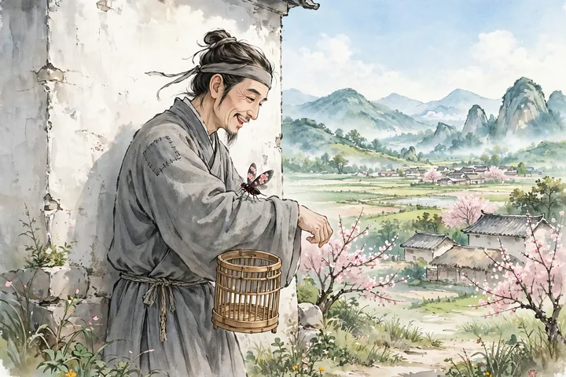
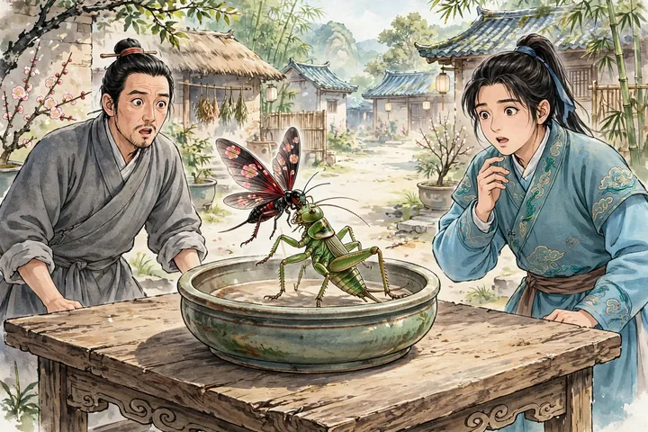
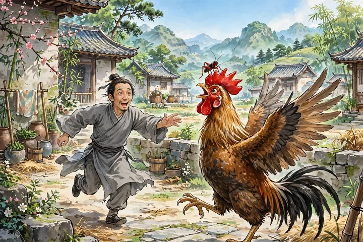
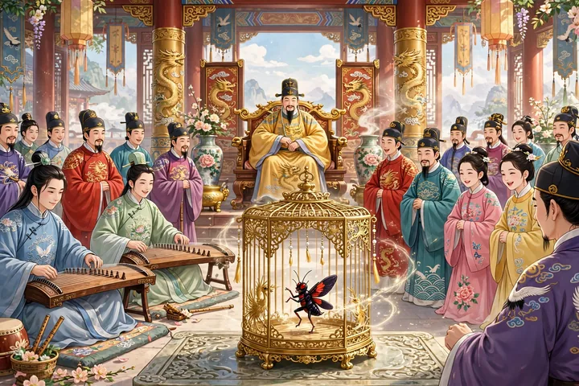

宣德年间，宫里喜好斗蟋蟀的游戏，每年向民间征收。这种东西本来不是本地出产的。有个华阴县令，想要讨好上司，拿一只蟋蟀进献上去，试着让它斗一斗还有点本事，于是上司就责令他经常进贡。县令又把这差事压到里正头上。

市里的游手好闲的少年，得到了好的蟋蟀就用笼子养起来，抬高价钱，当作奇货来卖。里胥狡猾奸诈，借着这个名目向每户人家摊派，每要一只蟋蟀，常常倾尽好几户人家的财产。

县里有个叫成名的人，读童子试的书，很久考不上。成名为人迂腐迟钝，就被狡猾的里胥报上去充当里正的差役，用尽办法也脱不了身。不到一年，微薄的家产都耗尽了。正赶上征收蟋蟀，成名不敢向各家各户摊派，又没有东西可以赔偿，忧愁烦闷得想死。妻子说：“死了有什么好处？不如你自己去找找，或许有万分之一的希望。”成名觉得有道理。从此早出晚归，提着竹筒和铜丝笼子，在破墙和丛草的地方翻石头、掏洞穴，什么办法都用尽了，还是没有收获。即使抓到三两只，也都瘦弱不堪，不合要求。县官严限追比，十多天里，成名被打了一百杖，两腿之间脓血流淌，连去捉虫的路都走不动了。在床上翻来覆去，只想自杀。这时村里来了一个驼背巫婆，能用神灵占卜。成名的妻子拿钱去问，看见红衣女子和白发老婆婆，把门口都挤满了。走进她的屋子，只见密室里垂着帘子，帘子外面设着香案。求问的人在鼎里烧香，再拜。巫婆在旁边望着空中替神祝祷，嘴唇开合，不知道说些什么，各人都肃立着听。不一会儿，帘子里扔出一张纸来，正好说中求问者心里的事，没有一点差错。成名的妻子把钱放在案上，烧香拜了又拜。过了一顿饭的工夫，帘子动了，一片纸抛落下来。捡起来看，不是字而是一幅画，画里有一座殿阁像寺庙，后面小山下怪石横卧，针一样尖的丛棘，青麻头伏在那里；旁边一只癞蛤蟆，好像要跳舞。反复看不明白。但看见画上有蟋蟀，暗合心里的事，就折起来藏好，回去拿给成名看。成名反复想：“这难道是教我去找虫子的地方吗？”仔细看画里的景象，和村东大佛阁真是一模一样。于是成名勉强起来拄着拐杖，拿着画到寺庙后面，有一座古坟高高隆起。沿着古坟走过去，看见蹲着的石头鳞鳞相连，俨然和画里一样。就在蒿草丛中侧耳慢走，好像在寻找针芥一样，心、眼、耳的力气都用尽了，一点踪影响动都没有。仔细搜寻还没有完，一只癞头蛤蟆忽然跳了出去。成名更加惊愕，急忙追赶它。蛤蟆进了草丛，成名循着踪迹拨开草找，看见一只虫子伏在棘根下面，急忙扑过去，虫子钻进了石洞里。用尖草挑它不出来，用竹筒灌水它才出来。形状极其俊健，成名追上去捉住了它。仔细一看：身子大尾巴长，青色的脖子金色的翅膀。成名大喜，装进笼子带回家，全家人庆贺，纵然是连城璧也不过如此了。把虫子放在土盆里养着，用蟹白和栗黄喂它，百般爱护。留着它等到限期，好交差塞责。

成名有个九岁的儿子，趁父亲不在，偷偷打开盆子，虫子一跃就跳了出来，快得抓不住。等到扑到手里，已经腿断肚裂，片刻就死了。儿子害怕，哭着告诉母亲。母亲听了，面色灰白像死人一样，大骂说：“业障，死期到了！你爹回来，自会和你算账！”儿子哭着跑了出去。不一会儿成名进来，听妻子一说，如同被冰雪浇头。怒气冲冲地找儿子，儿子却渺然不知去向；后来，在井里找到了他的尸体。于是成名化怒为悲，捶胸大呼，几乎气绝。夫妻俩对着墙角，茅屋里没有炊烟，相对默默无言，再没有心思过日子。

天快黑了，把儿子的尸体用草席裹了葬了，走近去抚摸，气息还有一点微弱。欢喜地把他放在床上，半夜又苏醒过来，夫妻俩心里稍稍安慰。只是儿子神气痴呆木讷，奄奄地只想睡觉，成名看见蟋蟀笼子空了，就气断声吞，也不再把儿子放在心上，从黄昏到天亮，眼睛没有合过。太阳升起来了，成名僵卧在长愁之中。忽然听见门外虫子叫，惊起去看，虫子宛然还在，欢喜地去捉它。虫子一叫就跳开，走得很快。用手掌盖住它，手掌下好像空无一物；手刚抬起，虫子又跳起来了。急忙追赶它，转过墙角，不知它去向了。徘徊四顾，看见虫子伏在墙上。仔细看它，短小，黑红色，一下子看出不是先前那只。成名因为它小，看不起它；只顾徘徊瞻望，寻找追逐的那只。墙上的小虫子，忽然跳落到成名的衣襟袖子里，看它的形状像土狗，有梅花翅膀，方头长腿，看上去倒是个好虫。成名欢喜地收了它。准备献到公堂，又惴惴不安，怕不合县官的心意，想先试着斗一斗看看。

村里有个好事的少年，驯养了一只虫子，自己取名叫“蟹壳青”，天天和子弟们斗，没有不胜的。他想拿它当利来赚钱，却抬高了价钱，也没人买。他径直来到成名家里拜访。看见成名养的虫子，掩口大笑起来。于是拿出自己的虫子，放进比试的笼子里。成名看见它，庞大修长，自己更加惭愧，不敢和它较量。少年坚持要比。成名想：养着劣等的虫子终究没用，不如拼着博一笑。于是把两只虫子一起放进斗盆里。小虫伏着不动，蠢得像木鸡一样。少年又大笑。用猪鬃毛撩拨小虫的触须，小虫还是不动。少年又笑。屡次撩拨它，小虫暴怒，直奔过去，互相腾跃击打，振奋作声。忽然看见小虫跃起来，张开尾巴伸出触须，一口咬住敌虫的脖子。少年大骇，解开笼子让它们停下来。小虫翘起头矜夸地鸣叫，好像在向主人报功。成名大喜。

正一起观赏，一只鸡忽然飞来，径直进前一啄。成名惊慌失措，大声呼喊。幸好没有啄中，虫子跳开一尺多远。鸡健步追来，紧逼着它，虫子已经在鸡爪下面了。成名仓猝间不知怎么救它，跺脚失色。忽然看见鸡伸着脖子扑腾；走近一看，虫子停在鸡冠上，用力叮住不放。成名更加惊喜，把它放进笼子里。

第二天献给县官。县官看见虫子小，愤怒地呵斥成名。成名述说它的奇异之处，县官不相信。试着让它和其他虫子斗，别的虫子都败了；又试着让它斗鸡，果然和成名说的一样。县官就赏赐成名，把虫子献给巡抚。巡抚大喜，用金笼子进献给皇上，详细上奏它的本领。虫子进了宫中，把天下进贡的蝴蝶、螳螂、油利挞、青丝额……一切奇异的虫子，全部试了一遍，没有能比得过它的。每当听见琴瑟的声音，虫子就应着节拍起舞，更加奇异了。皇上大为嘉悦，下诏赏赐巡抚名马和衣缎。巡抚不忘虫子是成名进献的，不久，县官凭着“卓异”被上报朝廷。县官高兴，免了成名的差役；又嘱托学使，让成名进了县学。过了一年多，成名的儿子精神恢复了，自己说：“我变成蟋蟀，轻捷善斗，现在才苏醒过来。”巡抚也厚厚地赏赐成名。不到几年，成名有了田地一百顷，楼阁上万间，牛羊各数千只。一出门，车马衣裘超过了世家大族。

异史氏说：“皇帝偶然喜欢一件东西，未必过后就忘了；而奉行的人就把它定为成例。加上官吏贪婪残暴，百姓每天卖妻卖儿，永无休止。所以皇帝的一举一动都关系百姓的性命，不可轻忽。成家的儿子因为贫穷而死，因为蟋蟀而富，衣裘车马扬扬得意。当他做里正、受杖责的时候，哪里想到会到这个地步！上天要酬报厚道的人，就让巡抚、县令一并受到蟋蟀的恩荫。听说：一个人升仙，鸡犬也跟着升天。信然啊！”
