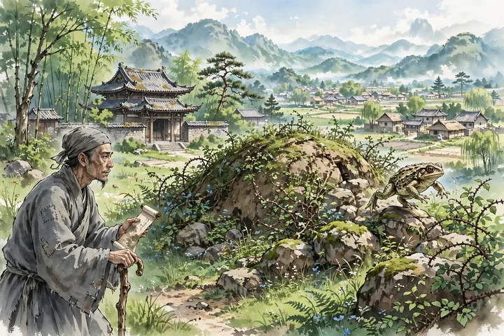
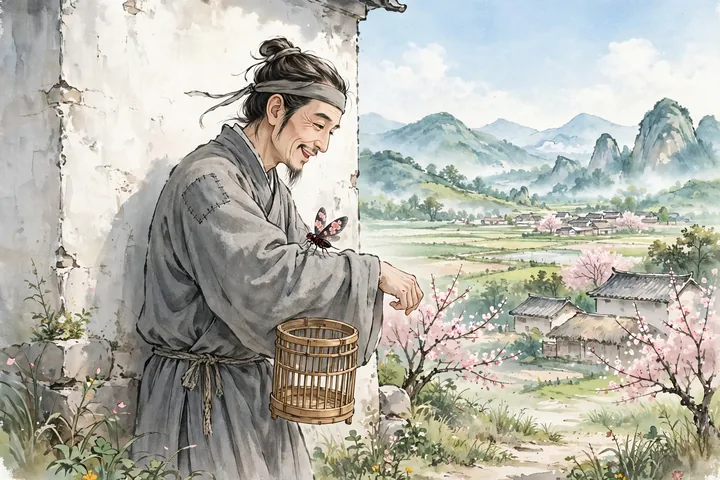
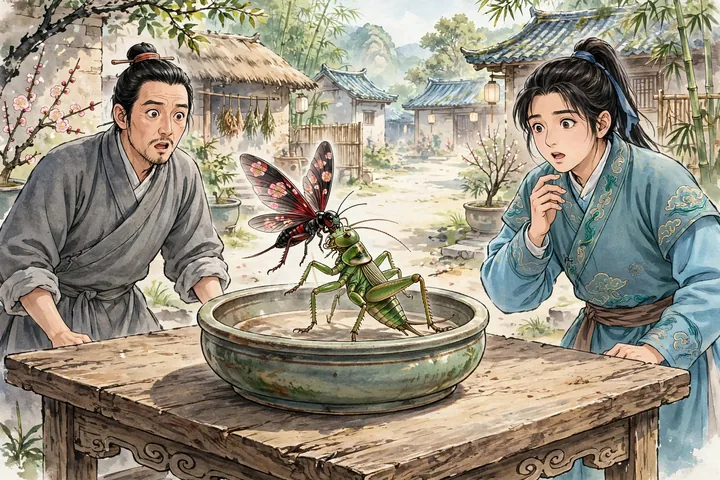
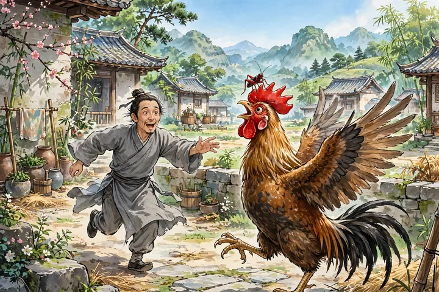
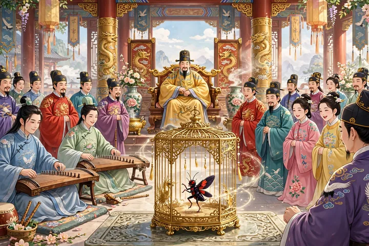

# 136 促织

## 翻译说明（只写在这里，不写进正文文件）

这篇故事出自清代蒲松龄的《聊斋志异》卷四，篇名《促织》，以下译文是 Muse 的翻译，只把文言换成今天的话来讲，原意、人物、情节顺序和结局都不改，没有增加人物，没有改动结局。

- 底本与来源：原文取自维基文库《聊斋志异/第04卷》直取底本，转简体；并以诗典古文分篇页（https://www.shidianguwen.com/zhang-jie-xiang-qing/2630172.html，该页标题误标为公孙九娘，内容为促织）逐字交叉核对，全文一致（引号按卷四已推篇目惯例用「」，诗典古文页用的是“”，已统一改回「」）。未抄现代整理本校注、未抄现代译文。分段按维基文库卷四页：全篇 9 段（含异史氏曰 1 段）。
- 正文文件含图片标记：译文正文直接从故事第一句开始，图片标记只插在段落之间；图 1 在第 3 段之后，图 2 在第 5 段之后，图 3 在第 6 段之后，图 4 在第 7 段之后，图 5 在第 8 段之后。
- 状态：本地草稿，未推 GitHub，未发头条；卷一、卷二、卷三及其他篇未动。
- 有异史氏曰：按原文段落保留在译文末段。

## 人物表（先写人物表，再按人物表生成图片）

- 成名：中年贫寒书生，清瘦，灰布衣袍、发髻。见于图 01（扶杖执图）、图 02（墙边看虫）、图 03（斗盆旁惊视）、图 04（追鸡惊呼）；四图同人同脸同服。
- 成妻：中年妇人，素色布衣。只在文字中出现，图中未画。
- 成子：九岁男孩，灰布衣。只在文字中出现，图中未画（其死与化虫只在文字中讲述，图片不作表现）。
- 好事少年：年轻男子，亮色衣袍。只见于图 03（斗盆旁）。
- 蟋蟀：小虫，黑红色，梅花翅、方首长胫、形若土狗。见于图 02（落于成名袖上）、图 03（斗盆中咬住蟹壳青）、图 04（立于鸡冠）、图 05（金笼中闻乐起舞）；四图同虫同貌。
- 蟹壳青：大个绿蟋蟀。只见于图 03（斗盆中被咬住脖颈）。
- 皇帝与宫人：只见于图 05（宫中观虫起舞）。

## 图片清单（共 5 张，按篇幅定数）

- images/01.webp：白天大佛阁后，灰布衣成名扶杖执图，端详长满荆棘的古陵怪石，一只癞蛤蟆跳过，对应译文第 3 段（巫卜得图、寺后寻虫）。
- images/02.webp：白墙边，灰布衣成名俯身欣喜，黑红色梅花翅小虫落在他的衣袖上，手提竹编虫笼，对应译文第 5 段（小虫忽跃落襟袖间）。
- images/03.webp：村中庭院木桌斗盆，黑红色梅花翅小虫跃起咬住大绿虫蟹壳青的脖颈，灰布衣成名与亮衣少年惊视，对应译文第 6 段（斗虫胜蟹壳青）。
- images/04.webp：村中庭院，大公鸡伸颈扑腾，黑红色小虫立于鸡冠上力叮不释，灰布衣成名惊呼着赶来，对应译文第 7 段（虫斗鸡、集冠上）。
- images/05.webp：明亮宫殿内，金笼中黑红色蟋蟀闻琴瑟起舞，乐工弹奏，皇帝龙椅上欣然观赏，对应译文第 8 段（进宫献虫、举世无匹）。
- 风格：仙侠、清新、明亮干净，不阴森、不血腥；五图均无文字、无水印。
- 克制处理：成子之死、杖责脓血只在文字中讲述，图片不作血腥表现；图 03 斗虫一幕点到为止，无血迹。
- 装配位置：图 1 在译文第 3 段之后，图 2 在第 5 段之后，图 3 在第 6 段之后，图 4 在第 7 段之后，图 5 在第 8 段之后；图都不插在段落中间。
- 同脸同服装：成名四图均为灰布衣袍、发髻；小蟋蟀四图均为黑红色、梅花翅；以目视核对为准。
- 手机尺寸：01 为 720×480、112KB；02 为 720×480、75KB；03 为 720×480、109KB；04 为 720×480、121KB；05 为 720×480、110KB；合计 528KB，均已去元数据。

## 校验结果（脚本自查）

- 原文段落数：9 段，1828 字（不含换行，含标点）。
- 译文正文段落数：9 段，2753 字（不含换行，含标点，不含图片标记）。
- 段落数一致：通过，原文 9 段 = 译文 9 段，换行跟原文走，段内句子连续，不按句分行；异史氏曰保留在末段。
- 小标题：通过，译文正文无小标题。
- 新增人物：通过，无新增人物；改结局：通过，结尾仍是成家田百顷、裘马过世家，顺序未改。
- 正文纯净：通过，两正文文件均不含“白话”二字，不含“Muse”，不含来源说明。
- 简体：通过，原文与译文文件已扫查，无繁体残留（OpenCC t2s 再转无变化）。
- 图片标记：通过，译文 .md 含 5 个图片标记 、、、、，与 images/ 内的 5 张图一一对应，位置均在段落之间。
- 图片生成：通过，五图一次生成成功，均已目视核对，场景与译文段落对应，同人同服；图文件均非零；尺寸与大小见图片清单。

## 失败项

- 无。原文、译文、README、图片齐全，无缺失。

## 文件

- 136-促织-原文.md
- 136-促织.md
- images/01.webp
- images/02.webp
- images/03.webp
- images/04.webp
- images/05.webp
- README.md（本文件）
