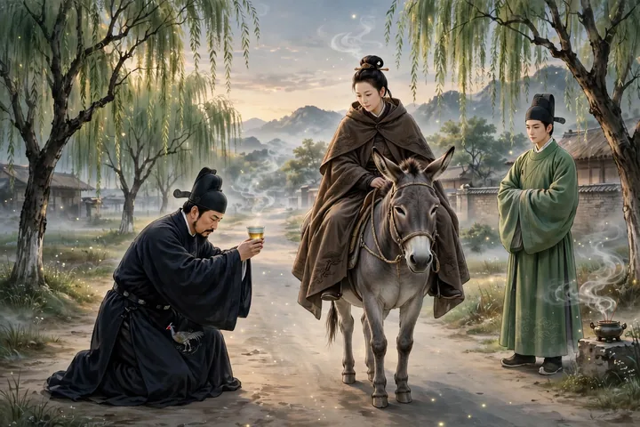

# 137 柳秀才

## 翻译说明（只写在这里，不写进正文文件）

这篇故事出自清代蒲松龄的《聊斋志异》卷四，篇名《柳秀才》，以下译文是 Muse 的翻译，只把文言换成今天的话来讲，原意、人物、情节顺序和结局都不改，没有增加人物，没有改动结局。

- 底本与来源：原文取自维基文库《聊斋志异/第04卷》直取底本，转简体；并以诗典古文分篇页（https://www.shidianguwen.com/zhang-jie-xiang-qing/2630173.html）逐字交叉核对，全文一致（引号按卷四已推篇目惯例用「」，诗典古文页用的是“”，已统一改回「」）。未抄现代整理本校注、未抄现代译文。分段按维基文库卷四页：全篇 2 段，无异史氏曰。
- “独控老苍卫”：维基文库与诗典古文两源皆作“卫”，未改；译文按上下文（前文“跨硕腹牝驴子”、后文“捉驴不令去”）译为老驴。
- “爇”字：OpenCC t2s 把“爇”误转为生僻字“𦶟”，已人工改回“爇”（136 促织原文同字沿用 OpenCC 输出未动，本篇不追溯改动已推篇目）。
- 正文文件含图片标记：译文正文直接从故事第一句开始，图片标记只插在段落之间；图 1 在第 1 段之后，图 2 在第 2 段之后。
- 状态：本地草稿，未推 GitHub，未发头条；卷一、卷二、卷三及其他篇未动。
- 无异史氏曰。

## 人物表（先写人物表，再按人物表生成图片）

- 柳秀才：年轻秀才，绿衣高冠，相貌修伟，实为柳神。见于图 01（路边静立旁观）。
- 沂州县令：中年官员，深色官袍、乌纱帽。见于图 01（跪捧酒杯哀求）。
- 蝗神妇：中年妇人，高髻、褐色披风，骑大肚母驴。见于图 01（骑驴缓行）。
- 村民：只在文字中出现，图中未画。

## 图片清单（共 2 张，短篇定数）

- images/01.webp：黄昏乡间道路，褐披风高髻妇人骑大肚灰驴缓行，绿衣高冠的柳秀才路边静立，深色官袍的县令跪捧酒杯哀求，路边柳树、香烟缭绕，对应译文第 1 段（道左求蝗神）。
- images/02.webp：蝗群如乌云遮天蔽日，却只集于田边杨柳、柳叶尽光，绿油油的禾田安然无恙，远处村庄群山，对应译文第 2 段（蝗不落禾田、尽集杨柳）。
- 风格：仙侠、清新、明亮干净，不阴森、不血腥；两图均无文字、无水印。
- 克制处理：无亲密或暴力情节。
- 装配位置：图 1 在译文第 1 段之后，图 2 在第 2 段之后；图都不插在段落中间。
- 同脸同服装：柳秀才只见于图 01，绿衣高冠；以目视核对为准。
- 手机尺寸：01 为 720×480、71KB；02 为 720×480、92KB；合计 163KB，均已去元数据。

## 校验结果（脚本自查）

- 原文段落数：2 段，255 字（不含换行，含标点）。
- 译文正文段落数：2 段，423 字（不含换行，含标点，不含图片标记）。
- 段落数一致：通过，原文 2 段 = 译文 2 段，换行跟原文走，段内句子连续，不按句分行；无异史氏曰。
- 小标题：通过，译文正文无小标题。
- 新增人物：通过，无新增人物；改结局：通过，结尾仍是蝗尽集杨柳、方悟秀才柳神也，顺序未改。
- 正文纯净：通过，两正文文件均不含“白话”二字，不含“Muse”，不含来源说明。
- 简体：通过，原文与译文文件已扫查，无繁体残留（“爇”字已人工改回，OpenCC t2s 除该字外再转无变化）。
- 图片标记：通过，译文 .md 含 2 个图片标记 、，与 images/ 内的 2 张图一一对应，位置均在段落之间。
- 图片生成：通过，两图一次生成成功，均已目视核对，场景与译文段落对应；两图文件均非零；尺寸与大小见图片清单。

## 失败项

- 无。原文、译文、README、图片齐全，无缺失。

## 文件

- 137-柳秀才-原文.md
- 137-柳秀才.md
- images/01.webp
- images/02.webp
- README.md（本文件）
