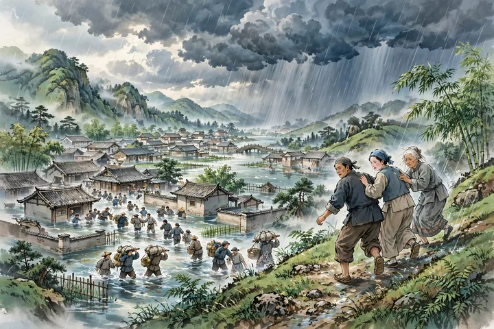

# 138 水灾

## 翻译说明（只写在这里，不写进正文文件）

这篇故事出自清代蒲松龄的《聊斋志异》卷四，篇名《水灾》，以下译文是 Muse 的翻译，只把文言换成今天的话来讲，原意、人物、情节顺序和结局都不改，没有增加人物，没有改动结局。

- 底本与来源：原文取自维基文库《聊斋志异/第04卷》直取底本，转简体；并以诗典古文分篇页（https://www.shidianguwen.com/zhang-jie-xiang-qing/2630174.html）逐字交叉核对，全文一致（引号按卷四已推篇目惯例用「」，诗典古文页用的是“”，已统一改回「」；诗典古文页另附下一篇首段，不属本篇）。未抄现代整理本校注、未抄现代译文。分段按维基文库卷四页：全篇 1 段，无异史氏曰。
- 正文文件含图片标记：译文正文直接从故事第一句开始；原文仅 1 段，只有一处段后空隙，因此两图均置于译文第 1 段之后（文末），沿用 129 瓜异的先例；图都不插在段落中间。
- 状态：本地草稿，未推 GitHub，未发头条；卷一、卷二、卷三及其他篇未动。
- 无异史氏曰。

## 人物表（先写人物表，再按人物表生成图片）

- 石门庄老叟：白发老农，布衣。只在文字中出现，图中未画。
- 农人：青壮男子，布衣短打。见于图 01（扶老母奔高阜）。
- 农人之妻：年轻妇人，布衣包头。见于图 01（扶老母奔高阜）。
- 老母：白发老妇，灰布衣。见于图 01（被扶着奔高阜）。
- 两儿：两个小孩，布衣。见于图 02（并坐床头嬉笑）。
- 村人：只在文字中出现，图中未画。

## 图片清单（共 2 张，短篇定数）

- images/01.webp：暴雨倾盆，村庄尽成泽国，屋舍浸在水中，农人与妻扶白发老母奔向高阜，村民涉水携物，对应译文前半（雨暴注、扶老母奔避高阜）。
- images/02.webp：水落后村庄成墟，唯有一间小屋独存，阳光透进门来，两个小孩并坐床头嬉笑玩耍、安然无恙，对应译文后半（一屋独存、两儿无恙）。
- 风格：仙侠、清新、明亮干净，不阴森、不血腥；两图均无文字、无水印。
- 克制处理：水灾只表现暴雨与逃难、废墟与生还，不作溺亡等血腥惨烈表现；图 02 取生还一幕，意境温暖。
- 装配位置：原文仅 1 段，两图均置于译文第 1 段之后（文末）；两图都不插在段落中间。
- 同脸同服装：农人一家只见于图 01，布衣；两儿只见于图 02，布衣；以目视核对为准。
- 手机尺寸：01 为 720×480、104KB；02 为 720×480、95KB；合计 199KB，均已去元数据。

## 校验结果（脚本自查）

- 原文段落数：1 段，197 字（不含换行，含标点）。
- 译文正文段落数：1 段，292 字（不含换行，含标点，不含图片标记）。
- 段落数一致：通过，原文 1 段 = 译文 1 段，段内句子连续，不按句分行；无异史氏曰。
- 小标题：通过，译文正文无小标题。
- 新增人物：通过，无新增人物；改结局：通过，结尾仍是六月二十二日事，顺序未改。
- 正文纯净：通过，两正文文件均不含“白话”二字，不含“Muse”，不含来源说明。
- 简体：通过，原文与译文文件已扫查，无繁体残留（OpenCC t2s 再转无变化）。
- 图片标记：通过，译文 .md 含 2 个图片标记 、，与 images/ 内的 2 张图一一对应，位置均在段落之间（文末段后）。
- 图片生成：通过，两图一次生成成功，均已目视核对，场景与译文段落对应；两图文件均非零；尺寸与大小见图片清单。

## 失败项

- 无。原文、译文、README、图片齐全，无缺失。

## 文件

- 138-水灾-原文.md
- 138-水灾.md
- images/01.webp
- images/02.webp
- README.md（本文件）
